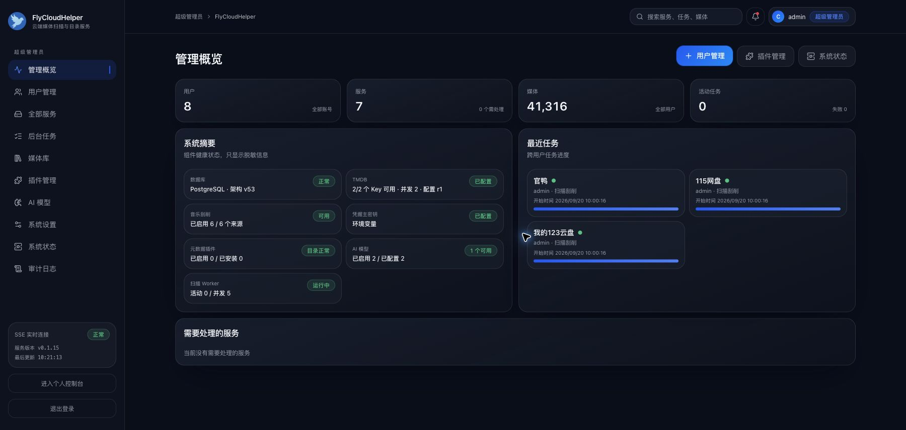
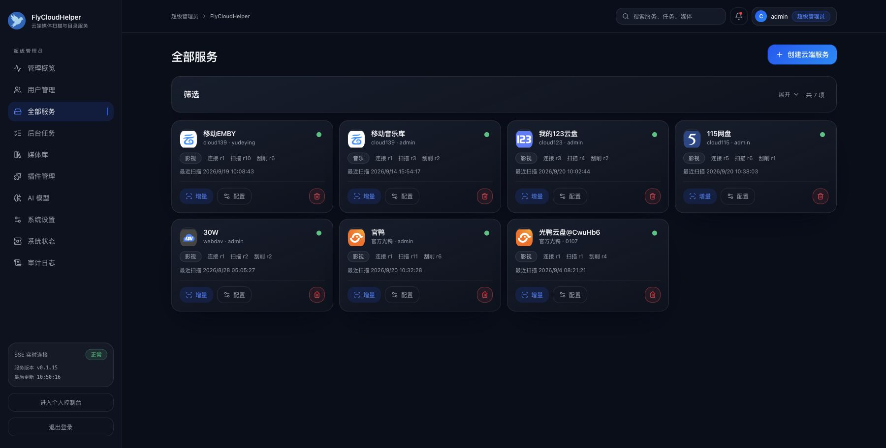
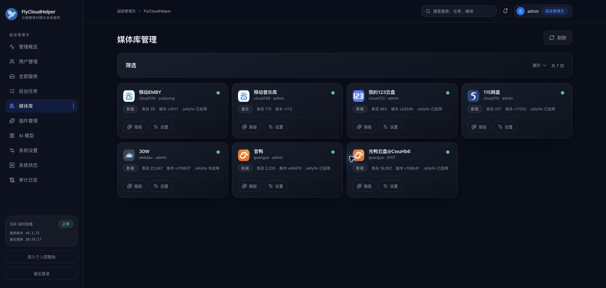
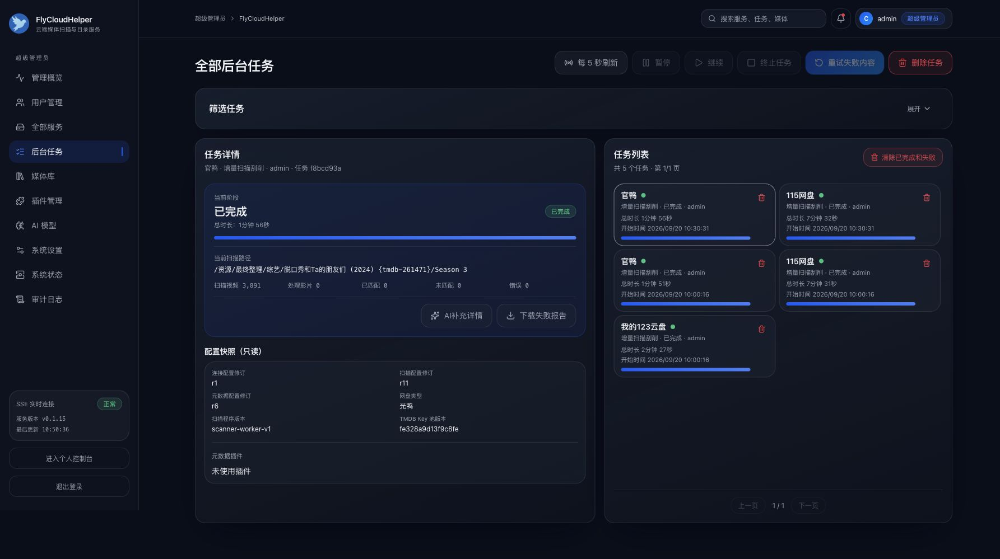
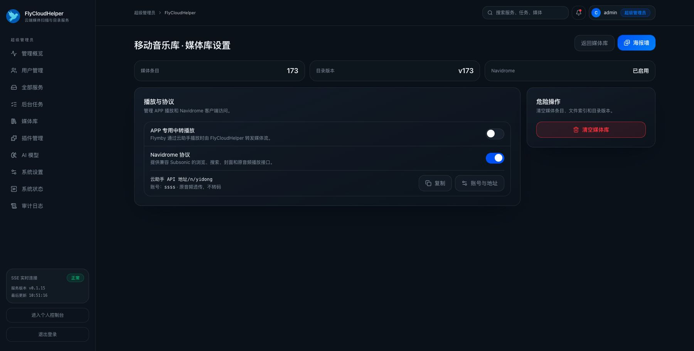

# FlyCloudHelper


FlyCloudHelper 是一个可自部署的媒体扫描、元数据刮削、媒体目录和协议兼容服务。它可以直接连接 WebDAV 和主流网盘，建立影视、音乐或有声书库，并通过 Web 管理端、REST API、Jellyfin、Emby、Navidrome/Subsonic 与 ABS 协议提供访问能力。

项目不依赖特定客户端才能运行。用户可以直接在 Web 管理端完成网盘登录、路径选择、扫描刮削、媒体库管理、协议账号配置和任务维护，也可以使用兼容客户端访问云端媒体库。Flymby 鸿蒙 APP 只负责上传已有网盘服务的基础信息与登录凭据，并通过普通 Jellyfin、Emby、Navidrome 或 ABS 服务使用云端媒体库。

影视库使用电影、节目、季和集模型，并可共享为 Jellyfin 或 Emby；音乐库使用歌曲、专辑和艺术家模型，通过“发现目录和文件、读取文件资料、在线补全”三阶段扫描后共享为 Navidrome/Subsonic。有声书使用作品、物理音频文件和逻辑章节模型，通过 ABS（Audiobookshelf）接口提供浏览、搜索、原音频访问和全书进度；官方、第三方及 Flymby 客户端的实际兼容性仍需验证。

## 项目定位

- **Provider 层**：负责网盘授权、目录枚举、文件定位、直连下载和中转读取，不直接承担媒体归组与元数据管理。
- **媒体库层**：影视库负责电影与节目归组、TMDB/NFO/插件刮削、手动匹配和海报墙；音乐库负责音频标签、旁挂资料、在线补全、歌曲、专辑、艺术家和封面歌词；有声书库负责作品归组、作者演播者、音轨时长与全书章节。
- **任务层**：负责全量扫描、增量扫描、音乐三阶段扫描、视频规格分析、定时执行、并发控制、暂停、终止、重试和进度记录。
- **访问层**：提供 Web 管理端、用户与管理员 REST API、SSE 任务事件、文件访问接口，以及 Jellyfin、Emby、Navidrome/Subsonic、ABS 兼容接口和 ABS Socket.IO 事件。
- **运行边界**：保存目录、元数据、任务状态和必要的加密凭据，不保存网盘媒体正文，不提供转码，也不在 Web 管理端直接播放。

## 界面预览

### 管理概览



### 服务与媒体库

| 服务管理 | 媒体库管理 |
| --- | --- |
|  |  |

### 后台任务与音乐库设置

| 后台任务 | 音乐库与 Navidrome 设置 |
| --- | --- |
|  |  |

## 主要功能

### 账号与管理

- 用户注册、登录、多用户数据隔离和超级管理员初始化。
- 一个用户可创建多个网盘服务；网盘服务只保存基础信息和登录凭据，媒体库独立管理类型、来源关系、扫描、元数据、任务、通知和协议。
- 超级管理员可以管理用户、全部服务、媒体库、任务、插件、TMDB Key、系统配置和审计记录。
- 通知中心记录任务结果、账号注册、服务删除、媒体库清空、会话撤销等事件，支持单条或全部清除。

### 网盘与文件访问

- 内置支持 WebDAV、光鸭、阿里云盘、百度网盘、115网盘、123云盘、天翼云盘个人云、移动云盘和夸克网盘，共 9 类 Provider。
- 光鸭支持官方 API 凭据同步、网页二维码和网页短信验证码三种授权方式。
- 115网盘、123云盘、天翼云盘、移动云盘和夸克网盘由云助手直接完成扫码授权，不依赖 FlymbyServer。
- 阿里云盘和百度网盘支持目录浏览、扫描、稳定文件标识、Token 刷新、直连下载和中转读取，当前通过连接表单填写 Token。
- 9 类 Provider 都可以作为媒体库来源；影视或音乐类型在创建媒体库时选择，华为云空间不在当前支持范围内。
- Provider 提供推荐扫描与刮削并发，实际扫描路径、并发和协议播放方式由媒体库配置。
- 文件访问支持临时直连地址和 HTTP Range 中转；服务端只转发字节流，不转码、不缓存媒体正文。

### 扫描、刮削与媒体库

- 路径选择式配置全量扫描目录和增量扫描目录，并支持本地 NFO 开关、元数据规则与插件来源。
- 扫描影视文件并归组为电影或节目，保存影片、季、集、源文件、海报、简介、年份和首映日期等目录数据。
- 音乐扫描拆分为发现目录和文件、读取文件资料、在线补全三个阶段；音频标签或在线补全失败时仍保留已读取的文件资料，并支持按阶段查看问题和重新执行。
- 音乐库保存歌曲、专辑、艺术家、音频规格、内嵌或旁挂封面与歌词，并支持 MusicBrainz、内置音乐来源和插件来源补全。
- 支持 TMDB 多 Key 动态并发、故障冷却与自动恢复，以及当前部署内跨用户、跨服务共享 14 天的成功结果缓存。
- 支持手动搜索与匹配、清除匹配结果、匹配状态筛选，以及按加入时间、年份、首映日期和名称排序。
- 用户按媒体库浏览海报墙、详情、真实文件路径与源文件信息；管理员可跨用户筛选查看。
- 影视媒体库提供文件浏览，可按目录或文件触发定向扫描刮削、解除匹配、手动搜索和匹配；音乐与有声书暂不提供此入口，Web 页面不直接播放。
- 云聚合视频库可关联多个网盘来源，每个来源独立配置扫描路径，共用媒体目录和协议地址。

### 在线内容源（当前源码）

- 在线内容源与网盘 Provider 保持独立，与元数据插件共用统一插件管理页面；可在媒体库创建页面选择“在线内容源媒体库”。
- 管理员导入声明式内容源插件、Python Spider 或 CatVod JavaScript；视频源选择分类并同步目录，通过 Jellyfin 或 Emby 访问，音乐源建立专辑、歌单目录，通过 Navidrome 访问。
- 全新安装默认没有内容源插件，管理员在「插件管理」点击统一的「导入插件」，选择 `.json` 清单、`.py` Spider 源或 `.js` CatVod 源，再启用使用；`.flymby-plugin` 文件自动进入元数据插件导入流程，无需选择类型。插件卡片仅展示名称、状态和常用操作，版本、说明等信息在「详情」中查看。影视插件包括电影天堂、虎牙、金鹰、魔都、猫眼、光速、量子、最大、新浪、卫士和飘凌，各自的独立 JSON 文件位于 `插件包/`；Python 插件包括 `咕噜咕噜源.py`、`青麦影视源.py`、`蚕驰短剧源.py`、`黄豆短剧源.py`、`白嫖者联盟源.py`、`独播库源.py` 和 `短剧大全源.py`，均位于 `插件包/`，按源站实际能力处理分类和搜索分页，不改原下载文件；升级和重启保留已有插件、启停状态及媒体库。
- Python Spider 共用独立进程宿主和 `base.spider` 请求兼容层，支持五接口、类或模块函数入口、会话保留、实时搜索和即时取址；脚本仅 AST 检查后登记，启用并实际访问时才执行。Docker 包含 Python、常用请求／HTML／加密依赖与 CA 证书；本地部署可用 `FLYCLOUDHELPER_PYTHON_PATH` 指定已有解释器。源实例之间不共享会话，停用、清空、删除或关闭服务时释放相关进程。仅导入可信脚本，普通子进程不等同文件权限沙箱。
- Python 听书源使用独立的有声书适配器，脚本明确声明 `cloud_helper_media_type = "audiobook"`。插件包括 `插件包/喜马拉雅听书源.py` 和 `插件包/悦听吧听书源.py`。导入并启用后，在“在线内容源媒体库”选择听书插件和分类；每分类首次同步一整页摘要，实时搜索读取原站，详情、章节及播放按需加载。有声书媒体库的“播放与协议”并列管理 ABS、FlyAudioBook；FlyAudioBook 当前仅支持单库，启用或保存配置时复用已有入口，地址使用固定 `/fab/` 前缀和自定义二级后缀，不再单独创建听书服务或选择关联库，多库聚合暂缓。悦听吧章节时长缺失时保留为空，不读取整书音频或估算时长；章节目录按页建立索引，播放使用永久章节 ID 即时取址。来源限流返回可重试错误，不伪装成空搜索。标准 ABS 功能保留且默认关闭，仍需真实章节时长；悦听吧使用 FlyAudioBook，不能将未知时长伪装成 ABS 全书时间轴。依赖来源请求头的音频在原生 Auto 模式下中转。此能力复用既有内容源和媒体目录，未追加数据库结构版本，不自动导入插件或修改已有媒体库。
- 各媒体库对外协议账号的密码输入框右侧统一提供“无密码”复选框，适用于 Jellyfin、Emby、Navidrome、ABS、FlyAudioBook 的新建和编辑。勾选并保存才将该账号改为免密码；取消勾选已有免密码账号时必须提供新密码。已有有密码账号编辑留空继续保留密码，ABS、FlyAudioBook 新建未填且未勾选时继续自动生成密码。修改密码或切换免密码仍撤销旧会话，保留用户进度与收藏；不改变管理登录或网盘凭据。
- Python 分类列表、最新内容和实时搜索统一保存源站卡片，不逐条补详情；列表自带播放字段时也只转换摘要，不解析分集或改写已有线路。打开详情、季集或播放时再按需读取单部详情，同一影片的并发请求合并，完整详情短时复用五分钟；列表刷新保留已补好的详情、稳定媒体 ID、收藏及观看记录。咕噜咕噜、青麦影视、蚕驰短剧、黄豆短剧、白嫖者联盟、独播库与短剧大全均使用此通用流程，Jellyfin、Emby 和网页详情入口一致。独播库保留四个真实分类，搜索读取官网卡片中的明确类型，按单页处理，官网搜索索引可能晚于 API 目录；短剧大全使用唯一的全部短剧分类，目录与搜索采用真实分页，播放时重新读取同集地址。黄豆仅使用原站实际返回的分集及授权播放地址，付费或未授权内容不会通过修改本地标记伪装成可播；白嫖者联盟保留原站线路选择，不在取址失败时自动换线。
- 金鹰、魔都、猫眼、光速、电影天堂和虎牙的 JSON 视频源也采用摘要入库：列表、最新内容和实时搜索保留标题、海报、分类及源站已有展示字段，分集、关系和线路留到详情、选集及播放时补齐。源页仍沿用完整页接口，避免缺少海报或分类；共用五分钟详情复用、并发合并和目录清理保护，旧媒体库无需重新导入插件或重建。
- 内容源只在插件管理页导入，已卸载插件从页面隐藏，后台保留原记录和媒体库关联。同一插件版本已有完整脚本时重复导入会提示已经添加；Python 脚本缺失时可直接重新上传同一文件补回，复用原插件记录并保持名称、状态及关联不变。创建媒体库页直接引用已启用插件，不展示或新增“源配置实例”和“内容源名称”；读取分类只预览源站内容，不写入实例记录，提交建库后才由服务端建立内部关联。同一用户同一插件已有未绑定实例时复用，已有媒体库时阻止重复创建，不自动调整旧库。
- 在线影视库创建页采用紧凑的插件选项和表单，只选择插件、分类并填写媒体库名称，首轮固定导入每个已选分类第一页的全部有效摘要，不再限制电影三部、节目一部；整页成功后推进后续导入游标，详情、选集和播放继续按需补齐。不展示页数、协议配置或初始账号。创建成功后自动进入当前媒体库设置；新库默认关闭 Jellyfin、Emby，在设置中按需手动开启，再管理账号和服务地址。
- 网易云音乐使用 `插件包/网易云音乐源插件.json`，导入启用后创建在线音乐库，自动发现公开推荐歌单、排行榜和新专辑，无需填写 ID；高级配置可选填专辑、歌单 ID 补充目录，已有配置继续保留。Navidrome 默认开启，账号和 `/n/地址后缀` 在协议页设置，客户端按 Navidrome 服务连接。
- 网易音乐支持歌曲、专辑、歌手实时搜索和独立分页，查看专辑、歌手详情时补齐源目录；播放时即时取址，支持自动、直连、中转及音频 Range。公开可播歌曲支持匿名访问，登录后的可播范围由网易账号权限决定，不提供转码；云助手本地收藏、播放记录和客户端歌单保存在云助手，网易账号收藏另外从源站读取。
- 网易账号在音乐库的“在线音乐源 → 网易账号”中使用网易云音乐 App 扫码确认，支持检查状态、切换和退出。会话使用已有主密钥加密保存在原有库配置中，不增加数据库表或字段；登录、退出及会话失效均保留媒体目录和 Navidrome 协议账号，客户端沿用现有连接。退出后恢复匿名访问，原站明确报告登录失效时提示重新扫码。
- 网易扫码创建与轮询按 Alger Music Player 服务端的 EAPI 流程，使用数字 `type=3` 并沿用同一次临时设备会话；原站授权后自动校验账号并加密保存，无需手动复制登录凭据。原站返回 `8821` 时展示网易安全提示，不把原站限制当作登录成功。扫码受限的账号可在网易官网登录后，在浏览器开发者工具的 Cookies 中复制 `MUSIC_U` 值，通过“网页登录（备用）”导入；原媒体库和 Navidrome 连接继续保留。
- 网易专辑目录通过原站 Web POST 接口读取，同时用于初始同步与 Navidrome 专辑详情；无需另部署网易 API 服务。公开目录与歌曲播放权限独立，登录也不保证账号能播放所有歌曲，受限内容仍按源站结果明确返回错误。
- 网易推荐歌单、排行榜和已登录账号的“我喜欢的音乐”、自建、收藏歌单通过标准 `getPlaylists/getPlaylist` 提供，账号歌单优先展示，源列表只读，打开时加载曲目。`getStarred/getStarred2` 与歌曲星标合并网易喜欢和当前 Navidrome 账号的本地收藏，不覆盖原评分、播放记录或偏好；网易喜欢需在网易云音乐中取消，协议取消时明确提示。喜欢 ID 缓存 5 分钟，歌单摘要及详情缓存按实例、网易账号和会话隔离，切换、退出、清空时同时失效。新专辑通过 `getAlbumList/getAlbumList2` 的 `newest` 实时分页，专辑详情按需补齐。手动同步刷新歌单和榜单摘要、新专辑第一页，再同步可选补充 ID；发现摘要、专辑页缓存 15 分钟，歌单曲目缓存 5 分钟。
- Jellyfin、Emby 的已选源分类支持按需浏览与下一页加载；电影天堂、虎牙、金鹰、魔都、猫眼、光速以及支持分页的 Python Spider 均可源站实时搜索。第一页先返回，再由服务器后台预取下一页，默认预备当前页和下一页目录，沿用稳定媒体 ID。动态分类和搜索使用源站顺序，当前目录数量随加载扩展；收藏、已看等用户状态筛选继续使用已有缓存。Python／CatVod JS 先解析分集标识再取流，未知格式不伪装为 MP4。静态网页中的 JSON、视频标签、播放器数据和有限 iframe 可由共用解析器取址；Python 本地代理通过既有协议认证提供 HLS 与图片。浏览器脚本嗅探、DRM 和标准直播仍需专用适配。
- CatVod JS 两种导出形式（`__jsEvalReturn()` 与 `export default`）复用同一 Node 子进程宿主及 Spider 目录适配器；同步 `req`、异步调用、HTML、AES、压缩、Cookie 和会话存储由宿主共用提供。源码安装时只做 AST 和依赖检查，首次浏览才运行；不自动安装、不自动启用或创建媒体库。JS 执行环境不是完整安全沙箱，仅导入可信管理员确认的源。
- 本次新增六份 JS 和十一份 Python 独立源文件，位于 `插件包/`，与 `FlyPlugin/helper/` 分发副本一致；清单和各源验证范围见《云助手内容源插件与标准媒体协议接入方案》第 20.55 节。源站网络、登录或购买权限与插件兼容性分别判断，不能把导入成功当成全部内容可播放。
- 当前提供目录同步、线路与单集映射、即时播放地址解析，以及按媒体库配置直连或中转；不使用网盘扫描路径与文件浏览。
- 在线库可保存独立自动同步计划，默认关闭，定时读取当前已选分类各自第一页，新作品摘要入库、已有作品更新摘要并保留已补齐资料；详情和新集在访问详情、选集及播放时按需补齐。在媒体库设置中查看调度时间和源站、线路样本诊断。
- 在线媒体库设置页只展示内容源、分类数量和同步／检测摘要；手动同步参数、分类选择、自动同步配置及检测结果通过对应弹窗查看和操作。
- 在线影视库和在线音乐库可在设置页标题旁点击铅笔修改媒体库名称；普通用户与管理员均可使用，不改变库 ID、协议路径或账号。
- Jellyfin、Emby 支持已入库内容的年份、最低评分、收藏、已看／未看、续播、标签等标准筛选，在筛选后排序分页。源评分和标签在下一次导入或刷新时补齐，不根据分类虚构元数据。
- 这些能力以当前源码为准，使用公开镜像时需确认所部署的版本已包含相关修改。

### 任务与自动化

- 全量扫描、增量扫描和 ffprobe 视频规格分析使用可管理的后台任务；音乐任务额外展示三个阶段各自的进度、失败与未匹配明细。
- 三类任务均可配置间隔、每日、每周或每月定时执行；视频规格分析使用独立队列，不占用扫描 Worker 槽位。
- 任务记录开始时间、结束时间、实际运行时长、当前路径和阶段统计。
- 支持运行状态筛选、排队等待原因、暂停与继续、终止、删除、失败重试和仅清理已完成任务。
- 同一轮云聚合扫描在任务列表中按父任务合并展示，并在组内列出每个网盘来源的执行状态；父任务支持暂停全部、继续全部、取消全部和删除整组，来源详情仍可单独控制。
- 不同网盘来源的扫描任务可以同时执行；同一个物理网盘源最多运行一个扫描任务，具体 Provider 仍使用各自的服务级推荐并发。

### 协议访问

- 影视库可分别启用 Jellyfin `/j/` 和 Emby `/e/` 地址，音乐库可启用 Navidrome/Subsonic `/n/` 地址，有声书库可启用 ABS `/abs/` 地址，地址后缀均可在媒体库设置中修改。
- Jellyfin 与 Emby 覆盖登录、媒体库、首页、列表、搜索、详情、季集、图片、播放定位、直连或中转播放、下载控制及观看状态上报等常用接口。
- 网盘节目单集达到 90% 完播条件后，继续观看会提供后续未观看单集的零进度入口，支持跨季；下一集已有进度时保留原位置。
- Navidrome/Subsonic 覆盖音乐库、艺术家、专辑、歌曲、封面、歌词、收藏、播放历史、播放定位和下载等常用接口；关闭中转后优先返回网盘直连，直连无法满足请求时回退中转。
- 每个协议地址可以创建多个独立账号；账号的会话、收藏、最近播放、观看进度和已播放状态相互隔离，Emby 与 Jellyfin 账号也互不共用。
- 协议层直接使用原始媒体文件，不提供视频或音频转码。

### 有声书与 ABS

- 在个人模式创建单来源媒体库时选择“有声书”，关联已有 WebDAV 或网盘服务，再选择扫描路径。多文件和常见分卷目录按作品归组，支持中文章节号与自然排序。
- 扫描读取音频标签、真实时长和 M4B 内嵌章节，不调用影视或音乐在线匹配。Docker 已包含 ffprobe；本地运行需配置可用的 `FLYCLOUDHELPER_FFPROBE_PATH`。
- 在媒体库设置中进入 ABS 配置，开启协议并创建独立账号。将完整 `/abs/地址后缀` 地址、用户名与密码填写到 ABS 客户端；Flymby 使用已有的普通 ABS 服务入口，本次不需要修改 APP。
- ABS 包含认证、刷新、书籍目录、作者系列、播放会话、全书续听、多书签、集合、播放列表、逐轨下载与离线会话导入，并提供 Socket.IO 事件。账号创建时省略密码会生成随机密码，只显示一次。多文件作品不提供整书 ZIP 打包。
- 支持直连与中转原音频和 Range，不提供实时转码。客户端不支持的格式需要更换客户端或事先转换文件。反向代理应将完整 `/abs/` 路径和 WebSocket 升级请求转发到云助手。
- 实施范围、接口语义及验证要点见[云助手标准 ABS 有声书实施方案](云助手标准ABS有声书实施方案.md)。原 Navidrome 有声书方案暂缓，音乐 Navidrome 功能继续保留。
- ABS 当前只接入 WebDAV/网盘物理音频，Python 听书内容源尚未接入。会话固定建立时的音轨和时间轴，旧版本无时间轴记录的会话需要重新打开作品。

### Flymby 客户端协作

- Flymby 鸿蒙 APP 可以把 WebDAV、光鸭、阿里云盘、百度网盘、115网盘、123云盘、天翼云盘、移动云盘和夸克网盘的基础信息与当前登录凭据单向上传到云助手；华为云空间不支持上传。
- 上传不会携带 APP 本地媒体库、扫描结果或元数据，也不会建立设备绑定和双向同步。重复上传同一设备上的同一本地服务会刷新云助手凭据。
- APP 不读取云助手媒体目录镜像，也不执行迁入或迁回。影视库通过 Jellyfin 或 Emby 使用，音乐库通过 Navidrome/Subsonic 使用，有声书库通过已有普通 ABS 服务入口访问。
- 协议账号可以一次性添加为 APP 中普通的 Jellyfin、Emby 或 Navidrome 服务；之后两端各自管理，不保存云助手绑定标记。

## 运行要求

- Node.js 20.19 或更高版本
- npm
- 默认无需安装外部数据库

## 本地启动

```sh
nvm use 20
npm install
npm run dev
```

启动后访问：

- Web 前端：`http://localhost:9935`
- 后台 API：`http://localhost:9934`
- 首次初始化：`http://localhost:9935/setup`

`npm run dev` 会同时启动前端和后台。也可以分别运行：

```sh
npm run dev:api
npm run dev:web
```

不创建 `.env` 时，服务默认使用 SQLite，数据库文件位于 `data/database/flycloud-helper.db`。首次运行会自动创建数据库结构；超级管理员账号需要在初始化页面中设置。

## Docker 启动

### 前后端集成版

生产镜像已经集成 Web 前端、后台 API 和扫描 Worker，部署时只需要启动一个容器。

#### 使用 Docker Compose（推荐）

新建一个部署目录，在其中创建 `docker-compose.yml` 并复制下面的完整内容。默认使用 SQLite，无需 `.env`、数据库账号、手动填写加密密钥或额外容器；Web、API 和扫描 Worker 由同一个镜像提供。

```yaml
name: flycloud-helper

services:
  flycloud-helper:
    # 镜像集成 Web、API 和扫描 Worker，无需另外启动前端或数据库。
    image: fbinba3955/flycloud-helper:latest
    container_name: flycloud-helper
    restart: unless-stopped
    ports:
      # 端口被占用时，只修改冒号左侧的宿主机端口。
      - "9934:9934"
    environment:
      TZ: Asia/Shanghai
      FLYCLOUDHELPER_PUID: "1000"
      FLYCLOUDHELPER_PGID: "1000"
      FLYCLOUDHELPER_DATABASE_TYPE: sqlite
      FLYCLOUDHELPER_SQLITE_PATH: /data/database/flycloud-helper.db
      # 首次启动自动生成密钥，和数据库一起保存在 /data 中。
      FLYCLOUDHELPER_GENERATED_CREDENTIAL_KEY_PATH: /data/secrets/credential-master-key
    volumes:
      - flycloud_helper_data:/data

volumes:
  flycloud_helper_data:
```

启动服务：

```sh
docker compose up -d
```

启动后访问 `http://服务器IP:9934/setup`，按页面提示创建超级管理员。TMDB Key、网盘登录凭据和媒体协议账号在 Web 页面中配置，不需要写进 Compose。

也可以下载与上述内容一致的 [docker-compose.yml](docker-compose.yml)：

```sh
curl -fL -o docker-compose.yml https://raw.githubusercontent.com/fbinba3955/FlyCloudHelper/master/docker-compose.yml
docker compose up -d
```

默认 `9934` 端口可直接使用；被其他程序占用时，将 `ports` 改成例如 `"19934:9934"`，然后访问 `http://服务器IP:19934`。使用 Docker 命名卷时无需修改 UID/GID 或数据路径。需要固定镜像版本时，直接修改 `image` 中的 `latest` 标签。

[compose.yml](compose.yml) 与 [docker-compose.yml](docker-compose.yml) 使用相同配置。两者都会明确使用 SQLite，不会读取宿主机 `.env` 中的数据库或密钥变量；不要将默认部署的 `.env` 当作容器配置文件。

#### 群晖 Container Manager

默认命名卷方案也能用于群晖。如果希望在 File Station 中直接管理数据，使用 [docker-compose.synology.yml](docker-compose.synology.yml)：

1. 在 Container Manager 中新建项目，粘贴该文件的完整内容。
2. 默认映射 `/volume1/docker/flycloud-helper/data:/data`；存储卷不是 `volume1` 时，只修改冒号左侧的宿主机路径。
3. 默认 UID/GID 为 `1026:100`；需要以其他群晖用户管理数据时，修改 `FLYCLOUDHELPER_PUID` 和 `FLYCLOUDHELPER_PGID`。
4. 启动项目后访问 `http://群晖IP:9934/setup`。

无需准备数据库或密钥文件。镜像入口会创建并修复数据目录权限，随后以指定 UID/GID 启动服务；容器不要额外设置 `user` 或将 `/data` 挂载为只读。

#### 升级与维护

```sh
# 查看运行状态
docker compose ps

# 查看实时日志
docker compose logs -f flycloud-helper

# 拉取新版本并保留原数据升级
docker compose pull
docker compose up -d

# 停止服务但保留数据
docker compose down
```

命名卷或群晖挂载目录保存数据库、凭据主密钥、插件、封面和导出文件，重建容器时继续使用同一个数据卷或目录。不要使用 `docker compose down -v`，它会删除命名卷。

升级已有部署时先备份数据，并保留原项目名称与挂载。新示例的项目名称为 `flycloud-helper`；如果旧项目使用其他名称，请把 `name` 改为原名称，避免 Docker 创建新的空卷。原先使用 PostgreSQL、MySQL 或自定义主密钥的部署必须保留原配置，不能直接套用默认 SQLite 配置。

#### 直接使用 Docker 命令

直接运行 Docker Hub 公开镜像：

```sh
docker run -d \
  --name flycloud-helper \
  --restart unless-stopped \
  -p 9934:9934 \
  -v flycloud_helper_data:/data \
  fbinba3955/flycloud-helper:latest
```

镜像同时支持 `linux/amd64` 和 `linux/arm64`。固定版本时直接将 `latest` 改为已发布的版本标签。

容器内部端口固定为 `9934`，`-p` 左侧可以修改宿主机端口。`/data` 必须持久化，其中保存 SQLite 数据库、凭据主密钥、插件和导出文件。即使改用 PostgreSQL 或 MySQL，也不能删除这个数据卷。

镜像启动时会先以 root 身份创建并修复 `/data` 下的数据库、密钥、插件、导出和迁移目录，再按 `FLYCLOUDHELPER_PUID`、`FLYCLOUDHELPER_PGID` 指定的普通用户身份启动服务，默认均为 `1000`。这可以兼容极空间、飞牛等 NAS 创建的 root 所有宿主机挂载目录。使用目录映射且 NAS 所有者不是 `1000:1000` 时，应把两个变量改成该目录实际的 UID/GID；只读挂载、NFS/SMB root squash 或 NAS ACL 禁止容器修改权限时，仍需先在宿主机授权。

启动后访问 `http://服务器地址:9934/setup` 设置超级管理员。

### 连接已有 PostgreSQL

以下为外部数据库的可选方案，默认 SQLite 部署无需设置。创建用于 `docker run --env-file .env` 的 `.env`（不要提交到 Git）：

```dotenv
FLYCLOUDHELPER_DATABASE_TYPE=postgres
FLYCLOUDHELPER_DATABASE_HOST=postgres容器名
FLYCLOUDHELPER_DATABASE_PORT=5432
FLYCLOUDHELPER_DATABASE_NAME=flycloud_helper
FLYCLOUDHELPER_DATABASE_USER=flycloud_helper
FLYCLOUDHELPER_DATABASE_PASSWORD=请替换
FLYCLOUDHELPER_DATABASE_AUTO_CREATE=true
```

如果 PostgreSQL 与 FlyCloudHelper 都运行在 Docker 中，应让两个容器加入同一个网络，并把 `DATABASE_HOST` 设置为 PostgreSQL 容器名，不要填写 `127.0.0.1`：

```sh
docker network create flycloud-network
docker network connect flycloud-network 已有PostgreSQL容器名

docker run -d \
  --name flycloud-helper \
  --restart unless-stopped \
  --network flycloud-network \
  --env-file .env \
  -p 9934:9934 \
  -v flycloud_helper_data:/data \
  fbinba3955/flycloud-helper:latest
```

两个容器已经处于同一网络时，不需要重复执行 `docker network connect`。如果数据库运行在其他主机，`DATABASE_HOST` 填写数据库主机的 IP 或域名。

数据库不存在且自动创建开启时，PostgreSQL 用户必须拥有 `CREATEDB` 权限。服务只创建 `DATABASE_NAME` 指定的数据库，并自动初始化 FlyCloudHelper 表结构，不会创建数据库用户。数据库创建完成后可以按部署策略收回该用户的 `CREATEDB` 权限。

### 连接已有 MySQL

MySQL 使用相同的配置方式：

```dotenv
FLYCLOUDHELPER_DATABASE_TYPE=mysql
FLYCLOUDHELPER_DATABASE_HOST=mysql容器名
FLYCLOUDHELPER_DATABASE_PORT=3306
FLYCLOUDHELPER_DATABASE_NAME=flycloud_helper
FLYCLOUDHELPER_DATABASE_USER=flycloud_helper
FLYCLOUDHELPER_DATABASE_PASSWORD=请替换
FLYCLOUDHELPER_DATABASE_AUTO_CREATE=true
```

MySQL 容器同样需要与 FlyCloudHelper 处于同一个 Docker 网络。自动创建要求用户对目标数据库拥有 `CREATE` 及后续建表、索引和读写权限；服务不会创建数据库用户。

### 使用项目 Compose 创建数据库

由项目同时创建 PostgreSQL 时，在 `.env` 中设置：

```dotenv
POSTGRES_DB=flycloud_helper
POSTGRES_USER=flymby
POSTGRES_PASSWORD=请替换
```

然后执行：

```sh
docker compose -f compose.yml -f compose.postgres.yml up -d
```

由项目同时创建 MySQL 时，在 `.env` 中设置：

```dotenv
MYSQL_DATABASE=flycloud_helper
MYSQL_USER=flymby
MYSQL_PASSWORD=请替换
MYSQL_ROOT_PASSWORD=请替换
```

然后执行：

```sh
docker compose -f compose.yml -f compose.mysql.yml up -d
```

### 从源码构建

从源码构建并启动：

```sh
docker compose -f compose.yml -f compose.build.yml up -d --build
```

默认通过 `http://localhost:9934` 访问服务。生产镜像由同一个 API 进程提供后台接口、Web 静态文件和扫描 Worker。

生产镜像已经直接安装 `ffprobe`（由 Debian `ffmpeg` 软件包提供），同时支持 `linux/amd64` 和 `linux/arm64`。媒体库元数据设置中的“分析视频规格（ffprobe）”默认关闭；开启后无需在宿主机安装程序或向容器挂载可执行文件。

## 配置方式

本地源码运行可复制示例文件后按需修改；默认 Docker Compose 部署无需此步骤：

```sh
cp .env.example .env
```

常用环境变量如下。Docker Compose 只会向容器传入 `environment` 或 `env_file` 中指定的变量；需要调整高级选项时，将对应变量直接添加到服务的 `environment` 中。镜像提供数据库、Cookie、HTTP Provider、程序路径等默认值，未写入 Compose 的选项继续使用镜像和程序默认配置。

| 变量 | 默认值 | 说明 |
| --- | --- | --- |
| `FLYCLOUDHELPER_PUID` | `1000` | 容器内后台进程使用的用户 ID；启动时用于修复 `/data` 权限 |
| `FLYCLOUDHELPER_PGID` | `1000` | 容器内后台进程使用的用户组 ID；启动时用于修复 `/data` 权限 |
| `FLYCLOUDHELPER_DATABASE_TYPE` | `sqlite` | 数据库类型：`sqlite`、`postgres` 或 `mysql` |
| `FLYCLOUDHELPER_SQLITE_PATH` | `data/database/flycloud-helper.db` | SQLite 文件位置 |
| `FLYCLOUDHELPER_DATABASE_HOST` | 空 | PostgreSQL 或 MySQL 地址 |
| `FLYCLOUDHELPER_DATABASE_PORT` | `5432`/`3306` | PostgreSQL 或 MySQL 端口 |
| `FLYCLOUDHELPER_DATABASE_NAME` | 空 | FlyCloudHelper 使用的数据库名称 |
| `FLYCLOUDHELPER_DATABASE_USER` | 空 | 数据库用户名 |
| `FLYCLOUDHELPER_DATABASE_PASSWORD` | 空 | 数据库密码，支持使用同名 `_FILE` 变量读取 Secret |
| `FLYCLOUDHELPER_DATABASE_AUTO_CREATE` | `true` | 数据库不存在时尝试自动创建 |
| `FLYCLOUDHELPER_DATABASE_URL` | 空 | 兼容原有完整连接地址，配置后优先于拆分字段 |
| `FLYCLOUDHELPER_COOKIE_SECURE` | `false` | HTTPS 部署时设为 `true` |
| `FLYCLOUDHELPER_FFPROBE_PATH` | Docker 中为 `/usr/bin/ffprobe` | ffprobe 可执行文件路径 |
| `FLYCLOUDHELPER_MEDIA_PROBE_CONCURRENCY` | `2` | 独立媒体规格队列并发数，最大为 2；不会占用扫描 Worker |
| `FLYCLOUDHELPER_ALLOW_INSECURE_HTTP` | `true` | 是否允许 Provider 使用 HTTP |
| `FLYCLOUDHELPER_CLOUD115_CLIENT_ID` | `100195125` | 115 OpenAPI 公开应用 ID，不是应用 Secret |
| `FLYCLOUDHELPER_HUAWEI_BINDING_PROOF_SECRET` | 空 | 可选的外部账号身份绑定验签密钥；配置后绑定注册必须提供短期受信任签名，支持同名 `_FILE` Secret |

完整配置见 [.env.example](.env.example)。旧版 `FLYMBYSCANNER_*` 环境变量仍可由后台兼容读取，建议新部署统一改为 `FLYCLOUDHELPER_*`。

`FLYCLOUDHELPER_HUAWEI_BINDING_PROOF_SECRET` 只用于 Flymby 外部账号身份绑定，不代表已经接入华为云空间 Provider。

TMDB Key 不再通过环境变量配置。超级管理员登录后，在“系统配置”页面中维护一个或多个 Key；后台会根据健康 Key 数量动态调整刮削并发。

内置 TMDB 刮削使用数据库持久化共享缓存，无需额外配置。电影、节目详情和节目季数据按媒体身份、标题查询条件、语言、地区与详情模式区分，成功结果保留 14 天；缓存不绑定用户、服务或网盘类型，因此同一部署中的全部影视服务可以复用。未匹配、鉴权失败、限流和网络错误不会进入共享缓存，音乐、有声书及插件自有元数据源不使用这份缓存。超级管理员可以在“系统配置”中二次确认后删除全部 TMDB 共享缓存，已入库的媒体数据不会随之删除。

受信任客户端可以在普通用户名、密码注册之外提交外部账号身份摘要，用于避免同一外部账号重复注册。默认空配置适合开发联调；正式启用身份绑定时建议配置 `FLYCLOUDHELPER_HUAWEI_BINDING_PROOF_SECRET`，并由受信任的账号服务按 `v1.过期秒时间戳.随机串.HMAC-SHA256(base64url)` 签发短期凭证。签名正文固定为 `v1\n账号摘要\n过期秒时间戳\n随机串`；配置验签密钥后，缺少、过期或签名无效的绑定注册请求会被拒绝。

PostgreSQL 与 MySQL 使用拆分字段时，服务会自动处理密码中的特殊字符。目标数据库不存在且自动创建开启时，PostgreSQL 用户需要 `CREATEDB` 权限，MySQL 用户需要 `CREATE` 权限；服务只创建指定数据库，之后自动初始化自身表结构，不会创建数据库用户。

媒体库来源会根据 Provider 类型提供默认扫描任务数和刮削任务数，并允许在媒体库设置中调整；全量和增量扫描使用当前来源的扫描任务数。影片任务使用媒体库配置的刮削任务数，TMDB 网络请求由当前可用 Key 容量独立调度，不会因为 Key 数量减少而把本地解析和数据库落库一起降为低并发。同一节目目录中的单集文件并发落库；重复全量扫描仍会枚举全部路径并执行缺失对账，但会复用源文件未变化、已匹配且元数据配置修订一致的目录结果。

影视文件名使用内置清洗规则生成刮削查询词，依次移除站点和分类前缀、TMDB/IMDb 标记、合集范围、清晰度和尺寸、来源、编码与位深、音轨字幕、平台、文件大小及发布组；清洗只影响识别查询，不修改网盘中的真实路径和文件名。该规则与已适配客户端的现有媒体识别行为保持兼容。

## 光鸭登录、扫描与文件访问

光鸭连接分为三类：

- `光鸭官方 API 登录`：接收受信任外部客户端同步的官方 API 授权信息，Web 管理端不直接发起该授权。
- `光鸭网页二维码登录`：在 Web 管理端发起，使用光鸭 APP 扫码确认。
- `光鸭网页验证码登录`：在 Web 管理端发起，使用中国大陆手机号和短信验证码登录；未注册手机号按光鸭官网规则创建账号。

网页二维码和网页验证码都通过一次性授权会话创建服务，Token、设备码、手机号原文和短信验证码不会由状态接口回显或写入诊断日志。连接成功后，Access Token、Refresh Token 等字段使用凭据主密钥加密保存。

外部客户端同步官方 API 连接时，可复用服务创建和连接更新接口。更新已有光鸭服务的示例：

```http
PUT /api/v1/services/{serviceId}/connection
Authorization: Bearer {FlyCloudHelper 登录令牌}
Content-Type: application/json
```

```json
{
  "connection": {
    "authMode": "official_api",
    "clientId": "由外部客户端当前光鸭配置提供",
    "projectId": "由外部客户端当前光鸭配置提供",
    "signSecret": "由外部客户端当前光鸭配置提供",
    "deviceId": "由外部客户端当前授权提供",
    "accessToken": "由外部客户端当前授权提供",
    "refreshToken": "由外部客户端当前授权提供",
    "tokenType": "Bearer",
    "expiresAt": 0,
    "userId": "可选的光鸭账号 ID"
  }
}
```

服务端只接受固定字段，并在验证根目录访问成功后替换连接。生产环境建议通过 HTTPS 传输；启用项目的非安全 HTTP 配置时，局域网或调试环境也可以使用 HTTP。创建新服务时使用 `POST /api/v1/services`，把同一 `connection` 放到 `provider.connection`，并设置 `provider.type` 为 `guangya`；创建成功不会自动触发扫描。

授权完成后先从网盘服务快速创建媒体库，再在媒体库设置中选择目录并创建全量或增量扫描任务。光鸭文件枚举结果进入与 WebDAV 相同的媒体处理管线。

客户端通过媒体库启用的 Jellyfin、Emby 或 Navidrome 协议访问扫描结果。旧版 APP 托管同步卡片使用的目录增量、源文件定位和临时直链接口已下架。

APP 上传接口只接收本地网盘服务基础信息、登录凭据和来源幂等标识，不接收媒体目录。云助手不再提供媒体库快照导出。

网页服务详情只管理网盘基础信息、登录凭据和快速创建媒体库入口。扫描路径、元数据、定时任务、通知和协议账号均由媒体库页面管理。

右上角通知中心会持久化展示扫描任务结果，以及新账号注册、服务删除、媒体库清空、密码重置、角色或状态修改、会话撤销等敏感操作。通知严格按用户归属读取，每 10 秒刷新一次，支持单条清除和全部清除；通知清除不会删除审计日志。

协议客户端按媒体库的 Jellyfin、Emby、Navidrome 播放设置直连网盘/CDN 或使用云助手中转。服务端只转发字节流，不转码、不缓存媒体正文，也不会向客户端返回网盘密码、Token 或上游认证头。

## 实现进度与后续计划

以下状态以当前仓库代码为准。已完成表示已经形成服务端与 Web 管理闭环；能力边界用于说明当前明确不支持或仍有使用限制的部分。

### 已完成

- [x] **影视扫描与刮削**：已完成路径选择、全量与增量扫描、电影与节目归组、NFO、TMDB、插件、手动匹配、清除匹配和媒体库浏览。
- [x] **后台任务与定时执行**：已完成扫描和视频规格分析队列、定时任务、进度与时长、等待原因、暂停、终止、重试、删除及完成任务清理。
- [x] **AI 模型目录文件清洗**：已完成 OpenAI Chat Completions 兼容模型配置、可用性测试、服务级选择、弱标题与 TMDB 首次未匹配补充、失败回退、任务配置记录和持久化缓存。
- [x] **9 类 Provider 接入**：WebDAV、光鸭、阿里云盘、百度网盘、115网盘、123云盘、天翼云盘、移动云盘和夸克网盘均已接入目录浏览、扫描、文件定位、直连和按能力中转；115、123、天翼、移动和夸克支持直接扫码登录。
- [x] **音乐三阶段扫描**：已完成目录与文件发现、音频标签和旁挂资料读取、在线元数据补全、阶段进度、问题明细与按阶段重试。
- [x] **网盘音乐与 Navidrome**：9 类 Provider 均可作为音乐媒体库来源，并提供歌曲、专辑、艺术家、封面、歌词和 Navidrome/Subsonic 兼容访问。
- [x] **服务与媒体库解耦**：网盘服务只保存基础信息与登录凭据，媒体库通过独立来源关系管理类型、扫描、元数据、通知和协议；保留旧单源媒体库，并支持云聚合视频库关联多个网盘来源。
- [x] **Flymby 单向上传与协议接入**：鸿蒙 APP 可上传本地网盘服务和凭据，并把 Jellyfin、Emby、Navidrome 协议账号一次性添加为普通本地服务。
- [x] **Jellyfin 常用协议兼容**：已完成账号登录、媒体库浏览、搜索、详情、季集、图片、播放定位、直连或中转播放及观看状态上报。
- [x] **Emby 独立协议兼容**：已完成独立地址、账号、会话、收藏、续播、历史、下载、地区媒体库和直连或中转播放，不复用 Jellyfin 账号与观看数据。
- [x] **协议多账号隔离**：Jellyfin、Emby 和 Navidrome 地址均可配置多个账号，收藏、观看或播放进度、历史和会话相互隔离。
- [x] **多用户管理与运维界面**：已完成用户隔离、超级管理员、系统配置、插件、通知、审计、Provider 与媒体库筛选，以及 SQLite、PostgreSQL、MySQL 和 Docker 部署。

### 进行中

- [ ] **阿里云盘与百度网盘内置授权流程**：Provider 能力已经可用，目前仍需要用户填写 Access Token、Refresh Token 等连接信息。
- [ ] **通用客户端接入规范**：服务、媒体库和协议访问接口已经存在，仍需整理稳定的公开接口文档、版本策略和参考客户端。
- [ ] **协议兼容性扩展**：Jellyfin、Emby 和 Navidrome/Subsonic 常用流程已经可用，仍需根据更多电视端、桌面端和移动端客户端补充协议细节。
- [ ] **通用 REST 播放进度同步**：协议兼容接口已经保存并隔离用户记录；面向任意 REST 客户端的统一提交、冲突处理和跨设备同步仍需完善。

### 能力边界

- [ ] **Flymby 音乐库同步**：APP 只上传本地网盘服务基础信息和凭据；音乐媒体库在云助手中创建、扫描，并通过 Navidrome/Subsonic 使用。
- [ ] **华为云空间 Provider**：当前没有接入计划；配置项中的华为账号绑定密钥只用于外部账号身份校验。
- [x] **有声书与 ABS 首期实现**：支持本地音频资料、作品/分卷归组、真实时长、M4B 内嵌章节与独立 ABS 服务。官方、第三方及 Flymby 实际客户端兼容性待验证；无实时转码或多文件整书 ZIP。
- [ ] **媒体转码**：Jellyfin、Emby 和 Navidrome/Subsonic 兼容层只提供原文件直连或字节流中转，不进行视频或音频转码。

## 数据与密钥

本地开发数据保存在 `data/`。默认 Docker 部署保存在项目的 `flycloud_helper_data` 命名卷，群晖目录映射方案保存在 `/volume1/docker/flycloud-helper/data`。未配置凭据主密钥时，服务首次启动会随机生成并保存到 `data/secrets/credential-master-key`；设置超级管理员时需要按页面提示备份该密钥。密钥丢失后，数据库中已有的网盘凭据将无法解密。

切换 SQLite、PostgreSQL 或 MySQL 不会自动迁移数据，需要自行执行导出、导入或数据库迁移。

当前源码版本为 `0.3.4`，数据库 schema 版本为 `65`；Docker Hub 的 `latest` 以实际发布镜像为准。初版 ABS 在 schema 64 增加独立配置与状态表，schema 65 再补充播放会话时间轴字段；已有库不会自动开启 ABS。升级前应备份数据库和 `/data`，不要通过删除数据解决升级问题。
历史协议账号、播放进度、播放历史、歌单和扫描计划会迁入原媒体库，保留密码校验及自定义协议地址。迁移步骤完成后逐步保存 schema 版本，启动中断后再次启动会继续迁移；旧记录全部迁入并核对后才删除对应旧表。遇到归属冲突或未知旧字段时会保留旧表并给出错误，不能用清空数据的方式绕过；低版本程序也不能直接启动已升级的新数据库。
旧版已软删除的服务及其专属媒体库数据会在升级时彻底清理。新版若有媒体库仍关联某个网盘服务，删除按钮不可用；必须先取消全部关联或删除相关媒体库，才能删除服务。
媒体库设置页显示关联的网盘来源。云聚合视频库可添加、移除多个来源，移除最后一个来源后保留空媒体库，之后可以重新添加来源；旧单源媒体库不支持单独移除来源，需要删除媒体库后再删除网盘服务。移除来源或删除媒体库不会删除网盘中的原始文件。

## 项目结构

```text
api/       Fastify API、数据库、Provider、内容源、扫描 Worker 与刮削逻辑
web/       React 管理前端
data/      本地数据库、密钥、插件和导出文件（不会提交到 Git）
```
