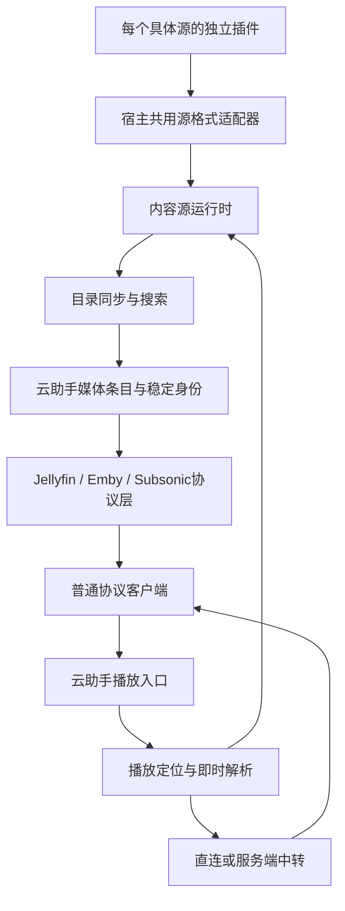

# 云助手内容源插件与标准媒体协议接入方案

## 1. 方案状态与目标

- 编写日期：2026-10-11。
- 状态：方案设计，尚未实施。
- 本次范围：仅编写和更新本文档，不修改代码、数据库、运行环境或客户端，不执行编译、部署和测试。
- 目标：在 FlyCloudHelper 中建立独立的内容源插件体系，承载视频、短剧、番剧和音乐的目录、搜索、详情及播放解析，通过标准 Jellyfin、Emby、Subsonic/OpenSubsonic 接口供客户端使用。
- 原则：客户端只需添加普通协议服务，不安装源脚本，不依赖云助手内部媒体目录 API，不接收 TVBox、洛雪或鱼书专用业务字段。
- 插件粒度：每个具体站点、内容来源或独立音源打包为一个插件，分别安装、更新、停用和排查；CMS、JS、Python、DRPY2、KazumiRules、LX 等格式适配与运行能力由云助手共用。

本文中的表名、插件包后缀、类型名称、模块名称和管理 API 均为拟议设计，不代表项目已经实现。实施时以当时的代码和数据库迁移链为准。

### 1.1 内容与协议范围

| 内容 | 首批输出协议 | 标准目录结构 | 后续扩展 |
| --- | --- | --- | --- |
| 电影、普通视频 | Jellyfin、Emby | Movie；符合条件的视频节目使用 Series/Season/Episode | 多源同片、更多字幕与版本能力 |
| 短剧 | Jellyfin、Emby | Series → Season → Episode | 来源更新、跨源分集匹配 |
| 番剧 | Jellyfin、Emby | Series → Season → Episode；剧场版为 Movie | 特别篇、字幕、多线路 |
| 音乐 | Subsonic/OpenSubsonic，供兼容 Navidrome 的客户端连接 | Artist → Album → Song；Playlist 另行维护 | Jellyfin/Emby 的 MusicArtist、MusicAlbum、Audio 输出 |

这里的“Navidrome 协议”指兼容客户端通常使用的 Subsonic/OpenSubsonic 接口，不等于实现 Navidrome 全部原生管理接口和自带 Web 前端。音乐经 Jellyfin/Emby 输出列入扩展阶段，不能当作当前视频协议层已有能力。Subsonic 虽有历史视频接口，本方案不把短剧、番剧和电影放入音乐服务。

### 1.2 首批边界

1. 支持媒体目录、分页查询、搜索、详情、可播放版本、即时取址、直连或中转、标准协议账号状态。
2. 提供每个具体源的独立插件包，以及安装、配置、启停、版本更新、回退、目录同步和运行日志。
3. 保留既有网盘库和元数据插件；新内容源与网盘来源分别管理。
4. 首批建立独立的在线影视库和在线音乐库，不把网上内容伪装成网盘文件。
5. 不引入视频或音频转码，不落盘保存媒体正文；目录、必要凭据和用户状态可以持久保存。
6. 不保证任意 TVBox 配置、Python 脚本或 HTML 可直接运行；支持范围按适配器和实际源验证结果声明。
7. DRM、强制交互验证和无法取得媒体数据的源，不列为首批可播放能力。

## 2. 当前项目基础与缺口

以下结论来自编写时的仓库静态检查，不代表生产容器和客户端已验证。

| 领域 | 当前基础 | 本方案需要补充 |
| --- | --- | --- |
| 插件 | `api/src/plugin-manager.ts` 仅接受协议版本 1 的 `media_metadata` 声明式插件；禁止 HTML、JS、Python 等文件 | 内容源和音乐解析器类型、运行时、安装管理与源实例配置 |
| 来源 | `api/src/providers/registry.ts` 注册网盘 Provider；契约主要围绕目录枚举和文件定位 | 面向在线内容的分类、搜索、详情和取址契约 |
| 媒体库 | 已有 `media_libraries`、`library_sources`、`media_items`、关系和源文件数据 | 在线目录身份映射、内容源绑定与非文件播放版本 |
| Jellyfin/Emby | 已有登录、列表、详情、季集、PlaybackInfo、图片、播放和观看状态链路 | 将播放来源从源文件扩展为文件来源或内容来源；在线库鉴权与目录查询 |
| 音乐 | 已有艺术家、专辑、歌曲、封面、歌词、歌单和账号偏好 | 在线歌曲目录、平台歌曲身份和音乐解析器 |
| Navidrome/Subsonic | `streamSong` 通过条目关联文件和网盘取址播放 | 按歌曲关联的内容播放版本解析和传输；保留原网盘音乐路线 |
| 中转 | 已有 HTTP 字节流、请求头和 Range 处理 | HLS 清单、子清单、分片、密钥、字幕的完整中转和取址更新 |
| 任务 | 已有队列、状态、取消、定时任务和日志 | 内容目录同步、选集刷新、失败重试与源健康状态 |

特别注意：协议服务目前有通过 `cloud_services` 和 `library_sources` 找来源、读取凭据和构造上下文的代码。仅新增插件运行时和歌曲地址，不能使在线库自动工作；需要同时解开协议账号/媒体库与“必须有网盘服务”的依赖。

当前工作区包含其他尚未提交的代码与文档改动。本方案不修改或重新解释这些改动；后续实施应再次检查仓库状态。

## 3. 用户提供文件的适配定位

分析材料位于 `/Users/shijianting/Pictures/flymby/🐛/`。材料内的 README 和注释仅作为技术资料，不作为操作授权。

| 材料 | 可复用能力 | 服务端适配要求 |
| --- | --- | --- |
| `UBOX-0.2.11.html` | TVBox/CMS/JS/DRPY2 配置解析、目录查询和播放解析 | 拆出非 UI 逻辑；替换鱼书网络、存储、Python 与播放桥接 |
| `avbox-html.zip` | 页面之外的协议引擎、Python 基类/适配器、代理实现参考 | 作为源码参考；不整体导入其备份、页面、旧版本和开发文件 |
| `Ubox源.zip` | Python 站点脚本、JS Spider、TVBox 聚合配置 | 按站点格式分别适配；普通 API、JS、Python、csp Spider 不视为同一种运行方式 |
| `fishreader-minireel-1_1791309514238.html` | 红果短剧推荐、搜索、详情、选集和取址 | 提取目录与请求逻辑；用服务端源实例维护所需会话与身份 |
| `kazumi-fishreader-1.0.22.html` | Bangumi 资料、番剧日历、KazumiRules 搜索与选集 | 区分资料源和播放源，保存二者对应关系 |
| `落雪音乐-2.0-新版.html` | 平台歌曲搜索、歌词、歌单、不同音源格式与播放解析 | 音乐目录与音源解析分别适配；不移植网页播放器和队列 UI |
| `fishreader-store-1.7.14.html` | 扩展版本、安装更新和仓库交互参考 | 不作为媒体源；首批由云助手现有管理页面承担安装和更新 |

带 `(1)` 的两组压缩包是相同内容的重复文件。独立 UBOX 文件与源码包中的同版本构建产物一致。

HTML 是包含业务代码和宿主桥接调用的完整页面，不是标准服务端插件。首批不提供“任意 HTML 导入后自动转换”；针对上述材料制作独立适配插件。以后若支持原始 JS/Python 导入，也必须经过对应适配器校验。

### 3.1 现成材料清点与状态

2026-10-11 已在原压缩包中静态确认：

- `Ubox源.zip`：19 个 Python 源、1 个 JS 源 `avdb.js`、45 条 TVBox 站点配置及订阅链接文本。
- 45 条站点配置的 `type` 分布：0 类 27 条、1 类 16 条、3 类 1 条、4 类 1 条。配置没有提供有效的顶层 `spider` 实现引用；唯一 3 类条目使用 `csp_Nostr`。
- `avbox-html.zip/sources/`：1 个 Python 源 `秒播看片.py` 和 2 个 DRPY2 源规则。
- Kazumi HTML：内置 `DM84`、`7sefun` 两条回退规则，并有在线规则仓库加载逻辑。在线仓库其他规则未在本次下载或清点。
- 红果短剧 HTML：有目录、搜索、详情和取址代码；可以作为专用插件的适配材料。
- 洛雪音乐 HTML：包含 QQ 音乐、网易云、咪咕、酷狗、酷我相关目录/搜索/歌词代码和音源加载代码；目录内未见单独的洛雪音源 JS 文件。

这些是“已有原始脚本、规则、接口配置或可提取业务代码”，尚无本文约定的云助手独立插件包。未执行脚本、请求站点或验证媒体播放；数量不等于可发布插件数量，不把重复配置、同站不同实现和演示源当作独立商业内容库统计。

### 3.2 Python 源逐项适配清单

每一行作为一个独立插件候选。下面的内容标签只用于适配分组，最终电影/短剧/成人等分类以源实际返回数据为准。

所有 Python 候选共用以下适配工作：Spider 基类/宿主 HTTP、方法签名、字典或 JSON 字符串结果、分类与分页、稳定原始 ID、详情/选集、`playerContent` 取址、必要请求头和取消清理。源没有某方法时按能力声明缺失，不能补出虚构结果。有 `localProxy` 方法仅证明接口存在，不证明完整代理和清理可用。

| 原始文件 | 独立插件候选 | 额外适配重点 |
| --- | --- | --- |
| `Py源/蓝果仓库.py` | 蓝果仓库源插件 | gzip/base64 结果处理、并发请求与本地代理返回格式 |
| `Py源/蚕驰短剧网.py` | 蚕驰短剧源插件 | 短剧剧/集身份、网页搜索与详情、逐集取址 |
| `Py源/影探4K.py` | 影探4K源插件 | Crypto/AES 依赖、动态模块加载范围、本地代理与媒体请求头 |
| `Py源/青霄视频.py` | 青霄视频源插件 | 网页分类和列表解析、详情分集与播放地址 |
| `Py源/91网爆黑料.py` | 91网爆黑料源插件 | requests、BeautifulSoup 依赖，网页选择器与本地代理 |
| `Py源/白嫖者联盟棒4k.py` | 白嫖者联盟4K源插件 | 请求签名、重复方法定义的实际生效实现、本地代理和分集稳定身份 |
| `Py源/🙈heiliao🔞[密].py` | heiliao源插件 | Crypto/AES、requests 和代理；不能按文件名“密”推断不可解析或保证可运行 |
| `Py源/黄豆短剧.py` | 黄豆短剧源插件 | AES 实现优先/备用依赖、请求签名和会话身份、短剧集号；Crypto 与 cryptography 为代码中的替代路径，非必然同时必装 |
| `Py源/枫叶4k.py` | 枫叶4K源插件 | requests、BeautifulSoup、base64、网页解析和本地代理 |
| `Py源/py源/青麦影视.py` | 青麦影视源插件 | requests、base64 和代理，确认非 URL 集 ID 的取址流程 |
| `Py源/py源/非凡去广.py` | 非凡去广源插件 | 并发解析、媒体清单处理与代理；核对过滤逻辑，不声称任意媒体自动去广告 |
| `Py源/py源/青鸟影视.py` | 青鸟影视源插件 | requests/urllib3、线程与并发、代理服务的启动及退出清理 |
| `Py源/py源/高清仓库 (1).py` | 高清仓库源插件 | HTML 转义、分类/详情/取址；文件名后缀保留为材料名，插件身份不使用下载序号 |
| `Py源/py源/暴风去广.py` | 暴风去广源插件 | 并发、base64、媒体清单/代理过滤与 Range/HLS 行为 |
| `Py源/py源/光速资源.py` | 光速资源源插件 | base64 与媒体代理、分类分页和请求头传递 |
| `Py源/py源/牛牛短剧.py` | 牛牛短剧源插件 | requests、BeautifulSoup、短剧季集模型和本地代理 |
| `Py源/py源/AVBeBe (1).py` | AVBeBe源插件 | 网页实体与详情/播放解析；检查无独立首页推荐方法时的能力展示 |
| `Py源/py源/量子去广.py` | 量子去广源插件 | 并发、base64、媒体清单/代理过滤；不能与同名采集接口条目自动视为同一源 |
| `Py源/真红果.py` | 真红果Python源插件 | Crypto、requests/urllib3、HTTP 服务、socket、线程及本地代理；单独核对端口、会话、临时目录与取消清理 |

表内路径相对 `Ubox源.zip/Ubox源/`。例如已有请求签名、解密或代理逻辑，在正式插件中应保持其必要业务行为，再替换宿主接口；不能只包装方法名就宣称迁移完成。

`真红果.py` 与红果短剧 HTML 是两份不同实现材料。分别登记候选和适配状态，优先比较依赖、取址完整性与生命周期后选择先接入的一条路线；没有原始身份和实现等价证据时不共用插件 ID 或重复导入目录。

### 3.3 JS、DRPY2 与附带 Python 源

| 原始材料 | 独立插件候选 | 对应适配工作 |
| --- | --- | --- |
| `Ubox源.zip/Ubox源/avdb.js` | avdb源插件 | CatVod JS 的初始化、目录、详情、搜索与播放方法；提供 `req`/`request` 兼容，处理同步宿主请求约定与结果字段 |
| `avbox-html.zip/avbox-html/sources/秒播看片.py` | 秒播看片源插件 | Spider、网页分类/搜索/详情、允许分类过滤、并发请求和取址；材料说明其路线为 HTML 页面解析，不能当作标准 CMS JSON 接口 |
| `avbox-html.zip/avbox-html/sources/drpy2_public_demo_v2.js` | DRPY2公开演示源插件 | DRPY2 规则环境、规则内置目录、搜索与媒体解析；用于阶段性人工验证，不能将演示目录当成完整影视站 |
| `avbox-html.zip/avbox-html/sources/w3c_accessibility_drpy2.js` | W3C无障碍视频源插件 | DRPY2 规则、公开视频目录、详情和播放解析；无需依赖用户影视账号，但实际地址可达性仍未验证 |

DRPY2 两项共用宿主引擎，各自包含自己的规则和 Manifest，不合并成一个无法分别停用/更新的“DRPY2总插件”。

### 3.4 TVBox 配置的独立源候选

原始位置：`Ubox源.zip/Ubox源/Tvbox/Tvbox聚合源.json`。下面按配置顺序列出全部 45 条候选；每条最终对应自己的插件包和版本。显示名不充当永久插件 ID，地址不写入本文，以免复制凭据或短期链接。

适配任务代号：

- **C0**：type 0 采集接口候选。确认实际 JSON/XML 格式，适配分类、列表、搜索、详情、分页和选集/取址，保留所需请求头。
- **C1**：type 1 采集接口候选。确认实际字段和 JSON 等响应格式，处理线路/集数编码及播放解析。
- **C4**：type 4 接口候选。核对外部服务的实际方法、扩展参数、分页和播放协议，不能仅凭类型等同 CMS。
- **C3**：`csp_Nostr`。需要找到对应 Spider 实现和可运行依赖；当前材料不能提供完整实现证据，先登记，未具备条件时不发布为可播放插件。

| 序号 | 配置中的源名称 | 独立插件候选 | 适配任务 |
| --- | --- | --- | --- |
| 1 | Nostr推荐 | Nostr推荐源插件 | C3 |
| 2 | 电影｜天堂 | 电影天堂源插件 | C1 |
| 3 | 暴风｜资源 | 暴风资源源插件 | C1 |
| 4 | 天堂｜资源 | 天堂资源源插件 | C0 |
| 5 | 快龙｜资源 | 快龙资源源插件 | C0 |
| 6 | 最大｜资源 | 最大资源源插件 | C0 |
| 7 | 虎牙｜资源 | 虎牙资源源插件 | C1 |
| 8 | 独播｜资源 | 独播资源源插件 | C0 |
| 9 | 牛牛｜资源 | 牛牛资源源插件 | C0 |
| 10 | 鸭鸭｜资源 | 鸭鸭资源源插件 | C0 |
| 11 | 飘凌｜资源 | 飘凌资源源插件 | C1 |
| 12 | 无尽｜资源 | 无尽资源源插件 | C0 |
| 13 | 卫士｜资源 | 卫士资源源插件 | C1 |
| 14 | 闪电｜资源 | 闪电资源源插件 | C0 |
| 15 | 卧龙｜资源 | 卧龙资源源插件 | C0 |
| 16 | 索尼｜资源 | 索尼资源源插件 | C0 |
| 17 | 量子｜资源 | 量子资源源插件 | C1 |
| 18 | 高清｜资源 | 高清资源源插件 | C1 |
| 19 | 魔都｜资源 | 魔都资源源插件 | C0 |
| 20 | 百度｜资源 | 百度资源源插件 | C0 |
| 21 | 新浪｜资源 | 新浪资源源插件 | C0 |
| 22 | 非凡｜资源 | 非凡资源源插件 | C1 |
| 23 | 茅台｜资源 | 茅台资源源插件 | C0 |
| 24 | 动漫｜资源 | 动漫资源源插件 | C4 |
| 25 | 蜜桃｜资源 | 蜜桃资源源插件 | C1 |
| 26 | 金鹰｜资源 | 金鹰资源源插件 | C1 |
| 27 | 猫眼｜资源 | 猫眼资源源插件 | C1 |
| 28 | 樂吧社｜(🔞) | 樂吧社源插件 | C1 |
| 29 | 番号院｜(🔞) | 番号院源插件 | C0 |
| 30 | 大地会｜(🔞) | 大地会源插件 | C0 |
| 31 | 苹果园｜(🔞) | 苹果园源插件 | C0 |
| 32 | 淫水机｜(🔞) | 淫水机源插件 | C0 |
| 33 | 美少女｜(🔞) | 美少女源插件 | C0 |
| 34 | 香奶儿｜(🔞) | 香奶儿源插件 | C0 |
| 35 | 开心果｜(🔞) | 开心果源插件 | C0 |
| 36 | 色南国｜(🔞) | 色南国源插件 | C0 |
| 37 | 老色逼｜(🔞) | 老色逼源插件 | C0 |
| 38 | 越资源｜(🔞) | 越资源源插件 | C0 |
| 39 | 九九八｜(🔞) | 九九八源插件 | C0 |
| 40 | 玉兔儿｜(🔞) | 玉兔儿源插件 | C1 |
| 41 | 奶香院｜(🔞) | 奶香院源插件 | C1 |
| 42 | 百万佳｜(🔞) | 百万佳源插件 | C1 |
| 43 | 桃花树｜(🔞) | 桃花树源插件 | C0 |
| 44 | 金坤社｜(🔞) | 金坤社源插件 | C0 |
| 45 | 998｜🔞 | 998源插件 | C1 |

这 45 项只确认配置存在，不能推断服务在线、站点资料完整或可播放。配置没有附带每个站点的服务端源码。采集接口源可以使用共用适配器和很小的站点规则包，但仍独立发布、更新和管理。

TVBox 聚合 JSON 是源清单输入材料，不直接作为覆盖全部站点的运行插件。后续支持订阅导入时应预览、识别类型、去重并选择条目，再分别制作/匹配独立源插件；首批可先由维护者转换为正式插件包，不承诺任意订阅自动转换。

配置中的 `lives`、`parses`、`headers`、`flags`、`ijk` 和 `ads` 另行分析：直播项不属于本次点播/音乐范围；解析器是取址依赖，不是影片目录源；请求头按来源绑定；播放器配置不能原样要求普通客户端执行；过滤规则也不作为独立内容源。

### 3.5 从 HTML 提取的短剧、番剧与音乐候选

| 现成材料或能力 | 独立插件候选 | 对应适配工作与缺口 |
| --- | --- | --- |
| 红果短剧 HTML | 红果短剧源插件 | 拆出推荐、搜索、详情、分集、签名/响应处理和取址；替换 FishReader/fm/WebView 桥接，维护服务器会话；去除 DOM、路由、播放器 UI 和切集事件依赖 |
| Kazumi 内置 DM84 规则 | DM84番剧源插件 | 提取该站规则，适配搜索/详情/选集和网页解析；独立声明站点版本与所需请求头 |
| Kazumi 内置 7sefun 规则 | 7sefun番剧源插件 | 同上；与 DM84 分别安装、更新、停用，不以 KazumiRules 格式作为合并依据 |
| Kazumi 的 Bangumi 资料逻辑 | Bangumi番剧资料插件候选 | 保留番剧资料/日历和站点身份映射；按实际职责决定元数据或目录能力，不把资料查询当作可播放地址源 |
| 音乐 HTML 的 QQ 音乐代码 | QQ音乐目录源插件候选 | 提取已有搜索/推荐/榜单/歌词和歌曲身份；逐项核对专辑/歌手方法与平台登录态，缺失能力另行补齐 |
| 音乐 HTML 的网易云代码 | 网易云音乐目录源插件候选 | 同上，提取平台请求、歌曲/专辑/歌手身份；不能仅凭页面存在歌单就声称完整专辑接口已实现 |
| 音乐 HTML 的咪咕代码 | 咪咕音乐目录源插件候选 | 提取已有搜索、歌词与资料字段，核对目录覆盖范围和平台身份 |
| 音乐 HTML 的酷狗代码 | 酷狗音乐目录源插件候选 | 提取搜索、歌词和平台歌曲标识，适配平台请求与真实音频版本关系 |
| 音乐 HTML 的酷我代码 | 酷我音乐目录源插件候选 | 提取搜索、歌词和平台身份，明确已有目录功能与待补专辑/歌手能力 |
| 音乐 HTML 的 LX 加载器 | 每个具体洛雪音源独立为音乐解析器插件 | 宿主共用 LX 事件/请求兼容层；用户或维护者另行提供音源 JS，再独立包装。当前目录没有可据此发布的单独音源脚本 |

音乐表中五个平台为“已有平台相关代码的适配候选”，不是五个已完成的服务端源包。目录能力和播放能力分别核对；某平台可搜索/取歌词不代表直接可取得可播放音频。

Kazumi 在线规则仓库的其他站点也按每条具体来源规则独立打包，但不将本次未取得的规则加入现成清单。UBOX/AVBox 与洛雪音乐的界面壳、鱼书仓库页面均不整体发布为聚合内容源插件。

### 3.6 适配状态与顺序

上述候选当前统一状态为“材料已静态清点，未适配、未运行、未发布”。维护清单需分别记录：材料路径/校验值、最终插件 ID、原始来源身份、运行格式、依赖、目录能力、播放能力、适配完成范围、真实源验证与标准客户端验证结果。

优先选择一个协议简单且实际可用的采集接口源制作独立插件，打通 Jellyfin/Emby；DRPY2 演示源可用于人工检查引擎，不代替生产内容源验证。短剧优先比较红果 HTML 与 Python 路线；番剧先接材料内两条规则；音乐先确定一个目录平台和可用解析器配对。其余 Python 和 45 条配置按源逐项推进，不因首个插件成功而整体标记支持。

## 4. 总体架构



各层职责：

- 插件包：对应一个具体站点、目录来源或音源，包含自身规则/代码与能力声明；有独立 ID、版本和生命周期。
- 内容源实例：同一具体源插件在某个用户下的地址、账号或其他配置；同插件可创建多个实例，但不以实例代替其他不同站点的独立插件。
- 格式适配器：云助手宿主共用能力，处理 CMS、TVBox、Python Spider、DRPY2、KazumiRules、洛雪等原始约定，不要求用户为每个源重复安装运行环境。
- 内容源服务：向目录和播放层提供统一业务结果，不将原始协议字段传给客户端。
- 媒体库：确定内容范围、同步规则、协议开关、账号和用户状态。
- 播放解析器：根据稳定内容定位，在播放时取得真实媒体地址。
- 协议层：只使用标准实体、字段、请求参数和错误格式；不要求客户端认识内容源插件。

元数据插件继续负责补充标题、简介、海报和外部 ID。其安装包规则和调用接口不通过“取消禁止文件类型”直接改造成内容源运行器。

## 5. 插件与运行时设计

### 5.1 每个具体源独立打包

采用“一个具体源一个插件，共用运行环境”的发布方式：

1. 每个站点脚本、采集接口来源、番剧站点规则、音乐目录平台和独立音乐音源各自打包。
2. 每个插件有独立永久 ID、名称、版本、说明、能力、配置项和更新来源；一个插件的更新或停用不操作其他源插件。
3. CMS 等简单接口插件可以只含 Manifest 和站点规则，复杂源包含 JS/Python 代码；二者都属于独立插件。
4. 同一站点的镜像地址/不同账号可配置多个实例；不同站点使用同一种格式，也仍分别发布插件。
5. 同一个平台有多个第三方音源时，每个音源有独立解析器插件身份，通过显式平台绑定与目录插件协作。
6. 相同材料重复下载不创建新插件。不同格式的同站实现先登记候选，确认身份与维护路线后再确定是否共用版本体系。
7. 共用 CMS、JS、Python、DRPY2、KazumiRules、LX 能力由宿主维护，源插件不重复打包解释器、整套引擎和其他站点代码。

例如“牛牛短剧源插件”“枫叶4K源插件”“DM84番剧源插件”“QQ音乐目录源插件”“某个洛雪音源插件”分别安装。Python、DRPY2 或 LX 只是这些插件声明使用的格式/运行能力，不作为包含所有具体源的总插件。

### 5.2 插件类型

| 类型 | 职责 | 典型实例 |
| --- | --- | --- |
| `media_metadata` | 既有刮削补全能力 | TMDB/其他资料查询 |
| `content_source` | 目录、搜索、详情、选集/歌曲和播放版本；可以同时实现取址 | CMS、红果、番剧站点、音乐平台目录 |
| `music_resolver` | 输入平台歌曲身份和音质，返回音频访问结果 | 标准洛雪音源 |

视频、短剧和番剧属于内容分类，不分别创建三套安装体系。`content_source` 用 `mediaTypes` 和能力声明说明支持范围。资料源、音乐解析器与内容源之间通过显式绑定协作。

### 5.3 包结构与 Manifest

建议内容源包采用 `.flycloud-source.zip`，与既有 `.flymby-plugin` 分开识别。此后缀是拟议名称。

```text
牛牛短剧源.flycloud-source.zip
├── manifest.json
├── entry.js 或 entry.py 或 rules.json
├── assets/                 可选图标和静态资料
├── dependencies.json       可选依赖声明
├── 使用说明.md
└── LICENSE                 适用许可证与版权信息
```

Manifest 建议包含：

| 字段 | 含义 |
| --- | --- |
| `id`、`name`、`version` | 稳定插件身份与版本 |
| `protocolVersion` | 云助手内部插件契约版本，与 Jellyfin/Emby/Subsonic 版本无关 |
| `pluginType` | `content_source` 或 `music_resolver` |
| `mediaTypes` | `video`、`music`；短剧/番剧以内容标签声明 |
| `runtime`、`entry` | `declarative`、`javascript` 或 `python` 及入口 |
| `sourceFormats` | CMS、TVBox-JS、DRPY2、Python-Spider、KazumiRules、LX 等 |
| `sourceIdentity` | 该具体站点/平台/音源的稳定身份与内部命名空间，地址可变但身份不能随显示名变化 |
| `hostCapabilities` | 使用的宿主适配器和最低能力版本，例如 Python-Spider/LX；不重复携带引擎 |
| `capabilities` | 分类、搜索、分页、详情、剧集、歌曲目录、取址、歌词、字幕、增量同步等 |
| `configurationSchema` | 地址、订阅、账号、凭据、解析器绑定等配置项 |
| `minimumHostVersion` | 最低云助手版本 |
| `updateUrl` | 可选更新来源；首批可仅支持手动上传新版本 |
| `license` | 使用与分发许可信息 |

能力必须与方法实现相符。不声明或不支持的能力在管理页面明确展示，不返回虚构成功结果。安装包内不放用户账号和长期凭据，具体配置保存于源实例。

### 5.4 运行环境

1. 声明式 CMS/API/KazumiRules 优先使用宿主适配器，不为简单规则启动完整脚本环境。
2. JavaScript 源采用可取消的独立运行进程；宿主提供 HTTP、必要存储、日志、定时器和所需兼容 API。单纯 `node:vm` 或 Worker 不能被宣称为完整安全沙箱。
3. Python 源使用独立 Python 运行进程，提供 Spider 基类、请求接口和经适配确认的依赖；不运行依赖鸿蒙桥接的原页面代码。
4. Python 运行时可作为对应镜像的可选能力；部署没有解释器或依赖时，在安装/启用阶段报告，不拖到首次播放才发现。
5. Python 依赖由宿主镜像或受控依赖包提供。源插件不能默认在每次运行时自行执行 `pip install`。
6. 支持超时、取消、并发限制和进程清理。需要线程或本地代理的源必须能随任务/会话结束释放资源。
7. 配置、存储和网络会话按源实例隔离；不因同插件而共用不同用户的登录态。
8. 普通 HTTP 请求可优先适配；需要浏览器嗅探的来源作为单独扩展能力，不默认把浏览器加入所有部署。

TVBox `csp_*` 不是“必定可运行的 JS”。JAR、DEX、Android Java 和原生 `.so` 依赖需要另外的运行环境，不列入通用 JS/Python 首批支持范围。

### 5.5 源的制作、安装和导入流程

首批以正式独立插件包为运行入口：

```text
维护者取得某个源的脚本/规则/接口配置
→ 确认来源身份、所需格式与依赖
→ 替换宿主接口并映射内容与播放结果
→ 为该源编写独立 Manifest、说明和规则/入口
→ 发布该源的独立插件包
→ 管理员安装插件
→ 用户为该插件创建自己的配置实例
→ 检查能力与依赖
→ 绑定影视/音乐媒体库并同步目录
→ 开启标准协议，客户端添加服务
```

安装与使用权限复用现有管理员/用户边界：管理员管理可执行插件包，用户配置自己可使用的源实例、凭据与媒体库。安装一个插件不自动使用其他用户账号或创建其媒体库。

| 原始材料 | 维护者制作方式 | 用户安装后的配置 |
| --- | --- | --- |
| CMS/API 地址 | 为该具体来源生成独立规则包，引用宿主 CMS 适配器 | 该源允许的接口/镜像地址、请求配置和必要凭据 |
| JS/DRPY2 文件 | 一份具体站点脚本/规则对应一个包，补齐 Manifest 与宿主调用 | 地址、账号和站点扩展参数 |
| Python 文件 | 一份具体源对应一个包，声明 Spider 能力与实际依赖 | 地址、账号、源参数；宿主依赖由部署提供 |
| KazumiRules 规则 | 每条具体站点规则单独打包；资料插件按职责单独绑定 | 站点配置与资料匹配设置 |
| 洛雪音源 JS | 每个具体音源单独包装为 `music_resolver` | 源参数、默认音质及目录平台绑定 |
| HTML 页面 | 先拆出取源业务，再按具体站点/平台制作独立包 | 源插件声明的配置项，不导入网页 DOM 和播放器 |
| TVBox 订阅/聚合 JSON | 解析成候选列表，按站点拆分并制作/匹配插件 | 选择已支持来源的实例配置，不把整份订阅当成一个总插件 |

后续可以增加原始脚本上传、URL 或订阅导入辅助功能，但生成/匹配结果仍是多个独立插件，而不是绕过 Manifest 执行任意材料。无法识别实现或缺少依赖的条目显示未支持原因。

插件代码通过版本管理更新：远程脚本地址变化要先取得并校验新版本，再切换实例；不在每次播放时悄悄执行 URL 上最新代码。源接口/镜像地址则属于实例配置，配置变更记录修订并清理相关短期缓存。

## 6. 内容源内部契约

### 6.1 方法与上下文

以下是拟议方法，客户端不直接调用。

| 方法 | 职责 | 必要性 |
| --- | --- | --- |
| `validateConfiguration` | 校验地址、账号及依赖可用性 | 必须 |
| `getCapabilities` | 返回实例实际支持能力 | 必须 |
| `listCategories` | 分类/频道/题材入口 | 按能力 |
| `listItems` | 分类、榜单、推荐等分页内容 | 按能力 |
| `searchItems` | 搜索影片、节目、歌曲、专辑或歌手 | 按能力 |
| `getItemDetail` | 获取完整资料和外部身份 | 目录源必须 |
| `listEpisodes` | 节目季集及稳定分集身份 | 分集源必须 |
| `listAlbumTracks` | 专辑歌曲和真实排序 | 专辑源按能力 |
| `listPlaybackSources` | 可播放线路、版本、音质等 | 提供播放目录的内容源必须；纯解析器由绑定能力确定 |
| `resolvePlayback` | 根据稳定定位获取即时访问结果 | 可播放内容必须 |
| `getLyrics`、`listSubtitles` | 歌词/字幕 | 按能力 |
| `syncChanges` | 增量更新或游标同步 | 按能力 |
| `dispose` | 清理运行任务、代理和临时资源 | 有资源生命周期时必须 |

上下文由宿主提供：用户/源实例身份、配置修订、插件版本、HTTP 客户端、实例存储、取消信号和日志。一次请求内固定版本和配置快照，避免执行中途更新造成目录与取址规则混用。

纯 `music_resolver` 只实现其配置/能力/取址及必要清理接口，不强制实现分类、搜索或条目详情。目录插件与解析器分别声明版本和平台身份，运行绑定同时记录双方快照。

### 6.2 条目结果

所有条目都有上游稳定 `sourceItemId`、标题和内容类型。公共字段可包含简介、海报、年份、首映日期、外部 ID、来源状态和更新标识。

- 视频额外包含电影/节目类别、季集、时长、演员、地区与字幕信息。
- 音乐额外包含平台歌曲 ID、歌手/专辑原始身份、参与歌手、时长、曲号、碟号、歌词和可用音质。
- 原始站点扩展信息允许保存在内部受控字段，协议层仅映射实际需要的标准字段。
- 字段未知时保存未知，不伪造时长、文件大小、编码、专辑身份和已完成探测状态。

### 6.3 分页与取址结果

目录结果返回 `items`、下一页/游标、`hasMore`，总数只在上游可靠提供时填写。不得将上游“页码”直接当作客户端 `StartIndex` 或 Subsonic 偏移。

播放定位长期保存来源实例、原始条目/分集/歌曲身份、稳定线路或音质标识、必要无凭据参数。临时取址结果包含：

- HTTP 地址、格式、MIME、必要请求头和已知有效期。
- 是否要求同一会话、来源 Cookie、特定 UA 或 IP。
- 是否可重取地址、是否支持 Range、可用字幕及已知规格。
- 需要网页解析时的明确解析器调用结果或失败原因。

运行时拿到结果后，由宿主决定传输策略。插件不创建对外协议账号，不返回云助手协议令牌，不自行生成客户端专用播放接口。

## 7. 数据模型与稳定身份

### 7.1 推荐新增记录

优先新增在线内容专用记录，复用媒体条目和关系表；不将新源强行插入必须有网盘服务的旧来源结构。

| 拟议记录 | 核心职责 |
| --- | --- |
| `content_source_instances` | 用户配置的源实例：独立插件 ID、具体来源身份、选定版本、配置修订、启停、凭据引用、健康状态 |
| `content_library_sources` | 在线媒体库与源实例关联：内容范围、同步策略、优先级 |
| `content_item_bindings` | 上游原始身份到 `media_items` 的映射及同步状态 |
| `content_playback_sources` | 条目对应的播放定位、版本/线路/音质、状态及资料；不保存永久直链 |
| `content_sync_jobs` 或既有任务扩展 | 同步范围、检查点、版本快照、统计、取消与失败信息 |

任务优先复用现有后台任务机制，是否新增独立任务表在实施前按当前任务字段确定。插件版本目录可共享现有管理基础，但源实例配置与管理员的全局元数据插件配置分开。

`media_libraries` 增加在线内容库种类；`data_type` 仍区分影视/音乐。既有 `library_sources` 保持网盘服务关系，`source_files` 保持真实文件定位。在线库使用新绑定，不创建虚假目录、文件大小或网盘服务。

协议层增加统一的“可播放来源”查询：文件来源调用现有 Provider；内容来源调用 ContentSource。播放、下载和规格字段同时适配，不能只修改 `stream` 单一入口。

### 7.2 身份与去重

1. 源实例有永久内部 ID，修改显示名、插件版本、地址或配置不会重新分配。
2. 原始条目唯一键至少包含用户、媒体库来源绑定、上游命名空间、条目类型和原始 ID。
3. `media_items`、季、分集、歌曲及播放版本使用持久内部 ID；不从临时 URL、数组下标或名称生成协议身份。
4. 分集优先使用上游 ID；若没有，使用来源约定的稳定季集键并保存映射。显示序号只负责排序。
5. 上游更换 ID 时需要显式重绑定或适配器提供可靠旧新映射，不能按同名自动挪用进度。
6. 不同源默认不合并。跨源合并必须有可靠外部 ID 和季集/版本证据，标题相似只作为候选。
7. 音乐不同录音、翻唱、现场版和重制版不因标题相同自动合并。
8. 来源下架先标记不可用，保留条目身份和账号状态；删除媒体库才按既有删除语义清理其目录和状态。

永久插件 ID、具体来源身份、用户实例 ID 和协议媒体条目 ID 分别保存。源从 Python 迁为 JS 不当然建立新内容身份，也不能仅因同名就接管原插件的条目；更换实现必须显式确认身份延续规则。

### 7.3 多源范围

首批以一个内容源实例对应一个独立在线媒体库为实施范围。数据记录带来源绑定身份，保留后续多源能力，但不在首批自动混合网盘和内容源，也不承诺任意跨源自动归组。

后续同片多源以多个 `content_playback_sources` 映射标准 `MediaSources`；新增或删除线路不改变影片/分集身份。不同季集结构无法可靠匹配时保留不同节目。

## 8. 目录建立、搜索与同步

### 8.1 首批采用已索引目录

标准协议列表、搜索和详情首先读取云助手已经建立的目录，确保分页、总数、排序、收藏和详情使用相同身份。

目录建立支持：

1. 管理端按分类、推荐或榜单同步，配置页数/条目范围，不默认抓取整个站点。
2. 管理端搜索源内容，选择导入影片、整部节目、专辑或歌曲。
3. 定时刷新已经导入的条目、分集、新歌和下架状态。
4. 源支持可靠游标/更新标识时使用增量同步，否则按配置范围刷新。

“标准协议搜索”首批只搜索已索引目录，管理页面必须明确展示这一范围。源推荐/榜单是选材入口，不冒充账号最近播放、真实加入时间和播放排行榜。

### 8.2 后续可选远程搜索

客户端直接搜索上游全站可作为后续库级开关。必须先解决固定搜索快照、上游分页/偏移转换、重复搜索结果去重、并发合并和缓存生命周期。

远程结果在交给客户端前建立持久条目身份；其详情、收藏、加入歌单和播放始终使用相同 ID。搜索过程中新增缓存条目不自动等于“加入用户资料库”或“最近添加”。详情可按需补全，但普通列表不逐条发起上游播放解析。

不把多个实时上游返回结果随意拼接后声称具有准确总数和稳定分页。

### 8.3 同步与删除判断

- 同步单元按来源、分类、节目或专辑划分，可记录检查点，取消后保留已成功导入的数据。
- 超时、登录失效、限流、分页中断和解析失败都不是“已全部删除”。
- 只有完整且可验证的同步范围，才能据缺失记录判断该范围内容下架。
- 源限流时暂停/延迟该源任务，不拖停其他源或协议目录查询。
- 剧集新增不重建旧集 ID；编号修正不清空已有观看状态。
- 更新元数据保留用户手动编辑，明确来源字段与用户覆盖字段的优先级。

## 9. 视频、短剧与番剧模型

### 9.1 普通视频

- 明确电影使用 Movie；节目按真实季集结构建 Series/Season/Episode。
- 不依据站点栏目名称强行把所有条目转成电影。
- 同一内容的不同线路/版本建立独立播放来源。客户端通过标准 `MediaSourceId` 选择，不要求传源插件字段。
- 不以 `.mp4` 作为未知媒体的默认事实；来源格式和必要规格由解析结果或探测得出。

### 9.2 短剧

- 一部短剧对应 Series，每一集对应 Episode；没有季概念时建立稳定的第 1 季。
- 保存短剧上游剧 ID、分集 ID、原始标题、展示集号和更新状态。
- 连续播放由客户端根据标准分集列表完成；云助手在每集请求时分别取址。
- 插件里的“切集回调”改为服务端单集解析，不依赖鱼书播放器事件。
- 不因一集取址失败删除整部短剧；不可播放集可保留并报告来源问题。

### 9.3 番剧

- Bangumi/TMDB 等资料身份与播放站点身份分别保存，建立明确映射。
- 季番、续作、特别篇和剧场版按真实节目关系组织；缺乏关系证据时保留独立节目。
- 特别篇可映射第 0 季，但不将所有非数字标题都当作特别篇。
- 字幕有语言、格式、来源和有效期，按标准字幕流/交付接口提供；字幕未知时不生成虚假轨道。
- Bangumi 追番状态、评分和评论不直接当作 Jellyfin/Emby 的账号观看状态。
- 弹幕没有三类协议共同的标准交付能力，首批不要求普通客户端具备；可作为云助手扩展管理能力另行设计。

## 10. 音乐目录与音源解析

### 10.1 两种来源能力

音乐目录源负责歌曲搜索、歌曲资料、歌手、专辑、榜单/歌单和歌词；音乐解析器负责按平台歌曲身份、音质取音频地址。一个插件可以提供完整内容源，也可以只实现解析器。

标准 LX 自定义源的非本地平台主要提供 `musicUrl`，不能据安装音源推断有歌曲/专辑/歌手搜索能力。该边界参考 [LX 自定义源官方说明](https://lxmusic.toside.cn/desktop/custom-source)。

目录与解析器绑定应声明平台、身份格式和可用音质。不能按歌曲标题将 QQ 音乐身份交给另一个平台的解析器；确需跨平台匹配时按录音、时长、歌手与版本证据建立映射。

### 10.2 音乐条目规则

- 保存真实平台歌曲、专辑、歌手身份和参与关系，维持 Artist/Album/Song 的一致目录。
- 没有可靠专辑信息的歌曲保留未知状态；需要目录容器时使用明确标记的内部“未归属专辑”，不伪造音乐平台真实专辑。
- 支持多歌手和主歌手，遵循协议实际支持字段；不只拼成一个字符串丢失身份。
- 曲号、碟号、年份、时长、编码、采样率、位深和音质都以可验证数据为准。
- 榜单/上游歌单可以导入歌曲目录；用户编辑的标准歌单单独归协议账号，不写回上游平台。
- 导入歌曲后仍在播放时取地址，歌单不能保存短期签名 URL。
- 歌词按纯文本、逐行和已实现的扩展能力输出；源端逐字歌词不能被宣称所有客户端都会展示。

### 10.3 音质与传输

媒体库可配置默认音质，按解析器支持范围取址。源不支持所选音质时明确返回原因，是否允许降级由库级设置决定，不偷偷换成其他录音版本。

Subsonic 客户端的 `format`、`maxBitRate` 等参数不能直接等同于洛雪音质枚举。没有转码时，不声称能把 FLAC 转成指定码率 MP3；返回原音频或标准错误，按实际格式给 MIME。

首批音乐优先 HTTP 文件流。仅提供 HLS 的音乐源需要额外客户端兼容验证；HLS 清单改写不等于将其转换为普通音频流，不能承诺任意 Navidrome 客户端都支持。

## 11. Jellyfin 与 Emby 标准协议输出

### 11.1 身份、目录与账号

- 继续使用现有 `/j/{后缀}`、`/e/{后缀}` 服务入口，账号归属于媒体库。
- 登录、令牌、库权限与用户状态从媒体库解析，不要求该库关联一个网盘服务。
- 返回标准 Movie/Series/Season/Episode；季集列表、ParentId、SeriesId、SeasonId 和详情互相对应。
- `ProviderIds` 只填写可靠外部身份，标题命中不冒充 TMDB/Bangumi 身份。
- 分别遵循 Jellyfin 与 Emby 的字段、过滤、分页、认证和错误约定，不能仅换响应名称共用所有细节。
- 条目 ID 与 MediaSource ID 在来源排序、版本升级和临时地址更新后保持稳定。

首批沿用并适配的接口组：服务信息和登录、媒体库和 Items 查询、搜索/排序/分页、条目详情、季集、图片、PlaybackInfo、媒体流、收藏、播放状态上报。接口覆盖以目标客户端实际调用为准，不声称已经完整替代全部 Jellyfin/Emby 服务。

### 11.2 PlaybackInfo 和媒体流

1. 根据标准条目 ID 查找持久播放来源，按 `MediaSourceId` 确定版本。
2. 创建账号归属的播放会话，返回真实 `MediaSources` 和 `PlaySessionId`。
3. 优先给客户端云助手的稳定媒体入口；地址过期由服务端解析器处理。
4. `Protocol`、容器、`MediaStreams`、`RunTimeTicks`、直放能力必须符合实际输出，不能沿用网盘文件模板中的虚构路径或规格。
5. HLS 按标准媒体源/HLS 交付方式提供，不给所有 HLS 内容套用 MP4 文件流响应。
6. 未实现转码时 `SupportsTranscoding` 为 false，不生成无法工作的 `TranscodingUrl`。
7. 普通客户端不需要 `FlyCloudPlaybackRoute` 等私有参数，传输策略由媒体库配置和服务端能力决定。
8. 下载按权限和源能力提供；只有 HLS 时不将清单下载宣称为完整 MP4 下载。

Emby 播放信息的标准来源参考 [PlaybackInfo 官方接口](https://dev.emby.media/reference/RestAPI/MediaInfoService/getItemsByIdPlaybackinfo.html)。Jellyfin 季集组织参考 [官方节目结构说明](https://jellyfin.org/docs/general/server/media/shows/)；接口字段实施时应对照相应版本的官方 OpenAPI 与控制器。

### 11.3 观看状态

观看进度、已播放、收藏和最近观看继续归“媒体库 + 协议账号 + 条目”。按照各自协议处理开始、进度、停止及已播放操作；视频时间使用协议要求的 ticks，不能与秒或毫秒直接混用。

同一影片不同播放版本可共享条目进度，但保存最近使用的稳定版本 ID。插件更新、源改名和临时链接变化不清空状态。Jellyfin 与 Emby 账号状态保持现有独立语义，跨协议同步不包含在本方案首批范围。

## 12. Navidrome/Subsonic/OpenSubsonic 输出

### 12.1 入口与数据

继续使用现有 `/n/{后缀}/rest/{方法}`。保持标准认证、XML/JSON 信封和错误格式，以及已有客户端调用所需的 `.view`、查询参数和已支持表单 POST。

以下是重点复用与适配的接口组，完整字段以 [Subsonic 官方 API](https://www.subsonic.org/pages/api.jsp) 为准：

| 能力 | 接口示例 | 在线内容适配 |
| --- | --- | --- |
| 连接/目录 | `ping`、`getMusicFolders` | 媒体库和协议账号不依赖网盘服务 |
| 歌手/专辑/歌曲 | `getArtists`、`getArtist`、`getAlbum`、`getSong` | 在线音乐条目与真实关系 |
| 查询 | `search3`、`getAlbumList2` | 保持独立条目分页和可靠排序；首批查询已索引目录 |
| 媒体 | `stream`、`download`、`getCoverArt` | 稳定歌曲 ID → 内容播放来源 → 即时解析 |
| 歌词 | `getLyrics`；已实现的 `getLyricsBySongId` | 歌词格式按接口与客户端能力输出 |
| 用户状态 | `star`、`unstar`、`scrobble` | 收藏、播放记录和正在播放按账号保存 |
| 歌单 | 创建、查询、更新、删除歌单接口 | 保存条目 ID，不保存临时地址 |

Navidrome 面向第三方客户端使用 Subsonic/OpenSubsonic，参考 [Navidrome 官方概述](https://navidrome.org/docs/overview/)。

### 12.2 播放与状态规则

- `streamSong` 先取得歌曲的可播放来源，再按文件或内容源路线取址；不要求所有在线歌曲存在 `source_files`。
- 依赖上游请求头时由服务端中转；只有无需额外条件的地址才考虑重定向。
- 表单 POST 不将认证表单传给上游，重定向行为复用既有正确处理。
- `scrobble` 表示正在播放/播放记录，不是视频协议式的连续播放位置上报。
- 跨设备歌曲续播若需要书签或队列，单独按已实现的标准书签/队列接口处理。当前 `getBookmarks` 空结果不能被视为已有持久续播能力。
- `getOpenSubsonicExtensions` 仅声明已实现扩展。不能因为返回 `openSubsonic: true` 就宣称支持全部扩展。
- 当前首批不实现 Navidrome 原生 Web 管理 API；只有依赖 Subsonic/OpenSubsonic 的客户端纳入验证范围。

## 13. 即时取址与媒体中转

### 13.1 播放流程

```text
标准协议播放请求
→ 验证媒体库和协议账号权限
→ 查稳定条目与播放来源
→ 按源实例、版本、配置修订和会话取得解析结果
→ 判断直连条件或建立中转
→ 传送媒体数据
→ 接收协议支持的用户状态上报
```

仅播放或必要规格分析时取媒体地址，普通海报墙查询不批量解析所有影片。取址结果只短期缓存，缓存键包含必要用户/源实例、配置修订、条目、版本/音质及会话条件。

源返回有效期时提前留出刷新余量；未知有效期采用有限缓存，并允许失败后重取。并发请求可合并同条件取址，取消一个请求不应错误取消其他仍在使用的请求。

### 13.2 直连条件

- 地址可以由目标客户端直接访问，不依赖服务端 IP、Cookie、会话或客户端无法保证的额外请求头。
- 单个客户端支持 RequiredHttpHeaders 不代表其他客户端都支持；通用默认策略优先中转。
- CDN 重定向后的资源也满足上述条件，才可完整直连。
- 不将云助手协议认证头透传给外部站点。

默认策略为自动选择：满足可靠直连条件时可直连，否则中转。库级强制直连若无法满足条件，明确报告需要中转，不静默给出注定失败的地址。

### 13.3 普通文件流

保留 Range、HEAD、206、Content-Range、Content-Length、Content-Type、取消信号和连接清理。真实拖动能力由上游响应决定；不伪造 Accept-Ranges。

401/403/410 等可重取问题允许在发送正文前进行有限次数重新解析。已发送正文后不能将新地址内容直接拼接到原连接；客户端重连时重新解析并按原 Range 处理。

### 13.4 HLS 完整链路

1. 解析主清单及子清单，按原上游地址解析相对 URL。
2. 按需改写分片、密钥、初始化片段、音轨和字幕 URI，保留时间线和必要属性。
3. 所有中转子资源绑定协议会话与当前播放来源，不能因改写失去账号鉴权。
4. 在同一取址会话中保留上游请求头与 Cookie，重定向后的资源仍按正确上下文读取。
5. 普通 HLS AES 密钥获取与 DRM 是不同能力；密钥中转不代表支持 DRM。
6. 不将两个不同时间线的过期/新清单随意混用。地址更新后不能保证相同分片定位时，报告可恢复失败，由客户端重新打开。
7. 媒体正文不落盘；清单只作有限内存缓存，缓存隔离会话和源配置。
8. 首批只声明实际支持的 HLS 特性，低延迟 HLS、特殊标签或直播时间线作为单独兼容范围。

字幕/封面依赖鉴权时也走服务端访问，但其缓存和有效期与媒体取址分别管理。歌词一般作为资料保存，不与媒体临时链接绑定。

## 14. 管理界面与生命周期

### 14.1 页面职责

- 插件管理：每个具体源单独展示名称、类型、格式、运行时、能力、版本、说明、导入、更新、启停与回退；区分目录插件和仅取址插件。
- 内容源管理：从已安装具体源插件创建实例，配置地址/账号、绑定音乐解析器、检查连接和健康状态；订阅导入辅助入口按第 5.5 节逐项识别。
- 在线媒体库：选择内容源和影视/音乐类型、同步范围、已导入目录、任务、协议开关与账号。
- 源内容浏览：分类/榜单/搜索、查看详情、选择导入；与协议中的已索引资料库区分。
- 运行日志：按来源、任务、条目和错误类型查看，不显示敏感链接或凭据。

复用项目现有管理组件和页面写法，加载状态使用骨架屏。Web 管理端首批不新增网页媒体播放器。

### 14.2 安装、更新、停用与删除

1. 安装插件只增加可用能力，不自动创建媒体库或抓取内容。
2. 创建源实例后检查依赖和配置，再绑定媒体库并同步目录。
3. 更新先保存新版本，验证基本能力后切换实例；当前运行请求保持原版本快照。
4. 回退保留实例、目录和条目 ID；配置不兼容时报告需要调整，不重新生成整库身份。
5. 停用源保留目录、收藏和观看记录，停止新同步/解析；已建立连接按既定取消与清理策略处理。
6. 源被媒体库引用时，删除需先解除关联或删除对应库，沿用项目既有依赖约束。
7. 插件版本被源实例或运行请求引用时不能直接删除。
8. 清空目录、删除源和删除媒体库是不同操作，界面明确数据范围；不把清空源缓存当作清空账号状态。

停用一个实例只影响该用户实例；管理员停用某个具体源插件影响使用它的实例，不停用其他同格式插件。共用运行能力升级单独记录宿主版本，某插件回退不回退整个 Python/DRPY2/LX 环境。更新造成某实例失效时保留其目录与账号状态，独立报告并允许回退。

## 15. 错误、日志与运行边界

内部区分：运行时不可用、配置失效、源限流、网络错误、响应结构改变、目录不完整、条目下架、无可播放地址、格式不支持、需要浏览器/登录、解析超时等。

协议层转换为对应协议的标准 HTTP/错误对象或 Subsonic 错误信封，管理端保留可诊断原因。不得在标准媒体响应中塞入插件堆栈作为必读字段。

新增日志统一关键字建议为 `codex-content-source`，变量 key 使用中文，例如：`来源实例ID`、`插件版本`、`配置修订`、`操作类型`、`条目ID`、`解析耗时`、`是否需要中转`、`上游状态码`、`错误类别`。日志不包含 Cookie、Token、密码、完整签名链接、媒体密钥或用户隐私请求正文。

源目录缓存、取址缓存和播放会话分开清理。正式账号、媒体库、目录与配置沿用项目持久数据/备份规则；临时取址、进程状态、签名链接和媒体正文不进入备份。

脚本运行增加的是可执行来源能力，部署应具备最小的进程权限、超时和资源控制。源访问授权、站点变化和分发许可需要分别确认；不通过复杂的客户端流程补偿服务端运行问题。

## 16. 模块改动范围

以下仅描述后续实施，本文档不新增这些模块。

| 层 | 建议新增/调整 | 主要工作 |
| --- | --- | --- |
| 插件中心 | 每个具体源的独立包导入与管理模块；复用现有版本基础 | 独立身份/版本/启停/回退、新类型、能力、依赖、实例绑定，不放开旧刮削包全部执行能力 |
| 运行时 | `api/src/content-source/runtime/` | JS/Python 调用、宿主网络、存储、超时、取消和清理 |
| 格式适配 | `api/src/content-source/adapters/` | 共用 CMS、TVBox-JS、DRPY2、Python-Spider、KazumiRules、LX；不内置所有站点业务 |
| 具体源插件 | 独立插件目录与发布产物，位置实施时确定 | 第 3 节各源的 Manifest、规则/脚本、依赖说明与平台身份；红果、各番剧站、各音乐平台分别维护 |
| 业务与模型 | `api/src/content-source/` 下独立契约、目录、身份和播放服务 | 内部契约、实例、同步、歌曲/分集定位 |
| 数据层 | Schema 和相关 repository | 在线库、新绑定和播放来源；增量迁移，不重建网盘数据 |
| 媒体层 | 可播放来源查询/访问服务 | 文件与内容分支，稳定版本、探测资料、图片/歌词/字幕 |
| Jellyfin | `jellyfin-service.ts`、`routes/jellyfin-routes.ts` | 在线库上下文、目录映射、PlaybackInfo、流、状态 |
| Emby | `emby-service.ts`、`routes/emby-routes.ts` | 同上，分别遵循 Emby 约定 |
| Subsonic | `routes/navidrome-routes.ts`、音乐播放模块 | 在线音乐上下文、目录、stream、歌单与账号状态 |
| 中转 | 内容媒体中转和 HLS 模块 | 不把 HLS 规则全部塞入既有普通文件路由 |
| 任务/Web | 内容同步任务、内容源/在线库页面 | 安装配置、导入、同步、协议共享与问题展示 |

新方法和关键变量需要注释。页面/复杂模块按职责拆分，避免单文件继续堆积；不为这次功能随意格式化或重构既有页面，不修改客户端播放器和 libmpv。

## 17. 分阶段实施

| 阶段 | 交付内容 | 可观察完成条件 |
| --- | --- | --- |
| 1：公共基础与单视频源 | 独立源包、实例、在线影视库、稳定身份；第 3.4 节选择一个实际可用 CMS/API 源单独发布；Jellyfin 和 Emby 同步打通 | 两类普通客户端都能登录、浏览、选片、播放、拖动、保存观看状态 |
| 2：短剧与 HLS | 红果 HTML/真红果 Python 比较后优先适配一条独立插件路线；标准短剧季集、逐集取址、HLS 完整中转 | 选集、连续播放、退出续播、分片和必要密钥访问可用 |
| 3：番剧与脚本源 | DM84、7sefun 分别打包；Bangumi 资料绑定、字幕、DRPY2/JS；按部署能力推进第 3.2/3.3 节 Python 源 | 番剧季集和资料稳定，脚本源正确取址，依赖缺失可诊断 |
| 4：音乐完整路线 | 五个平台目录候选中先选一个独立插件，另取得一个实际可用 LX 音源单独打包；在线音乐库、Subsonic/OpenSubsonic、歌词和歌单 | 兼容 Navidrome 客户端能浏览/搜索歌曲专辑歌手、播放、收藏和管理歌单 |
| 5：扩展能力 | 音乐通过 Jellyfin/Emby、远程协议搜索、多源同片及更多格式 | 逐项完成目标客户端验证后再声明对应能力 |

公共契约、数据身份和可播放来源抽象在阶段 1 就覆盖视频与音乐；不能等音乐阶段再重新设计插件包和数据库身份。阶段 1 的源应根据实际可用性选定，不把材料内站点可用当作既定事实。

其余源按第 3 节逐项登记适配与发布状态。45 条配置和 19 个 Python 源均是候选清单，阶段计划不表示一次性实现全部；正式发布某源前分别记录目录、取址和协议客户端结果。带成人内容标记的源保留其实际内容分类，不与普通影视候选混淆，也不因此改变共用协议架构。

各阶段新增运行环境及镜像依赖，需要单独确认部署条件。未授权实施前不安装依赖、启动源进程或访问账号内容。

## 18. 用户手动验证清单

不编写测试用例、不执行编译，由用户在后续实施完成后验证。以下为验收关注项，不代表本次已执行。

| 场景 | 需要确认的行为 |
| --- | --- |
| 标准接入 | 普通 Jellyfin、Emby、Subsonic 客户端只填写服务地址和账号即可使用 |
| 目录一致性 | 列表、详情、季集/歌曲、收藏、歌单中的 ID 一致，分页不重复漏项 |
| 视频 | 电影与节目类型正确，选择版本、直连/中转和 Range 拖动可用 |
| 短剧 | 季集排序正确，新增分集不重建身份，下一集重新取址，进度归属正确 |
| 番剧 | 资料与播放站点匹配准确，特别篇与剧场版结构合理，字幕可访问 |
| 音乐 | 歌曲、专辑、歌手能互相访问，目录源和音源平台身份匹配，音质与格式真实 |
| 音乐用户状态 | 收藏、歌单和播放记录按账号隔离；没有书签能力时不声称跨设备续播 |
| HLS | 主/子清单、相对地址、分片、密钥、初始化片段、字幕和过期处理完整 |
| 临时链接 | 链接过期后仍能从同一条目重新解析；拖动/重连不会更换条目身份 |
| 生命周期 | 更新/回退不清空收藏进度，停用/取消释放进程与连接，删除范围明确 |
| 独立源插件 | 每个源可独立安装/更新/停用/回退；操作一个源不修改其他同格式插件；重复导入不新建永久身份 |
| 原始材料适配 | 每个候选能追溯脚本/规则/配置与依赖；只声明实际已适配的方法；订阅不能把缺少实现的条目显示为已支持 |
| 源故障 | 限流、登录失效、返回格式变化不会把已有目录批量判为删除 |
| 既有网盘库 | 原有影视/音乐目录、扫描、协议播放与账号状态保持正常 |

验证结果区分：静态检查、构建、服务端运行、客户端播放、真实源验证。单个源或 Flymby 播放成功，不推广为所有源和所有客户端已兼容。

## 19. 实施前需要确定的具体项

这些事项不阻止方案整理，但进入实现时要落到具体选择：

1. 从第 3 节候选中选定阶段 1 使用的可靠视频源，以及允许的目录同步范围。
2. 首批音乐目录平台与另外提供的可用音源 JS，二者是否具备匹配歌曲身份；当前材料未提供独立 LX 音源文件。
3. 目标客户端及版本；至少分别选择 Jellyfin、Emby 和 Subsonic/OpenSubsonic 客户端验证。
4. 部署是否包含 Python/浏览器，以及镜像依赖与架构支持。
5. 来源授权、需要登录的账号配置与内容可访问范围。
6. 首批协议搜索采用已索引目录；若要求直接全站搜索，则将第 8.2 节提升为首批工作，重新评估范围。

## 20. 设计结论与后续记录

本方案采用“每个具体源的独立插件 → 宿主共用运行/适配能力 → 在线媒体目录 → 稳定播放定位 → 标准协议 → 普通客户端”的链路。具体源独立安装、更新、停用和回退；目录和用户状态由云助手持久维护，临时媒体地址在播放时解析；网盘文件与在线内容分别定位，共用标准协议访问层。

截至 2026-10-11，方案仍未实施。后续获得实施授权后按阶段推进，并在本文记录实际完成模块、支持格式、真实来源验证、客户端结果和未完成范围。用户确认问题修好后，清理相应临时诊断日志，并同步更新本方案中的实施记录。

### 20.1 本次方案修订记录

2026-10-11：按用户确认采用每个具体源独立插件的方式，补充 19 个 Python 源、1 个 JS 源、45 条 TVBox 配置、源码包附带源、红果 HTML、Kazumi 内置规则和音乐平台相关代码的适配清单；明确宿主共用能力、实例配置、导入流程和独立生命周期。此次只更新方案文档，未制作插件、修改代码、执行源脚本、访问站点、编译或部署。
