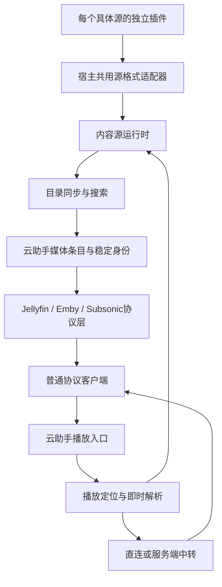

# 云助手内容源插件与标准媒体协议接入方案

## 1. 方案状态与目标

- 编写日期：2026-10-11。
- 状态：电影天堂、虎牙、金鹰、魔都、猫眼和光速已作为独立可导入的 CMS 视频插件接入；通用 Python Spider 宿主及咕噜咕噜、青麦影视、蚕驰短剧、黄豆短剧、白嫖者联盟五个独立 `.py` 插件已接入，标准 Jellyfin／Emby 后台完整流程此前在临时独立数据库核对。网易云以独立音乐插件通过 Navidrome 提供内容；全新安装默认没有内容源插件，管理员导入后启用。各源的实际验证范围见实施记录，手机客户端完整播放仍待验证。
- 本次范围：新增黄豆短剧和白嫖者联盟两个独立 Python 插件，列表与实时搜索只返回摘要，详情、季集与播放时按需补齐；同步到 `FlyPlugin/helper/`，随后导入飞牛并启用，记录真实源核对结果。复用已有 Jellyfin／Emby 接口，不修改客户端、网盘服务、数据库结构或已有媒体库数据；此前各轮实施和部署保留在第 20 节。
- 目标：在 FlyCloudHelper 中建立独立的内容源插件体系，承载视频、短剧、番剧和音乐的目录、搜索、详情及播放解析，通过标准 Jellyfin、Emby、Subsonic/OpenSubsonic 接口供客户端使用。
- 原则：客户端只需添加普通协议服务，不安装源脚本，不依赖云助手内部媒体目录 API，不接收 TVBox、洛雪或鱼书专用业务字段。
- 插件粒度：每个具体站点、内容来源或独立音源打包为一个插件，分别安装、更新、停用和排查；CMS、JS、Python、DRPY2、KazumiRules、LX 等格式适配与运行能力由云助手共用。

第 1 至 19 节保留视频、短剧、番剧和音乐的总体设计；第 20 节记录历次实施，CMS 和网易音乐见第 20.2 至 20.30 节，在线库改名见第 20.31 节，通用 Python Spider 与咕噜咕噜首源见第 20.32 节，创建完成后手动开启影视协议见第 20.33 节，插件新增与媒体库引用及防重见第 20.34 节，卸载隐藏及 Python 脚本修复导入见第 20.35 节，NAS 部署见第 20.36 节，内容源通用 HLS 兼容见第 20.37 节，源站解析异常及连接处理见第 20.38 节。JS、DRPY2 和需要额外伴随模块、本地代理或浏览器的复杂源仍需后续适配，代码接入不代表手机客户端功能已验证。

### 1.1 内容与协议范围

| 内容 | 首批输出协议 | 标准目录结构 | 后续扩展 |
| --- | --- | --- | --- |
| 电影、普通视频 | Jellyfin、Emby | Movie；符合条件的视频节目使用 Series/Season/Episode | 多源同片、更多字幕与版本能力 |
| 短剧 | Jellyfin、Emby | Series → Season → Episode | 来源更新、跨源分集匹配 |
| 番剧 | Jellyfin、Emby | Series → Season → Episode；剧场版为 Movie | 特别篇、字幕、多线路 |
| 音乐 | Subsonic/OpenSubsonic，供兼容 Navidrome 的客户端连接 | Artist → Album → Song；Playlist 另行维护 | Jellyfin/Emby 的 MusicArtist、MusicAlbum、Audio 输出 |

这里的“Navidrome 协议”指兼容客户端通常使用的 Subsonic/OpenSubsonic 接口，不等于实现 Navidrome 全部原生管理接口和自带 Web 前端。音乐经 Jellyfin/Emby 输出列入扩展阶段，不能当作当前视频协议层已有能力。Subsonic 虽有历史视频接口，本方案不把短剧、番剧和电影放入音乐服务。

### 1.2 首批边界

1. 支持媒体目录、分页查询、搜索、详情、可播放版本、即时取址、直连或中转、标准协议账号状态。
2. 提供每个具体源的独立插件包，以及安装、配置、启停、版本更新、回退、目录同步和运行日志。
3. 保留既有网盘库和元数据插件；新内容源与网盘来源分别管理。
4. 首批建立独立的在线影视库和在线音乐库，不把网上内容伪装成网盘文件。
5. 不引入视频或音频转码，不落盘保存媒体正文；目录、必要凭据和用户状态可以持久保存。
6. 不保证任意 TVBox 配置、Python 脚本或 HTML 可直接运行；支持范围按适配器和实际源验证结果声明。
7. DRM、强制交互验证和无法取得媒体数据的源，不列为首批可播放能力。

## 2. 当前项目基础与缺口

以下结论来自编写时的仓库静态检查，不代表生产容器和客户端已验证。

| 领域 | 当前基础 | 本方案需要补充 |
| --- | --- | --- |
| 插件 | `api/src/plugin-manager.ts` 仅接受协议版本 1 的 `media_metadata` 声明式插件；禁止 HTML、JS、Python 等文件 | 内容源和音乐解析器类型、运行时、安装管理与源实例配置 |
| 来源 | `api/src/providers/registry.ts` 注册网盘 Provider；契约主要围绕目录枚举和文件定位 | 面向在线内容的分类、搜索、详情和取址契约 |
| 媒体库 | 已有 `media_libraries`、`library_sources`、`media_items`、关系和源文件数据 | 在线目录身份映射、内容源绑定与非文件播放版本 |
| Jellyfin/Emby | 已有登录、列表、详情、季集、PlaybackInfo、图片、播放和观看状态链路 | 将播放来源从源文件扩展为文件来源或内容来源；在线库鉴权与目录查询 |
| 音乐 | 已有艺术家、专辑、歌曲、封面、歌词、歌单和账号偏好 | 在线歌曲目录、平台歌曲身份和音乐解析器 |
| Navidrome/Subsonic | `streamSong` 通过条目关联文件和网盘取址播放 | 按歌曲关联的内容播放版本解析和传输；保留原网盘音乐路线 |
| 中转 | 已有 HTTP 字节流、请求头和 Range 处理 | HLS 清单、子清单、分片、密钥、字幕的完整中转和取址更新 |
| 任务 | 已有队列、状态、取消、定时任务和日志 | 内容目录同步、选集刷新、失败重试与源健康状态 |

特别注意：Jellyfin、Emby 登录和账号主体已经按媒体库工作，可以复用；部分控制台目录查询、协议设置和实际取流仍通过 `cloud_services` 或源文件找来源。仅新增解析器不能使在线库自动工作，需要补齐在线库创建、目录查询和非文件播放来源。Navidrome 在线音乐还需另行适配，不能从视频接入结果推断音乐已完成。

当前工作区包含其他尚未提交的代码与文档改动。本方案不修改或重新解释这些改动；后续实施应再次检查仓库状态。

## 3. 用户提供文件的适配定位

分析材料位于 `/Users/shijianting/Pictures/flymby/🐛/`。材料内的 README 和注释仅作为技术资料，不作为操作授权。

| 材料 | 可复用能力 | 服务端适配要求 |
| --- | --- | --- |
| `UBOX-0.2.11.html` | TVBox/CMS/JS/DRPY2 配置解析、目录查询和播放解析 | 拆出非 UI 逻辑；替换鱼书网络、存储、Python 与播放桥接 |
| `avbox-html.zip` | 页面之外的协议引擎、Python 基类/适配器、代理实现参考 | 作为源码参考；不整体导入其备份、页面、旧版本和开发文件 |
| `Ubox源.zip` | Python 站点脚本、JS Spider、TVBox 聚合配置 | 按站点格式分别适配；普通 API、JS、Python、csp Spider 不视为同一种运行方式 |
| `fishreader-minireel-1_1791309514238.html` | 红果短剧推荐、搜索、详情、选集和取址 | 提取目录与请求逻辑；用服务端源实例维护所需会话与身份 |
| `kazumi-fishreader-1.0.22.html` | Bangumi 资料、番剧日历、KazumiRules 搜索与选集 | 区分资料源和播放源，保存二者对应关系 |
| `落雪音乐-2.0-新版.html` | 平台歌曲搜索、歌词、歌单、不同音源格式与播放解析 | 音乐目录与音源解析分别适配；不移植网页播放器和队列 UI |
| `fishreader-store-1.7.14.html` | 扩展版本、安装更新和仓库交互参考 | 不作为媒体源；首批由云助手现有管理页面承担安装和更新 |

带 `(1)` 的两组压缩包是相同内容的重复文件。独立 UBOX 文件与源码包中的同版本构建产物一致。

HTML 是包含业务代码和宿主桥接调用的完整页面，不是标准服务端插件。首批不提供“任意 HTML 导入后自动转换”；针对上述材料制作独立适配插件。以后若支持原始 JS/Python 导入，也必须经过对应适配器校验。

### 3.1 现成材料清点与状态

2026-10-11 已在原压缩包中静态确认：

- `Ubox源.zip`：19 个 Python 源、1 个 JS 源 `avdb.js`、45 条 TVBox 站点配置及订阅链接文本。
- 45 条站点配置的 `type` 分布：0 类 27 条、1 类 16 条、3 类 1 条、4 类 1 条。配置没有提供有效的顶层 `spider` 实现引用；唯一 3 类条目使用 `csp_Nostr`。
- `avbox-html.zip/sources/`：1 个 Python 源 `秒播看片.py` 和 2 个 DRPY2 源规则。
- Kazumi HTML：内置 `DM84`、`7sefun` 两条回退规则，并有在线规则仓库加载逻辑。在线仓库其他规则未在本次下载或清点。
- 红果短剧 HTML：有目录、搜索、详情和取址代码；可以作为专用插件的适配材料。
- 洛雪音乐 HTML：包含 QQ 音乐、网易云、咪咕、酷狗、酷我相关目录/搜索/歌词代码和音源加载代码；目录内未见单独的洛雪音源 JS 文件。

这些是“已有原始脚本、规则、接口配置或可提取业务代码”，尚无本文约定的云助手独立插件包。未执行脚本、请求站点或验证媒体播放；数量不等于可发布插件数量，不把重复配置、同站不同实现和演示源当作独立商业内容库统计。

### 3.2 Python 源逐项适配清单

每一行作为一个独立插件候选。下面的内容标签只用于适配分组，最终电影/短剧/成人等分类以源实际返回数据为准。

所有 Python 候选共用以下适配工作：Spider 基类/宿主 HTTP、方法签名、字典或 JSON 字符串结果、分类与分页、稳定原始 ID、详情/选集、`playerContent` 取址、必要请求头和取消清理。源没有某方法时按能力声明缺失，不能补出虚构结果。有 `localProxy` 方法仅证明接口存在，不证明完整代理和清理可用。

| 原始文件 | 独立插件候选 | 额外适配重点 |
| --- | --- | --- |
| `Py源/蓝果仓库.py` | 蓝果仓库源插件 | gzip/base64 结果处理、并发请求与本地代理返回格式 |
| `Py源/蚕驰短剧网.py` | 蚕驰短剧源插件 | 已提供 `插件包/蚕驰短剧源.py`；真实分类、分页、剧/集身份、网页搜索与详情及逐集取址，见第 20.41 节 |
| `Py源/影探4K.py` | 影探4K源插件 | Crypto/AES 依赖、动态模块加载范围、本地代理与媒体请求头 |
| `Py源/青霄视频.py` | 青霄视频源插件 | 网页分类和列表解析、详情分集与播放地址 |
| `Py源/91网爆黑料.py` | 91网爆黑料源插件 | requests、BeautifulSoup 依赖，网页选择器与本地代理 |
| `Py源/白嫖者联盟棒4k.py` | 白嫖者联盟4K源插件 | 已提供 `插件包/白嫖者联盟源.py`；签名目录、真实内容分类与分页、按需详情、多季多线路及即时取址，见第 20.46 节 |
| `Py源/🙈heiliao🔞[密].py` | heiliao源插件 | Crypto/AES、requests 和代理；不能按文件名“密”推断不可解析或保证可运行 |
| `Py源/黄豆短剧.py` | 黄豆短剧源插件 | 已提供 `插件包/黄豆短剧源.py`；AES 签名、真实子分类与搜索摘要、真实分集及授权取址，见第 20.46 节 |
| `Py源/枫叶4k.py` | 枫叶4K源插件 | requests、BeautifulSoup、base64、网页解析和本地代理 |
| `Py源/py源/青麦影视.py` | 青麦影视源插件 | 已提供 `插件包/青麦影视源.py`；匿名设备会话、真实分类与搜索分页、原线路与集 ID 即时取址，见第 20.41 节 |
| `Py源/py源/非凡去广.py` | 非凡去广源插件 | 并发解析、媒体清单处理与代理；核对过滤逻辑，不声称任意媒体自动去广告 |
| `Py源/py源/青鸟影视.py` | 青鸟影视源插件 | requests/urllib3、线程与并发、代理服务的启动及退出清理 |
| `Py源/py源/高清仓库 (1).py` | 高清仓库源插件 | HTML 转义、分类/详情/取址；文件名后缀保留为材料名，插件身份不使用下载序号 |
| `Py源/py源/暴风去广.py` | 暴风去广源插件 | 并发、base64、媒体清单/代理过滤与 Range/HLS 行为 |
| `Py源/py源/光速资源.py` | 光速资源源插件 | base64 与媒体代理、分类分页和请求头传递 |
| `Py源/py源/牛牛短剧.py` | 牛牛短剧源插件 | requests、BeautifulSoup、短剧季集模型和本地代理 |
| `Py源/py源/AVBeBe (1).py` | AVBeBe源插件 | 网页实体与详情/播放解析；检查无独立首页推荐方法时的能力展示 |
| `Py源/py源/量子去广.py` | 量子去广源插件 | 并发、base64、媒体清单/代理过滤；不能与同名采集接口条目自动视为同一源 |
| `Py源/真红果.py` | 真红果Python源插件 | Crypto、requests/urllib3、HTTP 服务、socket、线程及本地代理；单独核对端口、会话、临时目录与取消清理 |

表内路径相对 `Ubox源.zip/Ubox源/`。例如已有请求签名、解密或代理逻辑，在正式插件中应保持其必要业务行为，再替换宿主接口；不能只包装方法名就宣称迁移完成。

`真红果.py` 与红果短剧 HTML 是两份不同实现材料。分别登记候选和适配状态，优先比较依赖、取址完整性与生命周期后选择先接入的一条路线；没有原始身份和实现等价证据时不共用插件 ID 或重复导入目录。

### 3.3 JS、DRPY2 与附带 Python 源

| 原始材料 | 独立插件候选 | 对应适配工作 |
| --- | --- | --- |
| `Ubox源.zip/Ubox源/avdb.js` | avdb源插件 | CatVod JS 的初始化、目录、详情、搜索与播放方法；提供 `req`/`request` 兼容，处理同步宿主请求约定与结果字段 |
| `avbox-html.zip/avbox-html/sources/秒播看片.py` | 秒播看片源插件 | Spider、网页分类/搜索/详情、允许分类过滤、并发请求和取址；材料说明其路线为 HTML 页面解析，不能当作标准 CMS JSON 接口 |
| `avbox-html.zip/avbox-html/sources/drpy2_public_demo_v2.js` | DRPY2公开演示源插件 | DRPY2 规则环境、规则内置目录、搜索与媒体解析；用于阶段性人工验证，不能将演示目录当成完整影视站 |
| `avbox-html.zip/avbox-html/sources/w3c_accessibility_drpy2.js` | W3C无障碍视频源插件 | DRPY2 规则、公开视频目录、详情和播放解析；无需依赖用户影视账号，但实际地址可达性仍未验证 |

DRPY2 两项共用宿主引擎，各自包含自己的规则和 Manifest，不合并成一个无法分别停用/更新的“DRPY2总插件”。

### 3.4 TVBox 配置的独立源候选

原始位置：`Ubox源.zip/Ubox源/Tvbox/Tvbox聚合源.json`。下面按配置顺序列出全部 45 条候选；每条最终对应自己的插件包和版本。显示名不充当永久插件 ID，地址不写入本文，以免复制凭据或短期链接。

适配任务代号：

- **C0**：type 0 采集接口候选。确认实际 JSON/XML 格式，适配分类、列表、搜索、详情、分页和选集/取址，保留所需请求头。
- **C1**：type 1 采集接口候选。确认实际字段和 JSON 等响应格式，处理线路/集数编码及播放解析。
- **C4**：type 4 接口候选。核对外部服务的实际方法、扩展参数、分页和播放协议，不能仅凭类型等同 CMS。
- **C3**：`csp_Nostr`。需要找到对应 Spider 实现和可运行依赖；当前材料不能提供完整实现证据，先登记，未具备条件时不发布为可播放插件。

| 序号 | 配置中的源名称 | 独立插件候选 | 适配任务 |
| --- | --- | --- | --- |
| 1 | Nostr推荐 | Nostr推荐源插件 | C3 |
| 2 | 电影｜天堂 | 电影天堂源插件 | C1 |
| 3 | 暴风｜资源 | 暴风资源源插件 | C1 |
| 4 | 天堂｜资源 | 天堂资源源插件 | C0 |
| 5 | 快龙｜资源 | 快龙资源源插件 | C0 |
| 6 | 最大｜资源 | 最大资源源插件 | C0 |
| 7 | 虎牙｜资源 | 虎牙资源源插件 | C1 |
| 8 | 独播｜资源 | 独播资源源插件 | C0 |
| 9 | 牛牛｜资源 | 牛牛资源源插件 | C0 |
| 10 | 鸭鸭｜资源 | 鸭鸭资源源插件 | C0 |
| 11 | 飘凌｜资源 | 飘凌资源源插件 | C1 |
| 12 | 无尽｜资源 | 无尽资源源插件 | C0 |
| 13 | 卫士｜资源 | 卫士资源源插件 | C1 |
| 14 | 闪电｜资源 | 闪电资源源插件 | C0 |
| 15 | 卧龙｜资源 | 卧龙资源源插件 | C0 |
| 16 | 索尼｜资源 | 索尼资源源插件 | C0 |
| 17 | 量子｜资源 | 量子资源源插件 | C1 |
| 18 | 高清｜资源 | 高清资源源插件 | C1 |
| 19 | 魔都｜资源 | 魔都资源源插件 | C0 |
| 20 | 百度｜资源 | 百度资源源插件 | C0 |
| 21 | 新浪｜资源 | 新浪资源源插件 | C0 |
| 22 | 非凡｜资源 | 非凡资源源插件 | C1 |
| 23 | 茅台｜资源 | 茅台资源源插件 | C0 |
| 24 | 动漫｜资源 | 动漫资源源插件 | C4 |
| 25 | 蜜桃｜资源 | 蜜桃资源源插件 | C1 |
| 26 | 金鹰｜资源 | 金鹰资源源插件 | C1 |
| 27 | 猫眼｜资源 | 猫眼资源源插件 | C1 |
| 28 | 樂吧社｜(🔞) | 樂吧社源插件 | C1 |
| 29 | 番号院｜(🔞) | 番号院源插件 | C0 |
| 30 | 大地会｜(🔞) | 大地会源插件 | C0 |
| 31 | 苹果园｜(🔞) | 苹果园源插件 | C0 |
| 32 | 淫水机｜(🔞) | 淫水机源插件 | C0 |
| 33 | 美少女｜(🔞) | 美少女源插件 | C0 |
| 34 | 香奶儿｜(🔞) | 香奶儿源插件 | C0 |
| 35 | 开心果｜(🔞) | 开心果源插件 | C0 |
| 36 | 色南国｜(🔞) | 色南国源插件 | C0 |
| 37 | 老色逼｜(🔞) | 老色逼源插件 | C0 |
| 38 | 越资源｜(🔞) | 越资源源插件 | C0 |
| 39 | 九九八｜(🔞) | 九九八源插件 | C0 |
| 40 | 玉兔儿｜(🔞) | 玉兔儿源插件 | C1 |
| 41 | 奶香院｜(🔞) | 奶香院源插件 | C1 |
| 42 | 百万佳｜(🔞) | 百万佳源插件 | C1 |
| 43 | 桃花树｜(🔞) | 桃花树源插件 | C0 |
| 44 | 金坤社｜(🔞) | 金坤社源插件 | C0 |
| 45 | 998｜🔞 | 998源插件 | C1 |

这 45 项只确认配置存在，不能推断服务在线、站点资料完整或可播放。配置没有附带每个站点的服务端源码。采集接口源可以使用共用适配器和很小的站点规则包，但仍独立发布、更新和管理。

TVBox 聚合 JSON 是源清单输入材料，不直接作为覆盖全部站点的运行插件。后续支持订阅导入时应预览、识别类型、去重并选择条目，再分别制作/匹配独立源插件；首批可先由维护者转换为正式插件包，不承诺任意订阅自动转换。

配置中的 `lives`、`parses`、`headers`、`flags`、`ijk` 和 `ads` 另行分析：直播项不属于本次点播/音乐范围；解析器是取址依赖，不是影片目录源；请求头按来源绑定；播放器配置不能原样要求普通客户端执行；过滤规则也不作为独立内容源。

### 3.5 从 HTML 提取的短剧、番剧与音乐候选

| 现成材料或能力 | 独立插件候选 | 对应适配工作与缺口 |
| --- | --- | --- |
| 红果短剧 HTML | 红果短剧源插件 | 拆出推荐、搜索、详情、分集、签名/响应处理和取址；替换 FishReader/fm/WebView 桥接，维护服务器会话；去除 DOM、路由、播放器 UI 和切集事件依赖 |
| Kazumi 内置 DM84 规则 | DM84番剧源插件 | 提取该站规则，适配搜索/详情/选集和网页解析；独立声明站点版本与所需请求头 |
| Kazumi 内置 7sefun 规则 | 7sefun番剧源插件 | 同上；与 DM84 分别安装、更新、停用，不以 KazumiRules 格式作为合并依据 |
| Kazumi 的 Bangumi 资料逻辑 | Bangumi番剧资料插件候选 | 保留番剧资料/日历和站点身份映射；按实际职责决定元数据或目录能力，不把资料查询当作可播放地址源 |
| 音乐 HTML 的 QQ 音乐代码 | QQ音乐目录源插件候选 | 提取已有搜索/推荐/榜单/歌词和歌曲身份；逐项核对专辑/歌手方法与平台登录态，缺失能力另行补齐 |
| 音乐 HTML 的网易云代码 | 网易云音乐目录源插件候选 | 同上，提取平台请求、歌曲/专辑/歌手身份；不能仅凭页面存在歌单就声称完整专辑接口已实现 |
| 音乐 HTML 的咪咕代码 | 咪咕音乐目录源插件候选 | 提取已有搜索、歌词与资料字段，核对目录覆盖范围和平台身份 |
| 音乐 HTML 的酷狗代码 | 酷狗音乐目录源插件候选 | 提取搜索、歌词和平台歌曲标识，适配平台请求与真实音频版本关系 |
| 音乐 HTML 的酷我代码 | 酷我音乐目录源插件候选 | 提取搜索、歌词和平台身份，明确已有目录功能与待补专辑/歌手能力 |
| 音乐 HTML 的 LX 加载器 | 每个具体洛雪音源独立为音乐解析器插件 | 宿主共用 LX 事件/请求兼容层；用户或维护者另行提供音源 JS，再独立包装。当前目录没有可据此发布的单独音源脚本 |

音乐表中五个平台为“已有平台相关代码的适配候选”，不是五个已完成的服务端源包。目录能力和播放能力分别核对；某平台可搜索/取歌词不代表直接可取得可播放音频。

Kazumi 在线规则仓库的其他站点也按每条具体来源规则独立打包，但不将本次未取得的规则加入现成清单。UBOX/AVBox 与洛雪音乐的界面壳、鱼书仓库页面均不整体发布为聚合内容源插件。

### 3.6 适配状态与顺序

上述候选当前统一状态为“材料已静态清点，未适配、未运行、未发布”。维护清单需分别记录：材料路径/校验值、最终插件 ID、原始来源身份、运行格式、依赖、目录能力、播放能力、适配完成范围、真实源验证与标准客户端验证结果。

优先选择一个协议简单且实际可用的采集接口源制作独立插件，打通 Jellyfin/Emby；DRPY2 演示源可用于人工检查引擎，不代替生产内容源验证。短剧优先比较红果 HTML 与 Python 路线；番剧先接材料内两条规则；音乐先确定一个目录平台和可用解析器配对。其余 Python 和 45 条配置按源逐项推进，不因首个插件成功而整体标记支持。

## 4. 总体架构



各层职责：

- 插件包：对应一个具体站点、目录来源或音源，包含自身规则/代码与能力声明；有独立 ID、版本和生命周期。
- 内容源实例：同一具体源插件在某个用户下的地址、账号或其他配置；同插件可创建多个实例，但不以实例代替其他不同站点的独立插件。
- 格式适配器：云助手宿主共用能力，处理 CMS、TVBox、Python Spider、DRPY2、KazumiRules、洛雪等原始约定，不要求用户为每个源重复安装运行环境。
- 内容源服务：向目录和播放层提供统一业务结果，不将原始协议字段传给客户端。
- 媒体库：确定内容范围、同步规则、协议开关、账号和用户状态。
- 播放解析器：根据稳定内容定位，在播放时取得真实媒体地址。
- 协议层：只使用标准实体、字段、请求参数和错误格式；不要求客户端认识内容源插件。

元数据插件继续负责补充标题、简介、海报和外部 ID。其安装包规则和调用接口不通过“取消禁止文件类型”直接改造成内容源运行器。

## 5. 插件与运行时设计

### 5.1 每个具体源独立打包

采用“一个具体源一个插件，共用运行环境”的发布方式：

1. 每个站点脚本、采集接口来源、番剧站点规则、音乐目录平台和独立音乐音源各自打包。
2. 每个插件有独立永久 ID、名称、版本、说明、能力、配置项和更新来源；一个插件的更新或停用不操作其他源插件。
3. CMS 等简单接口插件可以只含 Manifest 和站点规则，复杂源包含 JS/Python 代码；二者都属于独立插件。
4. 同一站点的镜像地址/不同账号可配置多个实例；不同站点使用同一种格式，也仍分别发布插件。
5. 同一个平台有多个第三方音源时，每个音源有独立解析器插件身份，通过显式平台绑定与目录插件协作。
6. 相同材料重复下载不创建新插件。不同格式的同站实现先登记候选，确认身份与维护路线后再确定是否共用版本体系。
7. 共用 CMS、JS、Python、DRPY2、KazumiRules、LX 能力由宿主维护，源插件不重复打包解释器、整套引擎和其他站点代码。

例如“牛牛短剧源插件”“枫叶4K源插件”“DM84番剧源插件”“QQ音乐目录源插件”“某个洛雪音源插件”分别安装。Python、DRPY2 或 LX 只是这些插件声明使用的格式/运行能力，不作为包含所有具体源的总插件。

### 5.2 插件类型

| 类型 | 职责 | 典型实例 |
| --- | --- | --- |
| `media_metadata` | 既有刮削补全能力 | TMDB/其他资料查询 |
| `content_source` | 目录、搜索、详情、选集/歌曲和播放版本；可以同时实现取址 | CMS、红果、番剧站点、音乐平台目录 |
| `music_resolver` | 输入平台歌曲身份和音质，返回音频访问结果 | 标准洛雪音源 |

视频、短剧和番剧属于内容分类，不分别创建三套安装体系。`content_source` 用 `mediaTypes` 和能力声明说明支持范围。资料源、音乐解析器与内容源之间通过显式绑定协作。

### 5.3 包结构与 Manifest

建议内容源包采用 `.flycloud-source.zip`，与既有 `.flymby-plugin` 分开识别。此后缀是拟议名称。

```text
牛牛短剧源.flycloud-source.zip
├── manifest.json
├── entry.js 或 entry.py 或 rules.json
├── assets/                 可选图标和静态资料
├── dependencies.json       可选依赖声明
├── 使用说明.md
└── LICENSE                 适用许可证与版权信息
```

Manifest 建议包含：

| 字段 | 含义 |
| --- | --- |
| `id`、`name`、`version` | 稳定插件身份与版本 |
| `protocolVersion` | 云助手内部插件契约版本，与 Jellyfin/Emby/Subsonic 版本无关 |
| `pluginType` | `content_source` 或 `music_resolver` |
| `mediaTypes` | `video`、`music`；短剧/番剧以内容标签声明 |
| `runtime`、`entry` | `declarative`、`javascript` 或 `python` 及入口 |
| `sourceFormats` | CMS、TVBox-JS、DRPY2、Python-Spider、KazumiRules、LX 等 |
| `sourceIdentity` | 该具体站点/平台/音源的稳定身份与内部命名空间，地址可变但身份不能随显示名变化 |
| `hostCapabilities` | 使用的宿主适配器和最低能力版本，例如 Python-Spider/LX；不重复携带引擎 |
| `capabilities` | 分类、搜索、分页、详情、剧集、歌曲目录、取址、歌词、字幕、增量同步等 |
| `configurationSchema` | 地址、订阅、账号、凭据、解析器绑定等配置项 |
| `minimumHostVersion` | 最低云助手版本 |
| `updateUrl` | 可选更新来源；首批可仅支持手动上传新版本 |
| `license` | 使用与分发许可信息 |

能力必须与方法实现相符。不声明或不支持的能力在管理页面明确展示，不返回虚构成功结果。安装包内不放用户账号和长期凭据，具体配置保存于源实例。

### 5.4 运行环境

1. 声明式 CMS/API/KazumiRules 优先使用宿主适配器，不为简单规则启动完整脚本环境。
2. JavaScript 源采用可取消的独立运行进程；宿主提供 HTTP、必要存储、日志、定时器和所需兼容 API。单纯 `node:vm` 或 Worker 不能被宣称为完整安全沙箱。
3. Python 源使用独立 Python 运行进程，提供 Spider 基类、请求接口和经适配确认的依赖；不运行依赖鸿蒙桥接的原页面代码。
4. Python 运行时可作为对应镜像的可选能力；部署没有解释器或依赖时，在安装/启用阶段报告，不拖到首次播放才发现。
5. Python 依赖由宿主镜像或受控依赖包提供。源插件不能默认在每次运行时自行执行 `pip install`。
6. 支持超时、取消、并发限制和进程清理。需要线程或本地代理的源必须能随任务/会话结束释放资源。
7. 配置、存储和网络会话按源实例隔离；不因同插件而共用不同用户的登录态。
8. 普通 HTTP 请求可优先适配；需要浏览器嗅探的来源作为单独扩展能力，不默认把浏览器加入所有部署。

TVBox `csp_*` 不是“必定可运行的 JS”。JAR、DEX、Android Java 和原生 `.so` 依赖需要另外的运行环境，不列入通用 JS/Python 首批支持范围。

### 5.5 源的制作、安装和导入流程

首批以正式独立插件包为运行入口：

```text
维护者取得某个源的脚本/规则/接口配置
→ 确认来源身份、所需格式与依赖
→ 替换宿主接口并映射内容与播放结果
→ 为该源编写独立 Manifest、说明和规则/入口
→ 发布该源的独立插件包
→ 管理员安装插件
→ 用户为该插件创建自己的配置实例
→ 检查能力与依赖
→ 绑定影视/音乐媒体库并同步目录
→ 开启标准协议，客户端添加服务
```

安装与使用权限复用现有管理员/用户边界：管理员管理可执行插件包，用户配置自己可使用的源实例、凭据与媒体库。安装一个插件不自动使用其他用户账号或创建其媒体库。

| 原始材料 | 维护者制作方式 | 用户安装后的配置 |
| --- | --- | --- |
| CMS/API 地址 | 为该具体来源生成独立规则包，引用宿主 CMS 适配器 | 该源允许的接口/镜像地址、请求配置和必要凭据 |
| JS/DRPY2 文件 | 一份具体站点脚本/规则对应一个包，补齐 Manifest 与宿主调用 | 地址、账号和站点扩展参数 |
| Python 文件 | 一份具体源对应一个包，声明 Spider 能力与实际依赖 | 地址、账号、源参数；宿主依赖由部署提供 |
| KazumiRules 规则 | 每条具体站点规则单独打包；资料插件按职责单独绑定 | 站点配置与资料匹配设置 |
| 洛雪音源 JS | 每个具体音源单独包装为 `music_resolver` | 源参数、默认音质及目录平台绑定 |
| HTML 页面 | 先拆出取源业务，再按具体站点/平台制作独立包 | 源插件声明的配置项，不导入网页 DOM 和播放器 |
| TVBox 订阅/聚合 JSON | 解析成候选列表，按站点拆分并制作/匹配插件 | 选择已支持来源的实例配置，不把整份订阅当成一个总插件 |

后续可以增加原始脚本上传、URL 或订阅导入辅助功能，但生成/匹配结果仍是多个独立插件，而不是绕过 Manifest 执行任意材料。无法识别实现或缺少依赖的条目显示未支持原因。

插件代码通过版本管理更新：远程脚本地址变化要先取得并校验新版本，再切换实例；不在每次播放时悄悄执行 URL 上最新代码。源接口/镜像地址则属于实例配置，配置变更记录修订并清理相关短期缓存。

## 6. 内容源内部契约

### 6.1 方法与上下文

以下是拟议方法，客户端不直接调用。

| 方法 | 职责 | 必要性 |
| --- | --- | --- |
| `validateConfiguration` | 校验地址、账号及依赖可用性 | 必须 |
| `getCapabilities` | 返回实例实际支持能力 | 必须 |
| `listCategories` | 分类/频道/题材入口 | 按能力 |
| `listItems` | 分类、榜单、推荐等分页内容 | 按能力 |
| `searchItems` | 搜索影片、节目、歌曲、专辑或歌手 | 按能力 |
| `getItemDetail` | 获取完整资料和外部身份 | 目录源必须 |
| `listEpisodes` | 节目季集及稳定分集身份 | 分集源必须 |
| `listAlbumTracks` | 专辑歌曲和真实排序 | 专辑源按能力 |
| `listPlaybackSources` | 可播放线路、版本、音质等 | 提供播放目录的内容源必须；纯解析器由绑定能力确定 |
| `resolvePlayback` | 根据稳定定位获取即时访问结果 | 可播放内容必须 |
| `getLyrics`、`listSubtitles` | 歌词/字幕 | 按能力 |
| `syncChanges` | 增量更新或游标同步 | 按能力 |
| `dispose` | 清理运行任务、代理和临时资源 | 有资源生命周期时必须 |

上下文由宿主提供：用户/源实例身份、配置修订、插件版本、HTTP 客户端、实例存储、取消信号和日志。一次请求内固定版本和配置快照，避免执行中途更新造成目录与取址规则混用。

纯 `music_resolver` 只实现其配置/能力/取址及必要清理接口，不强制实现分类、搜索或条目详情。目录插件与解析器分别声明版本和平台身份，运行绑定同时记录双方快照。

### 6.2 条目结果

所有条目都有上游稳定 `sourceItemId`、标题和内容类型。公共字段可包含简介、海报、年份、首映日期、外部 ID、来源状态和更新标识。

- 视频额外包含电影/节目类别、季集、时长、演员、地区与字幕信息。
- 音乐额外包含平台歌曲 ID、歌手/专辑原始身份、参与歌手、时长、曲号、碟号、歌词和可用音质。
- 原始站点扩展信息允许保存在内部受控字段，协议层仅映射实际需要的标准字段。
- 字段未知时保存未知，不伪造时长、文件大小、编码、专辑身份和已完成探测状态。

### 6.3 分页与取址结果

目录结果返回 `items`、下一页/游标、`hasMore`，总数只在上游可靠提供时填写。不得将上游“页码”直接当作客户端 `StartIndex` 或 Subsonic 偏移。

播放定位长期保存来源实例、原始条目/分集/歌曲身份、稳定线路或音质标识、必要无凭据参数。临时取址结果包含：

- HTTP 地址、格式、MIME、必要请求头和已知有效期。
- 是否要求同一会话、来源 Cookie、特定 UA 或 IP。
- 是否可重取地址、是否支持 Range、可用字幕及已知规格。
- 需要网页解析时的明确解析器调用结果或失败原因。

运行时拿到结果后，由宿主决定传输策略。插件不创建对外协议账号，不返回云助手协议令牌，不自行生成客户端专用播放接口。

## 7. 数据模型与稳定身份

### 7.1 推荐新增记录

优先新增在线内容专用记录，复用媒体条目和关系表；不将新源强行插入必须有网盘服务的旧来源结构。

| 拟议记录 | 核心职责 |
| --- | --- |
| `content_source_instances` | 用户配置的源实例：独立插件 ID、具体来源身份、选定版本、配置修订、启停、凭据引用、健康状态 |
| `content_library_sources` | 在线媒体库与源实例关联：内容范围、同步策略、优先级 |
| `content_item_bindings` | 上游原始身份到 `media_items` 的映射及同步状态 |
| `content_playback_sources` | 条目对应的播放定位、版本/线路/音质、状态及资料；不保存永久直链 |
| `content_sync_jobs` 或既有任务扩展 | 同步范围、检查点、版本快照、统计、取消与失败信息 |

任务优先复用现有后台任务机制，是否新增独立任务表在实施前按当前任务字段确定。插件版本目录可共享现有管理基础，但源实例配置与管理员的全局元数据插件配置分开。

`media_libraries` 增加在线内容库种类；`data_type` 仍区分影视/音乐。既有 `library_sources` 保持网盘服务关系，`source_files` 保持真实文件定位。在线库使用新绑定，不创建虚假目录、文件大小或网盘服务。

协议层增加统一的“可播放来源”查询：文件来源调用现有 Provider；内容来源调用 ContentSource。播放、下载和规格字段同时适配，不能只修改 `stream` 单一入口。

### 7.2 身份与去重

1. 源实例有永久内部 ID，修改显示名、插件版本、地址或配置不会重新分配。
2. 原始条目唯一键至少包含用户、媒体库来源绑定、上游命名空间、条目类型和原始 ID。
3. `media_items`、季、分集、歌曲及播放版本使用持久内部 ID；不从临时 URL、数组下标或名称生成协议身份。
4. 分集优先使用上游 ID；若没有，使用来源约定的稳定季集键并保存映射。显示序号只负责排序。
5. 上游更换 ID 时需要显式重绑定或适配器提供可靠旧新映射，不能按同名自动挪用进度。
6. 不同源默认不合并。跨源合并必须有可靠外部 ID 和季集/版本证据，标题相似只作为候选。
7. 音乐不同录音、翻唱、现场版和重制版不因标题相同自动合并。
8. 来源下架先标记不可用，保留条目身份和账号状态；删除媒体库才按既有删除语义清理其目录和状态。

永久插件 ID、具体来源身份、用户实例 ID 和协议媒体条目 ID 分别保存。源从 Python 迁为 JS 不当然建立新内容身份，也不能仅因同名就接管原插件的条目；更换实现必须显式确认身份延续规则。

### 7.3 多源范围

首批以一个内容源实例对应一个独立在线媒体库为实施范围。数据记录带来源绑定身份，保留后续多源能力，但不在首批自动混合网盘和内容源，也不承诺任意跨源自动归组。

后续同片多源以多个 `content_playback_sources` 映射标准 `MediaSources`；新增或删除线路不改变影片/分集身份。不同季集结构无法可靠匹配时保留不同节目。

## 8. 目录建立、搜索与同步

### 8.1 持久目录与动态查询

标准协议详情、收藏和观看状态使用云助手持久目录。分类动态浏览和电影天堂、虎牙实时搜索先建立稳定的媒体身份，再返回标准协议数据，确保列表、详情及后续播放使用相同 ID；其他源搜索和复杂本地筛选沿用已建立目录。

目录建立支持：

1. 管理端按分类、推荐或榜单同步，配置页数/条目范围，不默认抓取整个站点。
2. 管理端搜索源内容，选择导入影片、整部节目、专辑或歌曲。
3. 定时刷新已经导入的条目、分集、新歌和下架状态。
4. 源支持可靠游标/更新标识时使用增量同步，否则按配置范围刷新。

电影天堂和虎牙的普通标准协议搜索查询源站，范围为当前已选视频分类；带收藏、已看或其他本地筛选的搜索仍查询已索引目录。管理页面明确展示这一范围。源推荐/榜单是选材入口，不冒充账号最近播放和播放排行榜。

### 8.2 源站实时搜索

电影天堂、虎牙普通关键词搜索默认查询上游，无需先同步完整目录。按关键词、媒体库、分类及类型维护短期有序窗口，转换上游分页和客户端偏移，过滤所选分类之外的结果并去重；其他源远程搜索按能力后续接入。

远程结果在交给客户端前建立持久条目身份；其详情、收藏、加入歌单和播放始终使用相同 ID。搜索过程中新增缓存条目不自动等于“加入用户资料库”或“最近添加”。详情可按需补全，但普通列表不逐条发起上游播放解析。

不把多个实时上游返回结果随意拼接后声称具有准确总数和稳定分页。

2026-10-11 实施前的只读核对确认：电影天堂和虎牙 CMS 接口均接受 `ac=detail`、`wd=关键词`、`pg=页码`。查询「武神」时，电影天堂返回 14 条／1 页；虎牙返回总计 67 条／4 页，第一页 20 条，返回标题均包含该关键词。两源对无匹配核对词均返回 0 条。随后核对关键词跨页与 `t` 叶分类限定，第二页与第一页无重合，分类搜索仅返回对应分类。原 Ubox 配置也均声明 `searchable: 1`。这些确认源接口能力，协议接入与验证范围见第 20.20 节。

### 8.3 同步与删除判断

- 同步单元按来源、分类、节目或专辑划分，可记录检查点，取消后保留已成功导入的数据。
- 超时、登录失效、限流、分页中断和解析失败都不是“已全部删除”。
- 只有完整且可验证的同步范围，才能据缺失记录判断该范围内容下架。
- 源限流时暂停/延迟该源任务，不拖停其他源或协议目录查询。
- 剧集新增不重建旧集 ID；编号修正不清空已有观看状态。
- 更新元数据保留用户手动编辑，明确来源字段与用户覆盖字段的优先级。

## 9. 视频、短剧与番剧模型

### 9.1 普通视频

- 明确电影使用 Movie；节目按真实季集结构建 Series/Season/Episode。
- 不依据站点栏目名称强行把所有条目转成电影。
- 同一内容的不同线路/版本建立独立播放来源。客户端通过标准 `MediaSourceId` 选择，不要求传源插件字段。
- 不以 `.mp4` 作为未知媒体的默认事实；来源格式和必要规格由解析结果或探测得出。

### 9.2 短剧

- 一部短剧对应 Series，每一集对应 Episode；没有季概念时建立稳定的第 1 季。
- 保存短剧上游剧 ID、分集 ID、原始标题、展示集号和更新状态。
- 连续播放由客户端根据标准分集列表完成；云助手在每集请求时分别取址。
- 插件里的“切集回调”改为服务端单集解析，不依赖鱼书播放器事件。
- 不因一集取址失败删除整部短剧；不可播放集可保留并报告来源问题。

### 9.3 番剧

- Bangumi/TMDB 等资料身份与播放站点身份分别保存，建立明确映射。
- 季番、续作、特别篇和剧场版按真实节目关系组织；缺乏关系证据时保留独立节目。
- 特别篇可映射第 0 季，但不将所有非数字标题都当作特别篇。
- 字幕有语言、格式、来源和有效期，按标准字幕流/交付接口提供；字幕未知时不生成虚假轨道。
- Bangumi 追番状态、评分和评论不直接当作 Jellyfin/Emby 的账号观看状态。
- 弹幕没有三类协议共同的标准交付能力，首批不要求普通客户端具备；可作为云助手扩展管理能力另行设计。

## 10. 音乐目录与音源解析

### 10.1 两种来源能力

音乐目录源负责歌曲搜索、歌曲资料、歌手、专辑、榜单/歌单和歌词；音乐解析器负责按平台歌曲身份、音质取音频地址。一个插件可以提供完整内容源，也可以只实现解析器。

标准 LX 自定义源的非本地平台主要提供 `musicUrl`，不能据安装音源推断有歌曲/专辑/歌手搜索能力。该边界参考 [LX 自定义源官方说明](https://lxmusic.toside.cn/desktop/custom-source)。

目录与解析器绑定应声明平台、身份格式和可用音质。不能按歌曲标题将 QQ 音乐身份交给另一个平台的解析器；确需跨平台匹配时按录音、时长、歌手与版本证据建立映射。

### 10.2 音乐条目规则

- 保存真实平台歌曲、专辑、歌手身份和参与关系，维持 Artist/Album/Song 的一致目录。
- 没有可靠专辑信息的歌曲保留未知状态；需要目录容器时使用明确标记的内部“未归属专辑”，不伪造音乐平台真实专辑。
- 支持多歌手和主歌手，遵循协议实际支持字段；不只拼成一个字符串丢失身份。
- 曲号、碟号、年份、时长、编码、采样率、位深和音质都以可验证数据为准。
- 榜单/上游歌单可以导入歌曲目录；用户编辑的标准歌单单独归协议账号，不写回上游平台。
- 导入歌曲后仍在播放时取地址，歌单不能保存短期签名 URL。
- 歌词按纯文本、逐行和已实现的扩展能力输出；源端逐字歌词不能被宣称所有客户端都会展示。

### 10.3 音质与传输

媒体库可配置默认音质，按解析器支持范围取址。源不支持所选音质时明确返回原因，是否允许降级由库级设置决定，不偷偷换成其他录音版本。

Subsonic 客户端的 `format`、`maxBitRate` 等参数不能直接等同于洛雪音质枚举。没有转码时，不声称能把 FLAC 转成指定码率 MP3；返回原音频或标准错误，按实际格式给 MIME。

首批音乐优先 HTTP 文件流。仅提供 HLS 的音乐源需要额外客户端兼容验证；HLS 清单改写不等于将其转换为普通音频流，不能承诺任意 Navidrome 客户端都支持。

## 11. Jellyfin 与 Emby 标准协议输出

### 11.1 身份、目录与账号

- 继续使用现有 `/j/{后缀}`、`/e/{后缀}` 服务入口，账号归属于媒体库。
- 登录、令牌、库权限与用户状态从媒体库解析，不要求该库关联一个网盘服务。
- 返回标准 Movie/Series/Season/Episode；季集列表、ParentId、SeriesId、SeasonId 和详情互相对应。
- `ProviderIds` 只填写可靠外部身份，标题命中不冒充 TMDB/Bangumi 身份。
- 分别遵循 Jellyfin 与 Emby 的字段、过滤、分页、认证和错误约定，不能仅换响应名称共用所有细节。
- 条目 ID 与 MediaSource ID 在来源排序、版本升级和临时地址更新后保持稳定。

首批沿用并适配的接口组：服务信息和登录、媒体库和 Items 查询、搜索/排序/分页、条目详情、季集、图片、PlaybackInfo、媒体流、收藏、播放状态上报。接口覆盖以目标客户端实际调用为准，不声称已经完整替代全部 Jellyfin/Emby 服务。

### 11.2 PlaybackInfo 和媒体流

1. 根据标准条目 ID 查找持久播放来源，按 `MediaSourceId` 确定版本。
2. 创建账号归属的播放会话，返回真实 `MediaSources` 和 `PlaySessionId`。
3. 优先给客户端云助手的稳定媒体入口；地址过期由服务端解析器处理。
4. `Protocol`、容器、`MediaStreams`、`RunTimeTicks`、直放能力必须符合实际输出，不能沿用网盘文件模板中的虚构路径或规格。
5. HLS 按标准媒体源/HLS 交付方式提供，不给所有 HLS 内容套用 MP4 文件流响应。
6. 未实现转码时 `SupportsTranscoding` 为 false，不生成无法工作的 `TranscodingUrl`。
7. 普通客户端不需要 `FlyCloudPlaybackRoute` 等私有参数，传输策略由媒体库配置和服务端能力决定。
8. 下载按权限和源能力提供；只有 HLS 时不将清单下载宣称为完整 MP4 下载。

Emby 播放信息的标准来源参考 [PlaybackInfo 官方接口](https://dev.emby.media/reference/RestAPI/MediaInfoService/getItemsByIdPlaybackinfo.html)。Jellyfin 季集组织参考 [官方节目结构说明](https://jellyfin.org/docs/general/server/media/shows/)；接口字段实施时应对照相应版本的官方 OpenAPI 与控制器。

### 11.3 观看状态

观看进度、已播放、收藏和最近观看继续归“媒体库 + 协议账号 + 条目”。按照各自协议处理开始、进度、停止及已播放操作；视频时间使用协议要求的 ticks，不能与秒或毫秒直接混用。

同一影片不同播放版本可共享条目进度，但保存最近使用的稳定版本 ID。插件更新、源改名和临时链接变化不清空状态。Jellyfin 与 Emby 账号状态保持现有独立语义，跨协议同步不包含在本方案首批范围。

## 12. Navidrome/Subsonic/OpenSubsonic 输出

### 12.1 入口与数据

继续使用现有 `/n/{后缀}/rest/{方法}`。保持标准认证、XML/JSON 信封和错误格式，以及已有客户端调用所需的 `.view`、查询参数和已支持表单 POST。

以下是重点复用与适配的接口组，完整字段以 [Subsonic 官方 API](https://www.subsonic.org/pages/api.jsp) 为准：

| 能力 | 接口示例 | 在线内容适配 |
| --- | --- | --- |
| 连接/目录 | `ping`、`getMusicFolders` | 媒体库和协议账号不依赖网盘服务 |
| 歌手/专辑/歌曲 | `getArtists`、`getArtist`、`getAlbum`、`getSong` | 在线音乐条目与真实关系 |
| 查询 | `search3`、`getAlbumList2` | 保持独立条目分页和可靠排序；首批查询已索引目录 |
| 媒体 | `stream`、`download`、`getCoverArt` | 稳定歌曲 ID → 内容播放来源 → 即时解析 |
| 歌词 | `getLyrics`；已实现的 `getLyricsBySongId` | 歌词格式按接口与客户端能力输出 |
| 用户状态 | `star`、`unstar`、`scrobble` | 收藏、播放记录和正在播放按账号保存 |
| 歌单 | 创建、查询、更新、删除歌单接口 | 保存条目 ID，不保存临时地址 |

Navidrome 面向第三方客户端使用 Subsonic/OpenSubsonic，参考 [Navidrome 官方概述](https://navidrome.org/docs/overview/)。

### 12.2 播放与状态规则

- `streamSong` 先取得歌曲的可播放来源，再按文件或内容源路线取址；不要求所有在线歌曲存在 `source_files`。
- 依赖上游请求头时由服务端中转；只有无需额外条件的地址才考虑重定向。
- 表单 POST 不将认证表单传给上游，重定向行为复用既有正确处理。
- `scrobble` 表示正在播放/播放记录，不是视频协议式的连续播放位置上报。
- 跨设备歌曲续播若需要书签或队列，单独按已实现的标准书签/队列接口处理。当前 `getBookmarks` 空结果不能被视为已有持久续播能力。
- `getOpenSubsonicExtensions` 仅声明已实现扩展。不能因为返回 `openSubsonic: true` 就宣称支持全部扩展。
- 当前首批不实现 Navidrome 原生 Web 管理 API；只有依赖 Subsonic/OpenSubsonic 的客户端纳入验证范围。

## 13. 即时取址与媒体中转

### 13.1 播放流程

```text
标准协议播放请求
→ 验证媒体库和协议账号权限
→ 查稳定条目与播放来源
→ 按源实例、版本、配置修订和会话取得解析结果
→ 判断直连条件或建立中转
→ 传送媒体数据
→ 接收协议支持的用户状态上报
```

仅播放或必要规格分析时取媒体地址，普通海报墙查询不批量解析所有影片。取址结果只短期缓存，缓存键包含必要用户/源实例、配置修订、条目、版本/音质及会话条件。

源返回有效期时提前留出刷新余量；未知有效期采用有限缓存，并允许失败后重取。并发请求可合并同条件取址，取消一个请求不应错误取消其他仍在使用的请求。

### 13.2 直连条件

- 地址可以由目标客户端直接访问，不依赖服务端 IP、Cookie、会话或客户端无法保证的额外请求头。
- 单个客户端支持 RequiredHttpHeaders 不代表其他客户端都支持；通用默认策略优先中转。
- CDN 重定向后的资源也满足上述条件，才可完整直连。
- 不将云助手协议认证头透传给外部站点。

默认策略为自动选择：满足可靠直连条件时可直连，否则中转。库级强制直连若无法满足条件，明确报告需要中转，不静默给出注定失败的地址。

### 13.3 普通文件流

保留 Range、HEAD、206、Content-Range、Content-Length、Content-Type、取消信号和连接清理。真实拖动能力由上游响应决定；不伪造 Accept-Ranges。

401/403/410 等可重取问题允许在发送正文前进行有限次数重新解析。已发送正文后不能将新地址内容直接拼接到原连接；客户端重连时重新解析并按原 Range 处理。

### 13.4 HLS 完整链路

1. 解析主清单及子清单，按原上游地址解析相对 URL。
2. 按需改写分片、密钥、初始化片段、音轨和字幕 URI，保留时间线和必要属性。
3. 所有中转子资源绑定协议会话与当前播放来源，不能因改写失去账号鉴权。
4. 在同一取址会话中保留上游请求头与 Cookie，重定向后的资源仍按正确上下文读取。
5. 普通 HLS AES 密钥获取与 DRM 是不同能力；密钥中转不代表支持 DRM。
6. 不将两个不同时间线的过期/新清单随意混用。地址更新后不能保证相同分片定位时，报告可恢复失败，由客户端重新打开。
7. 媒体正文不落盘；清单只作有限内存缓存，缓存隔离会话和源配置。
8. 首批只声明实际支持的 HLS 特性，低延迟 HLS、特殊标签或直播时间线作为单独兼容范围。

字幕/封面依赖鉴权时也走服务端访问，但其缓存和有效期与媒体取址分别管理。歌词一般作为资料保存，不与媒体临时链接绑定。

## 14. 管理界面与生命周期

### 14.1 页面职责

- 插件管理：每个具体源单独展示名称、类型、格式、运行时、能力、版本、说明、导入、更新、启停与回退；区分目录插件和仅取址插件。
- 内容源管理：从已安装具体源插件创建实例，配置地址/账号、绑定音乐解析器、检查连接和健康状态；订阅导入辅助入口按第 5.5 节逐项识别。
- 在线媒体库：选择内容源和影视/音乐类型、同步范围、已导入目录、任务、协议开关与账号。
- 源内容浏览：分类/榜单/搜索、查看详情、选择导入；与协议中的已索引资料库区分。
- 运行日志：按来源、任务、条目和错误类型查看，不显示敏感链接或凭据。

复用项目现有管理组件和页面写法，加载状态使用骨架屏。Web 管理端首批不新增网页媒体播放器。

### 14.2 安装、更新、停用与删除

1. 安装插件只增加可用能力，不自动创建媒体库或抓取内容。
2. 创建源实例后检查依赖和配置，再绑定媒体库并同步目录。
3. 更新先保存新版本，验证基本能力后切换实例；当前运行请求保持原版本快照。
4. 回退保留实例、目录和条目 ID；配置不兼容时报告需要调整，不重新生成整库身份。
5. 停用源保留目录、收藏和观看记录，停止新同步/解析；已建立连接按既定取消与清理策略处理。
6. 源被媒体库引用时，删除需先解除关联或删除对应库，沿用项目既有依赖约束。
7. 插件版本被源实例或运行请求引用时不能直接删除。
8. 清空目录、删除源和删除媒体库是不同操作，界面明确数据范围；不把清空源缓存当作清空账号状态。

停用一个实例只影响该用户实例；管理员停用某个具体源插件影响使用它的实例，不停用其他同格式插件。共用运行能力升级单独记录宿主版本，某插件回退不回退整个 Python/DRPY2/LX 环境。更新造成某实例失效时保留其目录与账号状态，独立报告并允许回退。

## 15. 错误、日志与运行边界

内部区分：运行时不可用、配置失效、源限流、网络错误、响应结构改变、目录不完整、条目下架、无可播放地址、格式不支持、需要浏览器/登录、解析超时等。

协议层转换为对应协议的标准 HTTP/错误对象或 Subsonic 错误信封，管理端保留可诊断原因。不得在标准媒体响应中塞入插件堆栈作为必读字段。

新增日志统一关键字建议为 `codex-content-source`，变量 key 使用中文，例如：`来源实例ID`、`插件版本`、`配置修订`、`操作类型`、`条目ID`、`解析耗时`、`是否需要中转`、`上游状态码`、`错误类别`。日志不包含 Cookie、Token、密码、完整签名链接、媒体密钥或用户隐私请求正文。

源目录缓存、取址缓存和播放会话分开清理。正式账号、媒体库、目录与配置沿用项目持久数据/备份规则；临时取址、进程状态、签名链接和媒体正文不进入备份。

脚本运行增加的是可执行来源能力，部署应具备最小的进程权限、超时和资源控制。源访问授权、站点变化和分发许可需要分别确认；不通过复杂的客户端流程补偿服务端运行问题。

## 16. 模块改动范围

以下仅描述后续实施，本文档不新增这些模块。

| 层 | 建议新增/调整 | 主要工作 |
| --- | --- | --- |
| 插件中心 | 每个具体源的独立包导入与管理模块；复用现有版本基础 | 独立身份/版本/启停/回退、新类型、能力、依赖、实例绑定，不放开旧刮削包全部执行能力 |
| 运行时 | `api/src/content-source/runtime/` | JS/Python 调用、宿主网络、存储、超时、取消和清理 |
| 格式适配 | `api/src/content-source/adapters/` | 共用 CMS、TVBox-JS、DRPY2、Python-Spider、KazumiRules、LX；不内置所有站点业务 |
| 具体源插件 | 独立插件目录与发布产物，位置实施时确定 | 第 3 节各源的 Manifest、规则/脚本、依赖说明与平台身份；红果、各番剧站、各音乐平台分别维护 |
| 业务与模型 | `api/src/content-source/` 下独立契约、目录、身份和播放服务 | 内部契约、实例、同步、歌曲/分集定位 |
| 数据层 | Schema 和相关 repository | 在线库、新绑定和播放来源；增量迁移，不重建网盘数据 |
| 媒体层 | 可播放来源查询/访问服务 | 文件与内容分支，稳定版本、探测资料、图片/歌词/字幕 |
| Jellyfin | `jellyfin-service.ts`、`routes/jellyfin-routes.ts` | 在线库上下文、目录映射、PlaybackInfo、流、状态 |
| Emby | `emby-service.ts`、`routes/emby-routes.ts` | 同上，分别遵循 Emby 约定 |
| Subsonic | `routes/navidrome-routes.ts`、音乐播放模块 | 在线音乐上下文、目录、stream、歌单与账号状态 |
| 中转 | 内容媒体中转和 HLS 模块 | 不把 HLS 规则全部塞入既有普通文件路由 |
| 任务/Web | 内容同步任务、内容源/在线库页面 | 安装配置、导入、同步、协议共享与问题展示 |

新方法和关键变量需要注释。页面/复杂模块按职责拆分，避免单文件继续堆积；不为这次功能随意格式化或重构既有页面，不修改客户端播放器和 libmpv。

## 17. 分阶段实施

| 阶段 | 交付内容 | 可观察完成条件 |
| --- | --- | --- |
| 1：公共基础与单视频源 | 独立源包、实例、在线影视库、稳定身份；第 3.4 节选择一个实际可用 CMS/API 源单独发布；Jellyfin 和 Emby 同步打通 | 两类普通客户端都能登录、浏览、选片、播放、拖动、保存观看状态 |
| 2：短剧与 HLS | 红果 HTML/真红果 Python 比较后优先适配一条独立插件路线；标准短剧季集、逐集取址、HLS 完整中转 | 选集、连续播放、退出续播、分片和必要密钥访问可用 |
| 3：番剧与脚本源 | DM84、7sefun 分别打包；Bangumi 资料绑定、字幕、DRPY2/JS；按部署能力推进第 3.2/3.3 节 Python 源 | 番剧季集和资料稳定，脚本源正确取址，依赖缺失可诊断 |
| 4：音乐完整路线 | 已选网易原站匿名 HTTP 接口作为独立 JSON 音乐插件，同时提供目录和取址；在线音乐库、Subsonic/OpenSubsonic、歌词和歌单 | 兼容 Navidrome 客户端能浏览/搜索歌曲专辑歌手、播放、收藏和管理歌单 |
| 5：扩展能力 | 音乐通过 Jellyfin/Emby、远程协议搜索、多源同片及更多格式 | 逐项完成目标客户端验证后再声明对应能力 |

公共契约、数据身份和可播放来源抽象在阶段 1 就覆盖视频与音乐；不能等音乐阶段再重新设计插件包和数据库身份。阶段 1 的源应根据实际可用性选定，不把材料内站点可用当作既定事实。

其余源按第 3 节逐项登记适配与发布状态。45 条配置和 19 个 Python 源均是候选清单，阶段计划不表示一次性实现全部；正式发布某源前分别记录目录、取址和协议客户端结果。带成人内容标记的源保留其实际内容分类，不与普通影视候选混淆，也不因此改变共用协议架构。

各阶段新增运行环境及镜像依赖，需要单独确认部署条件。未授权实施前不安装依赖、启动源进程或访问账号内容。

## 18. 用户手动验证清单

不编写测试用例、不执行编译，由用户在后续实施完成后验证。以下为验收关注项，不代表本次已执行。

| 场景 | 需要确认的行为 |
| --- | --- |
| 标准接入 | 普通 Jellyfin、Emby、Subsonic 客户端只填写服务地址和账号即可使用 |
| 目录一致性 | 列表、详情、季集/歌曲、收藏、歌单中的 ID 一致，分页不重复漏项 |
| 视频 | 电影与节目类型正确，选择版本、直连/中转和 Range 拖动可用 |
| 短剧 | 季集排序正确，新增分集不重建身份，下一集重新取址，进度归属正确 |
| 番剧 | 资料与播放站点匹配准确，特别篇与剧场版结构合理，字幕可访问 |
| 音乐 | 歌曲、专辑、歌手能互相访问，目录源和音源平台身份匹配，音质与格式真实 |
| 音乐用户状态 | 收藏、歌单和播放记录按账号隔离；没有书签能力时不声称跨设备续播 |
| HLS | 主/子清单、相对地址、分片、密钥、初始化片段、字幕和过期处理完整 |
| 临时链接 | 链接过期后仍能从同一条目重新解析；拖动/重连不会更换条目身份 |
| 生命周期 | 更新/回退不清空收藏进度，停用/取消释放进程与连接，删除范围明确 |
| 独立源插件 | 每个源可独立安装/更新/停用/回退；操作一个源不修改其他同格式插件；重复导入不新建永久身份 |
| 原始材料适配 | 每个候选能追溯脚本/规则/配置与依赖；只声明实际已适配的方法；订阅不能把缺少实现的条目显示为已支持 |
| 源故障 | 限流、登录失效、返回格式变化不会把已有目录批量判为删除 |
| 既有网盘库 | 原有影视/音乐目录、扫描、协议播放与账号状态保持正常 |

验证结果区分：静态检查、构建、服务端运行、客户端播放、真实源验证。单个源或 Flymby 播放成功，不推广为所有源和所有客户端已兼容。

## 19. 实施前需要确定的具体项

这些事项不阻止方案整理，但进入实现时要落到具体选择：

1. 从第 3 节候选中选定阶段 1 使用的可靠视频源，以及允许的目录同步范围。
2. 首批音乐目录平台与另外提供的可用音源 JS，二者是否具备匹配歌曲身份；当前材料未提供独立 LX 音源文件。
3. 目标客户端及版本；至少分别选择 Jellyfin、Emby 和 Subsonic/OpenSubsonic 客户端验证。
4. 部署是否包含 Python/浏览器，以及镜像依赖与架构支持。
5. 来源授权、需要登录的账号配置与内容可访问范围。
6. 两个已接入视频源的普通协议搜索实时查源；其他源及音乐源仍需逐项确认搜索能力，复杂本地筛选查询已索引目录。

## 20. 设计结论与后续记录

本方案采用“每个具体源的独立插件 → 宿主共用运行/适配能力 → 在线媒体目录 → 稳定播放定位 → 标准协议 → 普通客户端”的链路。具体源独立安装、更新、停用和回退；目录和用户状态由云助手持久维护，临时媒体地址在播放时解析；网盘文件与在线内容分别定位，共用标准协议访问层。

2026-10-11 用户已授权按确认方案开始首个视频源实施。首批采用「电影｜天堂」，接入电影、连续剧和标准 Jellyfin、Emby；音乐、其他源及通用 JS/Python 运行时仍属于后续阶段。实际实现与验证范围见后续记录。用户确认问题修好后，清理相应临时诊断日志，并同步更新本方案中的实施记录。

### 20.1 本次方案修订记录

2026-10-11：按用户确认采用每个具体源独立插件的方式，补充 19 个 Python 源、1 个 JS 源、45 条 TVBox 配置、源码包附带源、红果 HTML、Kazumi 内置规则和音乐平台相关代码的适配清单；明确宿主共用能力、实例配置、导入流程和独立生命周期。此次只更新方案文档，未制作插件、修改代码、执行源脚本、访问站点、编译或部署。

### 20.2 首个源的实施记录

2026-10-11：用户回复「按这个方案开始」，授权实施首个独立视频源、控制台流程、Jellyfin/Emby 接入并更新本文。下面记录当前代码范围，第 1 至 19 节中的其他格式和音乐能力仍是总体设计。

**首源与插件格式**

- 源材料：`Ubox源.zip/Ubox源/Tvbox/Tvbox聚合源.json` 中的 `t1_dian_ying_tian_tang`，显示名「电影｜天堂」。
- 首源插件 ID：`cms.movie-paradise`，版本 `1.0.0`，适配器 `cms_json`。
- 独立插件文件：`插件包/电影天堂源插件.json`。首期内容源包为 UTF-8 JSON 声明清单，统一使用 `.json` 扩展名；不是 JS/Python 脚本包或 TVBox 聚合配置的直接导入。
- 内容源与原 `media_metadata` 插件分别管理；原元数据插件仍使用自己的 `.flymby-plugin` 导入流程。
- 首期曾在 API 首次初始化登记并启用首源；当前按第 20.24 节取消自动登记，全新安装由管理员导入并启用。升级和重启保留已有插件及其启停、卸载状态。另一个同格式源可制作自己的清单、ID 和版本，复用 CMS 适配器。
- 同一 ID/版本的相同清单重复导入为幂等操作，内容不同必须用新版本；既有实例固定绑定原版本。首期未提供已绑定库一键升级/回退界面。
- 首期清单使用固定公开 CMS 接口和公开请求头，不接受内嵌账号、接口查询参数或脚本执行；需要登录、解密、解析页或签名请求的源应另行适配。

**实际模块**

| 模块 | 实施内容 |
| --- | --- |
| `api/src/content-sources/schema.ts` | 独立插件、实例、在线库绑定和播放来源表；不创建假的网盘源文件 |
| `api/src/content-sources/cms-adapter.ts` | 分类、分页详情、单条详情；解析 `$$$` 线路、`#` 分集及 `$` 地址；只接直连 HLS/MP4 |
| `api/src/content-sources/catalog.ts` | 电影、节目和单集目录；稳定条目/线路身份、季集关系及目录版本变化 |
| `api/src/content-sources/manager.ts` | 插件安装启停、实例、库创建、分页检查点、既有目录刷新、即时取址和停止收尾 |
| `api/src/content-sources/source-category-library.ts` | 保存源分类树快照；合并当前、历史和实际入库分类，缓存协议分类定义 |
| `api/src/jellyfin-source-category.ts` | 精确读取源分类和风格字段，用于 Jellyfin 分类范围筛选 |
| `api/src/routes/content-source-routes.ts` | 用户与管理员管理接口，按实际库所有者限制数据范围 |
| `api/src/content-sources/playback.ts` | 标准 Http MediaSources、稳定媒体源 ID、最近线路与 HLS 时长 |
| `api/src/content-sources/direct-playback.ts` | 播放时检查直连清单与资源，按临时地址和客户端 UA 短期缓存判断结果 |
| `api/src/content-sources/hls-relay.ts` | 完整清单改写、资源票据、主/子清单、分片、KEY/MAP/字幕引用、Range/HEAD 和请求取消 |
| 既有 Jellyfin/Emby 服务与路由 | 在线库目录详情、PlaybackInfo、媒体入口、收藏/观看状态、续播及下一集；保留网盘分支 |
| 既有库仓储与控制台 API | 在线库创建及两套独立协议账号；解除控制台目录和协议设置对网盘的要求；同步中阻止清空/删除/停用库及彻底删除所属用户 |
| Web 控制台 | 内容源插件管理、在线库创建、初始协议凭据展示、实例启停、同步状态及协议配置 |

在线库类型为 `content_source_video`，`library_sources.source_mode` 为 `content_source`；`service_id` 为空。绑定保存在 `content_source_libraries`，条目原始身份保存在媒体目录元数据，播放定位保存在 `content_playback_sources`。这是首期对第 7 节拟议表结构的具体落地，尚未另外建立通用多源条目绑定表。

**目录与同步规则**

1. 每个用户源实例对应一个独立在线影视库，至少选择一个可用的视频叶分类。创建与后续编辑均提供「全选」「取消全选」，取消原 10 个分类上限；全选只包含源站当前支持的叶分类，父分类和插件排除分类不参与，不默认导入全站。
2. 创建时固定导入每个所选分类第一页的全部有效摘要，不再限制电影三部、节目一部；沿用连续导入批次，成功完成整页后才推进游标。详情、选集和播放仍按需补齐。
3. 「继续同步下一批」按各分类游标导入，每类每批 1 至 20 页；成功完成一页后才推进游标。批次目标页和已完成分类持久保存，失败后的「重试未完成批次」沿用原范围，跳过已完成分类；原批次完成前不能修改页数。升级前尚未完成的样本批次继续沿用保存的剩余额度及已成功样本 ID，重试不扩大原批次；新库不再创建样本批次。失败保留已有内容，不批量删除。
4. 「刷新已入库内容」仅重新读取已有内容的详情，更新元数据、线路和新增单集，不扩大入库范围。协议 Refresh 也走这个操作。
5. 没有可靠季信息时固定展示第 1 季；明确的季集标识单独解析。源条目标识、线路名称和单集标识用于稳定身份，播放地址和排序位置不作为永久 ID。
6. 停用插件或实例停止同步，并使该源不能继续取流；目录与账号记录保留。重启后的未完成同步显示可重试状态，手动继续原批次；「刷新已入库内容」不会清除尚未完成的导入批次。
7. 清空在线库会清空目录并重置分页游标；删除媒体库删除相应目录/协议账号，但保留插件和用户实例。这两项仍沿用明确的用户操作入口。
8. 刷新时，明确不存在或已无可直连媒体的条目暂时停止提供播放来源，保留目录和观看记录，继续刷新其他已入库条目；后续恢复时复用原身份。网络、JSON 或数据库错误仍将本批标为失败，不据此删除内容。
9. 已创建库可在「媒体库设置 → 在线内容源 → 修改分类」调整未来导入范围。保存不自动同步，不删除已入库媒体、观看记录或协议账号。新分类从第 1 页开始，取消的分类保留游标，重新添加后沿用原进度。
10. 同步排队或运行期间禁止修改分类。实际分类集合发生变化时，结束旧未完成批次，保留成功页游标，状态改为待手动同步；保存同一集合不改变原批次和状态。分类保存与同步启动共用媒体库行锁，启动时在锁内读取最新分类与进度。

**协议与播放规则**

- 创建在线库时同时生成独立 Jellyfin、Emby 账号，默认开启两协议。初始密码只在创建响应和当前页面展示，后续可在协议设置修改/重置。
- 普通客户端使用现有 `/j/{库后缀}`、`/e/{库后缀}` 入口；不要求客户端执行源代码或传内容源专有参数。
- 在线影视库的 Jellyfin 媒体库入口按源分类名称展示，使用标准 `CollectionFolder` 和 `ParentId` 查询，具体规则见第 20.10 节。Emby 首批沿用电影／节目入口，后续也已接入源分类展示与分页，见第 20.18 节。
- 在线 MediaSource 使用标准 `Protocol: Http`，根据实际来源声明 HLS/MP4；不虚构文件大小、码率或编解码流，不声明转码。
- 详情和 PlaybackInfo 的媒体地址均使用实际协议根路径和标准访问令牌；停用后仍允许保存最后一次停止进度。
- 每次主媒体请求从同一条目、线路、单集即时取址。两套协议分别支持自动、直连、中转，缺省自动；直连通过标准 307 返回即时源地址，中转将 HLS 网络引用改写为经协议鉴权的服务内资源地址。目录数据库不保存临时媒体地址，源请求头不交给客户端。
- 支持清单和资源 HEAD、二进制 Range、上游重定向后相对地址解析。资源票据限定账号/媒体库/条目/来源，服务重启或票据失效时重新打开播放。
- 完整 VOD 清单累计 `EXTINF` 取得真实时长并转换为 ticks，用于进度、自动已观看和续播；不直接采用 `vod_duration` 文本。清单探测失败时不虚构时长。
- 首期固定中转后，已按第 20.11 节补齐三种播放模式；自动定时同步后续已按第 20.21 节补齐。原文件下载、转码、完整 codec/分辨率探测和在线音乐仍未包含在当前内容源实现中。

### 20.3 当前验证证据与用户验证步骤

在实施前的只读来源检查中，已确认电影天堂分类/列表、搜索、单条详情返回有效 JSON；电影样本的 HLS 主清单、完整子清单和抽取 TS 分片均可读取，Range 返回 206。样本电影的完整清单约 109 分 21 秒，与源站「106 分钟」文本不同；电视剧样本有第 01、02 集。这些证明当时上游可达，不证明云助手新代码已经运行或实际客户端已播放。

首阶段代码接入时只进行了静态语法、引用、调用链和差异检查；当时未编译、未进行类型检查、未写/运行测试，也未启动服务或部署。用户随后授权本地启动查看插件页面，实际结果见第 20.4 节；客户端播放仍未验证。

用户验证顺序：

1. 运行更新后的云助手，全新安装时内容源列表为空。在管理员「插件管理」点击「导入插件」，选择上述 `.json` 文件，再点击「启用」；已有安装的插件可直接沿用。
2. 打开「创建媒体库 → 在线内容源媒体库」，选择插件，填写实例名，点击读取分类。先选择一个电影分类和一个连续剧分类，创建小样本库。
3. 保存页面展示的 Jellyfin、Emby 初始账号/密码，进入媒体库设置，等待同步状态完成，再查看海报墙、电影详情和节目分集。
4. 分别使用普通 Jellyfin、Emby 客户端添加对应库地址，验证登录、浏览、搜索已入库条目、图片、电影播放和单集播放。
5. 验证拖动到中间、暂停、停止后续播、下一集、收藏/已观看；检查 HLS 主清单和子资源均经云助手读取，账号间进度保持独立。
6. 使用「刷新已入库内容」确认新增剧集和线路变化；验证成功后再「继续同步下一批」。需要扩大范围时使用「修改分类」，可一次全选，保存后手动继续同步；取消分类不删除原目录。
7. 停用/恢复实例或插件，确认目录和播放记录保留；回查一个既有网盘库，确认原扫描、海报墙和协议播放仍正常。

来源接口为公开 HTTP CMS 地址，需要部署配置允许该 HTTP 请求。媒体实际使用的域名和 TLS 条件以当前源返回为准；不得通过关闭证书校验来掩盖部署问题。

### 20.4 本地启动与插件显示验证

2026-10-11：用户反馈插件管理中没有电影天堂，并授权启动本地服务器查看。

- 用户当时访问的 `192.168.3.11:29934/admin/plugins` 页面显示服务版本 `v0.1.10-dev10`，只有旧插件管理界面；本地新代码尚未部署到该服务。
- 本地已有 `web/dist` 也是旧静态页面，不包含内容源面板。开发时从 `http://localhost:9935/admin/plugins` 查看源码页面；`9934` 是 API 端口，不能用其旧静态页面判断本次 Web 改动。
- 使用 Node `20.20.2` 和 `launchctl` 启动项目开发服务。原本地 SQLite 数据较旧，缺少 `cloud_services.user_id`，不能沿当前迁移链启动；已保留启动前备份，最终采用项目 `.env` 中原有 PostgreSQL 开发配置，未修改 `.env`。
- 启动暴露出内容源建表复用同一个 Knex SchemaBuilder、导致重复执行建表的问题。当前代码已改为每次检查和建表都重新获取 builder，保留已存在的表并继续创建缺失表。
- 本地 API 与前端代理健康接口均返回 `200`、版本 `0.2.4`。数据库已登记 `cms.movie-paradise@1.0.0`，状态为 `enabled`；浏览器插件管理页面实际显示「电影｜天堂」「已启用」以及停用、卸载操作。
- 本次本地启动暂时关闭网盘扫描和媒体规格 Worker，内容源手动同步独立运行。验证只覆盖启动、健康接口、插件登记和页面显示；未创建在线库、未执行内容同步或客户端播放，未编译、未写/运行测试，也未部署 NAS 服务。

### 20.5 协议账号编辑与服务路径

2026-10-11：创建完成页面的协议凭据框用于展示初始账号，不能在该页编辑。修改入口为「进入媒体库设置 → 播放与协议 → Jellyfin／Emby 配置 → 账号面板编辑 → 保存账号」。两套账号独立管理，用户名至少 4 个字符，新密码留空表示保留现有密码。

协议配置页顶部的地址后缀通过「保存地址」修改。Jellyfin 固定以 `/j/` 开头，Emby 固定以 `/e/` 开头；后缀填 `movies` 时对应 `/j/movies`、`/e/movies`。后缀为单段路径，支持字母、中文、数字、下划线和连字符，长度 1 至 64 个字符，同协议内不能与其他库重复。这里不填写完整 URL、多层路径或磁盘目录；客户端使用页面给出的完整服务地址。在线库的内容范围由所选源分类控制，没有网盘扫描目录。

已在本地浏览器确认 Jellyfin「编辑」能打开用户名、新密码和「保存账号」控件，随后取消；未修改用户账号、密码或路径。

### 20.6 同步故障修复与实际入库验证

2026-10-11：用户创建「在线影视库」，选择动作片、喜剧片、爱情片、科幻片，并反馈「内容源同步失败，请检查源站与数据库状态后重试」。

- 历史 PostgreSQL 的 `media_items.service_id` 仍带非空约束，而在线媒体条目的网盘服务引用应为空；首次入库被拒绝。内容源初始化现仅在该列仍不允许为空时放宽约束，新表原定义已允许为空，不建立虚假网盘服务，不清空目录或观看记录。运行后确认该列 `is_nullable=YES`。
- 期间一次请求返回共用网络模块的连接错误；同一套 Node 请求代码随后读取分类及上述四个分类第一页均返回 HTTP 200，各页 20 条。该次底层系统错误码此前没有记录，不能据此断言具体网络原因。适配器现使用内容源专用错误文案，并增加 `codex-content-source-sync` 诊断，仅记录操作、主机、错误代码、耗时和处理数量，不记录媒体地址、请求头、SQL 或错误原文。
- 一轮导入处理到 74 条后，开发模式监听到其他代码修改并重启 API，保留了已入库内容和分页游标。本地启动已调整为 `start:api` 与 `dev:web` 并行，API 不再自动重载；后续 API 代码变更需手动重启本地服务，前端仍使用 9935 开发页面。
- 修复重试范围：同步状态增加持久化 `pendingBatch`，固定原批次页数、每类目标页、完成分类和样本额度；失败、停用、重启及目录刷新保留批次，成功完成导入后清除。旧失败记录没有足够信息自动反推原批次；本次依据已记录的“四类各第一页、每类一页”及前三类完成游标，补回该失败库的确切批次信息，只继续科幻片第一页。
- 浏览器实际显示「重试未完成批次」、前三类「本批次已完成」以及锁定的原页数。重试完成后显示「同步完成」，总计 80 个电影条目；四类下一批游标均为第 2 页，没有读取第二页。
- 数据库确认同步状态 `completed`、错误为空、未完成批次已清除，80 个 `video.movie` 条目及 85 个有效播放定位。重试本身处理科幻片第一页的 20 条，其中已入库条目复用原 ID，补齐后的总数为 80。

本次验证覆盖真实源站请求、历史数据库升级、电影目录入库、部分批次续跑和控制台状态；尚未验证连续剧／短剧／番剧入库、Jellyfin／Emby 客户端实际播放或既有网盘回归。未编译、未写/运行测试，未部署到 NAS。

### 20.7 本地手机客户端连接

2026-10-11：用户在手机 Flymby App 中选择 Jellyfin，使用本机局域网 IP、端口 9935、路径 `/j/dytt` 和无密码协议账号。

- 本地 API 监听 `127.0.0.1:9934`，手机不能直接访问该监听地址。前端开发服务监听 `0.0.0.0:9935`，但原 Vite 配置只代理 `/api`；该端口的 `/j/dytt/System/Info/Public` 返回 HTTP 200 的 HTML 页面，客户端不能将其识别为 Jellyfin 服务。
- 开发入口现增加 `/j/` 与 `/e/` 到本机 API 的代理，保留原 Host，协议请求和媒体流均从客户端可达的 9935 入口访问。没有更改协议账号、密码、媒体库后缀或 API 监听范围。
- 实际检查用户所用入口的标准 `System/Info/Public` 返回 HTTP 200、JSON，`LocalAddress` 为客户端访问的完整 `/j/dytt` 地址；媒体库已启用 Jellyfin，路径和无密码账号均与用户配置一致。标准 `Users/AuthenticateByName` 登录返回 HTTP 200，随后用标准 `Sessions/Logout` 注销临时诊断会话，未记录令牌。
- 登录后的电影列表还暴露出旧排序查询无条件内连接 `cloud_services`，使在线条目全部被过滤的问题。Jellyfin 排序及 Jellyfin／Emby 共用外部编号筛选现仅在已认证的 `content_source_video` 上下文中查询无网盘引用的媒体条目，保留用户、媒体库和未删除条件；普通网盘库维持原服务存在及未删除过滤。
- 手动重启本地 API 加载修复后，使用 `http://192.168.3.207:9935/j/dytt` 检查服务识别、无密码登录、虚拟电影库以及标准电影分页均成功。验证时目录已完成后续一批同步：数据库有 160 个电影条目，四类游标均为第 3 页，协议电影总数和电影库子项数均为 160；临时会话注销返回 204。

手机客户端连接本地开发服务时选择 HTTP，主机填当前电脑局域网 IP、端口 9935、路径填该库配置的 `/j/dytt`，协议账号保持原设置；此地址只适用于当前局域网和当前电脑 IP。

此节为本地开发入口和标准协议接口诊断，尚不能代替手机端实际连接及播放验证。未编译、未写/运行测试或部署。正式部署的统一 API 端口仍按原配置使用，不依赖 Vite 开发代理。

### 20.8 分类编辑与全选

2026-10-11：用户要求补齐创建后的分类修改和一次全选。

- 创建在线库与已有库的分类编辑均提供「全选」「取消全选」，取消前后端原 10 个分类上限。可选列表统一由服务端筛选视频叶分类，父分类和插件排除分类不进入全选。
- 入口为「媒体库设置 → 在线内容源 → 修改分类」，展开独立编辑区域，提供骨架加载、读取失败重试、已选数量、取消草稿及保存。原来已选但当前不可用的分类单列展示，可取消选择。
- 保存至少选择一个当前可用分类；没有实际变化时不提交。同步排队、运行或源已停用时禁止编辑，编辑期间禁止启动同步和启停源，读取与保存共用提交锁。服务端分类保存和同步启动共用媒体库行锁，锁内读取最新配置，防止旧范围覆盖新分类。
- 保存只调整未来导入范围，不自动同步，不删除原媒体、观看记录或协议账号。新增分类从第 1 页开始，既有分类保持进度，取消后重新添加也沿用原游标。实际集合变化会结束未完成批次并保留已成功页进度，之后手动按新范围继续；同一集合保持原同步状态。
- 用户与管理员分别使用 `GET/PATCH /api/v1/content-source-libraries/{libraryId}/categories` 和 `GET/PATCH /api/v1/admin/content-source-libraries/{libraryId}/categories`。GET 返回 `{items}`，PATCH 接收 `{categoryIds}` 并返回当前库配置与同步状态。
- 本地服务重启加载后，浏览器实际读取 28 个可选分类；全选显示 28，取消全选显示 0 且保存不可用，取消草稿后恢复原四类展示。用户原有 160 个电影条目和四类第 3 页进度未修改。未保存实际分类变更，新增分类导入和真实保存后的行为由用户继续验证；未编译、写/运行测试或部署。

### 20.9 手机连接结果确认

2026-10-11：用户继续反馈 9935 无法连接；手机浏览器能读取正确地址的公共信息，但鸿蒙 Flymby App 显示「无法连接到服务器」。

- 再次检查本机局域网地址、9935 全网卡监听和协议代理均正常。按当前鸿蒙客户端顺序检查公共信息、`/j/dytt/emby/Users/AuthenticateByName` 无密码登录及 `/j/dytt/Users/{id}` 用户权限均返回 200，诊断会话已注销。
- 排查期间临时在 Vite 开发入口增加 `codex-content-source-connect`，只记录连接接口的安全路径、响应状态、类型与耗时，不记录密码、令牌或正文。
- 用户随后确认「能连上了」「我 IP 填错了」，本次仍失败的直接原因是 App 地址配置错误。移除本次临时连接日志，保留 `/j/` 与 `/e/` 开发代理及分类管理改动。

目前手机端连接已经由用户确认成功；实际电影播放、拖动、续播和连续剧等内容仍未收到用户验证结果，不据连接成功推断播放验证完成。

### 20.10 按源分类输出 Jellyfin 媒体库

2026-10-11：用户要求先按源站分类同步 Jellyfin 分类。此次范围为 `content_source_video` 在线影视库，不调整普通网盘媒体库或 Emby，也不重做电影／节目类型判断。

- Jellyfin `Users/{userId}/Views` 将源分类作为独立媒体库入口，沿用动作片、喜剧片、爱情片、科幻片等源名称。每个入口返回标准 `CollectionFolder`、稳定 UUID 和 `LocationType: FileSystem`，客户端通过标准 `ParentId` 浏览，不需要内容源专有字段。分类入口身份由媒体库 ID 与源分类 ID 决定，源分类改名不改变入口 ID。
- 入库与刷新在父作品、单集元数据的 `contentSource` 中保存 `categoryId`、`categoryName`、`parentCategoryId`，继续保留实例与远程条目定位。分类字段不参与媒体条目 ID，人工匹配的标题和其他展示元数据保留，只合并内容源定位字段。
- 库配置增加完整源分类树快照 `categoryCatalog`，保留历史分类名称和父级关系。更新快照时在原媒体库行锁内重读配置，仅合并快照和名称，不覆盖所选分类或同步进度。协议浏览读取数据库快照，源停用后仍能查看已有目录。
- 展示范围合并当前所选分类、历史分页游标对应分类和实际已入库作品的分类。取消未来同步的分类仍保留已入库内容入口；源条目迁到其他分类时按其实际分类展示。只有存在缺少分类信息的历史内容时才显示「未分类」，刷新补齐后该入口自动消失。
- 入口 `CollectionType` 按明确分类规则或实际内容类型声明；未知或混合类型省略，分类名称不改变作品本身的 `Movie`、`Series`、`Episode` 类型和季集结构。
- 分类过滤在排序和分页前完成，分类数量、封面、列表、最新内容、风格、收藏、已观看、继续观看和播放历史使用同一分类范围。作品详情的分类父入口与面包屑同步调整；明确指定 `ParentId` 的下一集查询也限定该范围。未指定分类的相似推荐继续允许跨源分类。
- 原电影／节目入口 ID 仅保留已有客户端缓存查询的兼容，不再列入在线库新的 Views。客户端需刷新媒体库列表以取得新入口；观看记录、协议账号和既有同步游标继续复用。
- 此操作不自动导入其他分类或全站内容。新增内容同步即保存分类；历史内容通过原「刷新已入库内容」补齐分类，无需清空或重建媒体库。

本地运行与回填结果：

1. 重启本地 API 加载改动，健康接口返回 `200`。在已有「在线影视库」执行一次「刷新已入库内容」，完成处理 160 条；保存 32 个源分类树节点，160 个作品全部补齐源分类，没有剩余「未分类」。
2. 数据库回填前后对比确认媒体 ID 与类型摘要、1 条观看记录摘要、协议账号摘要、所选四类及分页游标均一致；动作片、喜剧片、爱情片、科幻片各 40 条，四类下一批仍从第 3 页开始。没有导入新一页内容。
3. 通过 9935 本地入口使用标准 Jellyfin 无密码账号登录返回 `200`，Views 返回上述四个标准 `CollectionFolder`、UUID、`movies` 类型和 `FileSystem` 位置。四个入口的子项数与实际 `ParentId` 查询总数均为 40。
4. 各类不传 `IncludeItemTypes` 的查询仍正常返回作品；第 39 项起取 5 条实际返回末项 1 条、总数保持 40。分类详情、最新内容、作品详情的 `ParentId` 和 Ancestors 归属均正确；各类 Genres 接口正常返回。诊断会话注销返回 `204`。
5. 本次核对覆盖本地历史电影回填与标准分类浏览接口，未执行客户端播放、手机分类界面或短剧／番剧实际入库验证。未编译、类型检查、写/运行测试或部署。手机客户端需刷新媒体库列表后确认新分类入口。

### 20.11 自动、直连与中转播放

2026-10-11：用户要求 Jellyfin、Emby 都提供「自动／直连／中转」，默认自动，具备直连条件时优先直连，否则中转。

| 模式 | 行为 |
| --- | --- |
| 自动（默认） | 实际取流时即时取得源地址，按播放器请求 UA 检查不携带源专用请求头的访问；通过则标准 307 跳转，不通过则使用源配置请求头中转 |
| 直连 | 即时取址与鉴权后直接返回标准 307，由实际播放器尝试访问源站，不静默改为中转；第 20.19 节修正了此前先探测、未通过就返回 409 的行为 |
| 中转 | 不执行直连检查，直接由云助手转发原始 HLS、MP4 和所需资源，不转码 |

- 入口为「媒体库设置 → Jellyfin／Emby 配置 → 播放模式」，点击选择即保存。提供骨架加载、读取重试和保存状态；服务端保存成功才改变选中项，失败保留原模式。
- 在线库 `configuration_json.playbackModes` 分别保存 `jellyfin`、`emby`，枚举为 `auto`、`direct`、`relay`；旧库缺字段、新库未配置均默认自动。保存与分类编辑共用库行锁，重读并合并配置，保留另一协议、分类树及同步配置；无需改表结构，同步期间也可调整播放模式。原网盘中转布尔开关继续沿用原逻辑。
- 个人和管理员分别使用 `GET/PATCH /api/v1/content-source-libraries/{libraryId}/playback-modes` 与对应 `/api/v1/admin/` 接口。PATCH 接收 `{protocol, mode}`，GET/PATCH 返回 `{jellyfin, emby}`；归属校验沿用原在线库管理权限。
- 详情、列表、PlaybackInfo 继续返回标准 Http MediaSource 和稳定的服务内 Videos 地址，避免海报墙逐条请求源站。实际媒体 GET/HEAD 读取该协议保存的模式，再决定直连或中转；原 `FlyCloudPlaybackRoute=origin/server` 显式请求继续优先，普通客户端无需传此参数。
- 自动模式的 HLS 检查包括主／变体、音轨、字幕清单及 KEY、MAP 等引用，按上游最终响应地址解析相对路径。视频分片检查首尾和各资源域名样本，MP4、分片等仅以小 Range 读取前缀，不下载完整影片。单次判断等待最多 8 秒，即使 DNS 等待未及时响应取消也可结束等待；超范围、错误页、资源不可读或超时均由自动模式中转。显式直连不使用这一探测判断。
- 判断结果按地址、格式和客户端 UA 的摘要缓存，成功 60 秒、失败 10 秒；源地址仍在每次主媒体请求时重新取得，源停用与账号鉴权仍先校验。客户端断开取消取址、探测和中转，不继续创建上游请求。直连 Location 不附加云助手令牌，中转保持现有鉴权、HLS 改写、HEAD 和 Range 行为。
- 自动回退覆盖服务器能判断的源站或必要资源访问失败。307 后视频由客户端直接从源站读取，服务器无法获知客户端网络、源站 IP 限制等后续失败；此时可选择中转。检查分片样本也不能证明整部影片的每个分片始终可用，不将服务端探测当作手机完整播放验证。

本地实际核对结果：

1. 重启本地 API 后健康接口返回 200；浏览器两套协议页面均显示三选项，首次读取自动。先改变 Jellyfin 模式时，Emby 仍为自动，独立保存成立。
2. 两套协议分别保存三种模式后，以既有免密码账号正常登录并调用标准 PlaybackInfo、媒体 GET。自动与直连返回 307，跳转源清单返回 200、有效 HLS；Location 未带云助手协议令牌。中转返回 200，有效 HLS 的资源引用已替换为服务内 content 地址。
3. 标准 Http MediaSource 与来源 ID 保持稳定；临时诊断会话均经标准 Logout 注销，临时创建但未播放的诊断播放会话已清理，没有上报 Playing／Progress／Stopped。
4. 核对后两套协议恢复自动；本轮改动前后 160 个媒体 ID 与类型、当时已有的 2 条 Jellyfin 观看记录、Jellyfin 账号及四类同步游标的数据库摘要均一致。
5. 以上为当时的真实本地接口与页面操作核对；无法直连时的自动回退及当时强制直连 409 行为已完成静态调用检查，后续直连行为调整见第 20.19 节。未构造源站故障或编写测试；手机／电视端实际播放、短剧番剧不同源的直连条件仍由用户验证，未编译、类型检查或部署。

### 20.12 Jellyfin、Emby 默认协议图标

2026-10-11：用户要求检查整个云助手项目，Jellyfin 默认返回 Jellyfin 图标，Emby 默认返回 Emby 图标；图标复用鸿蒙 App 资源。

- 移除两套用户头像接口中按用户名首字符生成 SVG 的逻辑。复制鸿蒙项目 `main/src/main/resources/base/media/ic_jellyfin.png`、`ic_emby.png` 到云助手 `api/assets/protocol-icons/`，保持原始 512×512 PNG 图片字节。
- 两套协议共用 `api/src/media/protocol-user-image.ts`，分别返回对应品牌 PNG。用户头像路由没有媒体库类型分支，因此在线内容库、单源网盘库、聚合网盘库使用相同默认规则；用户名称和协议账号权限继续由原 UserDto 返回。
- 覆盖两套协议的 `Users/{id}/Images/Primary`，补齐标准第 0 张索引路径 `Users/{id}/Images/Primary/0`；Jellyfin 的 `UserImage` 接口同步返回 Jellyfin 图标。原协议前缀与 `/emby` 兼容前缀均使用相同处理逻辑。
- `PrimaryImageTag` 和 HTTP `ETag` 使用实际图标内容摘要，替换图片时自动改变缓存版本。图片支持 GET、HEAD，返回 `image/png` 与正确图片长度；条件缓存请求支持强／弱标记、标记列表与通配符。
- PNG 资源独立于 Web 构建目录，源码和编译产物通过同一相对路径读取；Docker 运行层同步复制 `api/assets`。已静态核对打包路径，未构建或部署镜像。
- 全项目搜索及调用链检查没有发现其他协议用户名首字母头像生成逻辑。媒体海报、演员头像、Web 用户角标及网盘提供商图标属于各自现有展示流程。

本地实际核对结果：

1. 重启本地服务后健康接口返回 200。现有在线库的 Jellyfin、Emby 账号均登录成功；登录结果与标准用户查询返回的图片标记一致，均已不同于原用户名头像标记。
2. Jellyfin 六条图片路径、Emby 四条图片路径的 GET 均返回对应 PNG，图片字节与鸿蒙资源完全一致；相应 HEAD 均返回正确图片类型及原始图片长度，没有响应体。
3. 两套协议的强标记、弱标记、标记列表与通配符条件请求均返回 304。用户名称保持原值，临时核对会话均经标准 Logout 注销并返回 204。
4. 已有 App 服务可能仍保存旧头像 URL；编辑该服务并重新连接保存，取得新的用户图片标记后更新头像。手机界面由用户验证；本次未编译、类型检查、编写测试或部署。

### 20.13 Navidrome 默认协议图标

2026-10-11：按用户要求，Navidrome 默认头像同样复用鸿蒙 App 图标。

- 将鸿蒙项目 `main/src/main/resources/base/media/ic_navidrome.png` 原样复制到 `api/assets/protocol-icons/navidrome.png`，保持 512×512 PNG 和原始图片字节。复用前节的共享图片处理器、内容摘要缓存和 Docker 资源复制路径。
- 补齐标准 Subsonic/OpenSubsonic `getAvatar`，沿用 `/n/{地址后缀}/rest/{方法}` 的统一认证和方法分发，支持无后缀、`.view`、`.json` 与 GET、HEAD、表单 POST。`u` 认证请求账号，`username` 指定头像目标账号；目标限定为同一媒体库内启用的账号，支持当前账号或同库其他账号。
- 成功直接返回 Navidrome 品牌 PNG、正确图片类型与长度，GET/HEAD 支持 ETag 条件缓存；POST 返回图片，不使用 GET/HEAD 的 304 分支。缺少目标用户名返回 Subsonic 错误码 10，认证失败沿用 40，目标不存在沿用 70。头像错误按[官方 getAvatar 约定](https://opensubsonic.netlify.app/docs/endpoints/getavatar/)返回 XML，即使请求指定 `f=json` 或 `.json` 后缀。
- 本地 Vite 增加 `/n/` 到 API 的代理，让 9935 入口的头像及音乐协议请求到达 API；生产 API 已有 `/n/` 路由与 Web 页面回退排除规则。
- 鸿蒙 App 普通添加和云助手快捷添加当前均直接显示本地 Navidrome 图标，没有请求 `getAvatar`；本次补齐服务端默认头像，无需修改 App。

核对范围：

1. 资源 SHA256 与鸿蒙原图一致；共享处理器、路由和 Docker 资源路径已静态检查，差异无空白错误。
2. 重启本地服务后健康接口返回 200；经 9935 请求三种 `getAvatar` 后缀均到达协议路由，并因当前无已启用服务返回标准 XML 失败信封及错误码 70，没有落入 Web 页面。
3. 当前本地音乐库数量为 0，未创建验证库或账号，也未开启其他协议服务。有效音乐账号取图、缺参数及目标账号查询分支完成调用链检查，实际成功取图由用户验证；未编译、类型检查、编写测试或部署。

### 20.14 第二个独立源候选：虎牙资源

2026-10-11：用户反馈电影天堂看起来都是电影，要求寻找其他源。本次核对现有源材料与实时接口，选出「虎牙｜资源」，并准备独立导入包；未自动安装、建库或同步内容。

- 来源为原始 TVBox 清单第 7 项，公开 CMS 接口采用 HTTPS，可复用当前 `cms_json`，无需增加 JS/Python 运行时。独立包为 `插件包/虎牙资源源插件.json`，插件 ID 为 `cms.huya-resources`，版本 `1.0.0`。
- 实际分类请求返回 200、有效 JSON 和 44 个分类，包含父子字段 `type_pid`。电视剧根为 1，动漫根为 17，短剧根为 30，电影根为 2；其 ID 与电影天堂不同，不复用电影天堂的电影分类规则。
- 包内电影规则为 2（电影父类，包含动画片 23）、8（独立伦理片单片类）、31（预告片单片类）；节目分类继续按源分类和实际线路建立剧／集。源站的体育、综艺和其他分类由用户在建库时选择，不默认导入全站。
- 《雷霆令》详情返回 200，共 34 集；`hym3u8` 为当前适配器支持的直接 HLS 线路。首集清单返回 200，包含 814 个分片和结束标记；密钥少量读取返回 200，首分片 Range 抽样返回 206，未下载完整影片。
- 中国动漫分类实际返回目录，样本含 179 集。古装仙侠短剧分类实际返回目录，但抽取的《九尾女判官》只有一条「全集完结」视频；仅保留该真实视频，不虚构分集。源未提供明确季号时仍按第 1 季展示，不依据标题猜测季号。
- `hyyun` 等解析页面线路不符合直接 HLS/MP4 约定，会由现有适配器忽略。本次量子资源的分类、详情可读，但所测连续剧首集清单返回 404，未作为首推荐；单条失败不代表其全站不可用。索尼资源分类接口也可读，保留为后续候选。
- 插件包通过现有管理页面导入后为「已导入」状态，需要启用，再创建独立源实例与在线影视库。建议先选择内地剧、日本动漫、古装仙侠等少量分类，确认真实分集后再扩大范围；不覆盖电影天堂插件、实例或媒体库。

现有库状态与核对边界：

1. 读取当前本地数据库，电影天堂库已选 28 个叶分类，包含剧集、动漫和短剧，但实际目录仍只有 160 个 `video.movie`，没有 `video.series` 或 `video.episode`。因此当前客户端展示全是电影，不能据此判断电影天堂源只有电影；本次没有替用户继续同步。
2. 虎牙分类、电视剧详情、HLS 与必要资源抽样已完成。独立包通过宿主清单校验；实际适配器分别读取内地剧、中国动漫、古装仙侠首批各 20 条，并从详情解析出《她似野火》18 集、动漫样本 179 集、短剧样本 1 个全集视频，均使用 `hym3u8`。动画片命中电影分类，电视剧、动漫和短剧不命中电影分类。尚未安装到本地插件管理或完成目录入库、Jellyfin/Emby 客户端播放。
3. 本次没有修改运行代码、数据库配置或现有媒体库，没有编译、类型检查、编写测试或部署。源的当前可达性和抽样结果不保证每部内容或后续更新始终可用。

### 20.15 虎牙资源作为独立内置插件（历史记录）

2026-10-11：用户当时要求虎牙资源与电影天堂一样作为云助手内置插件，在插件管理中直接看到和使用。下列内容保留当时实施与验证记录；当前安装方式已按第 20.24 节改为默认空列表、手动导入，不再执行本节的内置登记。

- 当时新增 `api/src/content-sources/plugins/huya-resources.ts`，登记 `cms.huya-resources@1.0.0`，名称为「虎牙｜资源」。其清单与前节的独立导入包通过宿主校验后完全一致，保留源分类、电影分类树和直接 HLS/MP4 线路规则。当前已按第 20.24 节移除该内置模块，清单通过独立插件包导入。
- 启动初始化分别登记电影天堂、虎牙两个独立插件，新记录默认 `enabled`。同一插件 ID／版本已存在时忽略插入，不覆盖原清单、管理员停用、导入或卸载状态；两个插件独立启停，已有源实例仍绑定自己的插件版本。
- 插件管理和在线媒体库创建页面直接读取现有内容源接口，无需另增前端入口。虎牙复用分类读取、全选／修改分类、分批同步、源分类视图、标准 Jellyfin／Emby 与默认自动播放模式，不建立网盘服务绑定。
- 使用方式：刷新「插件管理」，确认「虎牙｜资源」已启用；进入「媒体库 → 创建媒体库 → 在线内容源媒体库」，选择虎牙，点击「读取分类」，选择需要的电视剧、动漫、短剧或电影分类，再创建独立媒体库。完成同步后，在该库的 Jellyfin／Emby 配置页面取得地址和账号供客户端使用。首期内置版本无需手动导入，当前按第 20.24、20.27 节使用 `.json` 插件清单导入。

本地实际核对结果：

1. 重启前确认当前没有排队或运行中的内容同步；重启本地服务后健康接口返回 200，数据库新增虎牙记录，状态为 `enabled`。
2. 浏览器插件管理实际显示「虎牙｜资源」「cms.huya-resources · 1.0.0」「已启用」及停用、卸载按钮；创建在线库页面同时显示虎牙和电影天堂，虎牙可直接选择并填写源名称。
3. 重启前后电影天堂插件的清单、状态和时间字段一致，现有在线库配置及同步状态摘要一致，现有媒体条目的身份、类型及删除状态摘要一致。本轮没有创建虎牙源实例、媒体库或自动同步内容。
4. 本节核对了真实本地运行及页面入口；分类、分集和播放资源的上游抽样见第 20.14 节。虎牙目录入库、Jellyfin／Emby 客户端实际播放由用户验证；未编译、类型检查、编写测试或部署。

### 20.16 虎牙媒体库创建与 Jellyfin 配置

2026-10-11：用户要求像电影天堂一样创建虎牙媒体库并开启 Jellyfin，只更换服务路径。

- 在电影天堂相同所有者下创建独立「虎牙影视库」，媒体库 ID 为 `921c0a02-fb0c-4bc4-8b18-ed6d21af12d6`；通过现有创建接口建立源实例、目录绑定和协议账号，没有创建网盘服务。
- Jellyfin 启用，路径为 `/j/huya`；当前局域网入口为 `http://192.168.3.207:9935/j/huya`。沿用电影天堂当前账号 `ssss`、免密码、关闭下载和节目地区分组；复制当前实际选择的「直连」模式，插件本身的默认模式仍为「自动」。电影天堂的 `/j/dytt` 与原配置保持原值。
- 使用虎牙自己的 33 个叶分类，覆盖参考库选择的电影、电视剧、动漫、综艺和短剧范围。虎牙没有的海外等分类不虚构，体育赛事和预告片没有对应参考范围，本次未选择。初次每分类查找 1 页，沿用每电影分类最多 3 部、每节目分类最多 1 部的样本额度。
- 首次同步在剧情片列表中遇到《爱丽丝梦游仙境》的两个同名「正片」，对应不同 HLS 地址，不能猜测是否为同一版本。原分页实现会先解析整页，导致单条异常阻止整页及后续分类同步；首次已保存 18 部电影、5 部节目和 40 集后停止。
- 最小修复为分页逐条解析，仅跳过明确的 `content_episode_ambiguous` 条目；`detail()` 仍拒绝歧义条目，其他接口、网络和解析错误仍按原流程抛出。增加 `codex-content-source-item-invalid` 中文键日志，记录插件、分类、页码、源条目 ID 和标题，不记录播放地址；用户确认问题修好后清理相关诊断日志。
- 对未完成的 22 个分类首批共 440 条进行只读核对，发现 9 条歧义，分布于剧情片、大陆综艺和日韩综艺；所有重复均为同名但不同地址，分类仍有有效候选。修复后从原失败批次继续，保留已写入目录、样本额度和游标，不清空或重新创建媒体库。

实际连接核对：

1. 本机代理与局域网地址的标准 `System/Info/Public` 均返回 200，名称为「虎牙影视库」，库 ID 与新建记录一致。
2. 标准 `Users/AuthenticateByName` 以相同免密码账号登录成功；`Items/Counts` 和 `Users/{id}/Views` 返回 200，分类采用虎牙源站名称。诊断协议会话通过标准 Logout 注销，配置用短期控制台会话随操作结束撤销。
3. 浏览器 Jellyfin 配置实际显示地址后缀 `huya`、账号 `ssss`、免密码和「直连」选中。未编译、类型检查、编写测试或部署；手机客户端连接和播放仍由用户验证。
4. 续传首次样本批次后状态为 `completed`，错误为空；33 个已选分类完成首批导入，最终目录为 30 部电影、23 部节目、763 集。9 条存在播放身份歧义的源条目被跳过，本次没有继续导入下一批或同步全站。

### 20.17 不支持或缺数据的排序回退

2026-10-11：用户要求不支持的排序返回支持的一种排序，不得仅因排序条件不支持而返回空列表。本次统一回退为「标题升序」，使用中文和数字比较，并以条目 ID 保持同名内容跨页顺序稳定。

- Jellyfin 原有未知字段回退继续沿用；支持的排序字段在当前筛选集合中全部缺值时，改为标题升序。真实零值（如零次播放）仍视为有效，支持的多字段、方向、随机排序和空值置后规则继续沿用；排序不删除候选条目。
- Emby 对排序字段精确匹配，采用首个支持字段及其方向；全部不支持时改为标题升序。类型、身份、演员、收藏和已看等筛选完成后，显式标题排序与缺数据的排序回退统一在分页前执行，避免电影与节目分开取回后各排一段。未指定排序时保留现有默认列表和季集顺序。
- 在线内容源的 `/Users/{id}/Items` 请求仅指定 `DatePlayed` 时，不再自动转换成历史列表查询。Jellyfin 按当前账号的播放日期排序，日期全部缺失则回退标题；Emby 该普通列表排序暂未支持，回退标题。原网盘播放历史入口继续保留，显式收藏和已看筛选仍按原条件执行；未知字段包含 `DatePlayed` 字样也不再误入历史列表。
- 筛选实际没有匹配内容、指定身份无效或分页越界时，仍返回标准的真实空结果；不会为了避免空列表而忽略筛选或伪造影片。当前 Emby 只采用首个支持字段，候选读取的现有 500 条范围保持不变，不将本轮改动描述为完整多字段或无限目录分页。
- 本节实施时仅修改已入库目录的排序处理；后续已按第 20.18 节接入分类动态分页，第 20.20 节接入两源实时搜索，两种动态查询均采用源站默认顺序。不能将逐页标题排序当作全分类标题排序，也不能使用筛选前源总数冒充有效条目总数。

本地实际核对结果：

1. 重启前确认没有正在运行或排队的内容同步；重启后分别通过虎牙 Jellyfin、Emby 的标准账号登录，访问 `Items` 与 `Users/{id}/Items` 两种列表入口。
2. 未知字段、社区评分、评论评分、播放日期及「未知字段＋标题降序」请求均返回 200 和 30 部已入库电影，排序分别与标题升序回退或保留的标题降序一致。
3. 回退排序的前两页各返回 5 部，总数一致、没有重复、顺序与完整标题列表连续一致；无匹配标题搜索仍返回 0 条和总数 0。诊断协议会话均通过标准 Logout 注销。
4. 差异无空白错误，完成只读调用链复核和真实本地接口核对；未编译、类型检查、编写测试或部署，手机客户端展示由用户验证。

### 20.18 Jellyfin／Emby 源分类动态分页

2026-10-11：用户要求客户端加载影片分类下一页时，云助手能够按需查询源站。本轮实施分类动态浏览，沿用两个内置 CMS 插件和已有媒体库，不要求先手动同步完整源目录。

#### 查询入口与范围

- 当前已选源分类作为 Jellyfin、Emby 的标准 `CollectionFolder` 入口；两协议使用稳定的分类 UUID，返回源站分类名称。取消选择后不再展示该分类入口或继续向该分类动态查源，原媒体、收藏和观看记录保留。
- `Items`、`Users/{id}/Items` 普通分类浏览按 `ParentId`、`StartIndex`、`Limit` 查询动态目录。云助手按源页顺序收集有效顶层电影或节目，跨源页补齐客户端窗口；单集仍按已有节目、季和集关系返回，不拆分源站没有提供的集数。
- 本节实施时根目录、最新内容、搜索、演员、风格、收藏、已看和继续观看使用已缓存或手动同步的数据库目录，不增加跨分类实时聚合；后续第 20.20 节将两源普通关键词搜索扩展为实时查源，其余本地筛选维持原语义。
- 动态列表统一采用源站默认顺序，包括客户端请求源站不支持的标题、评分、年份或其他排序时。不将每个源页单独排序当作整个分类的全局排序，也不因排序不支持返回空列表。数据库列表继续使用第 20.17 节的排序处理。

#### 分页、身份与当前目录总数

1. 源页大小与客户端页大小分别处理，不直接用客户端页码换算源页码。无播放内容、播放身份歧义、分类不符、被排除或重复的源条目不占有效目录位置；非末页补满 `Limit`，并提前确认至少一个后续有效条目。
2. 当前页与后续预读条目成功入库并具备有效顶层实体和播放定位后，才加入同一有序查询索引。复用源实例与源条目的稳定媒体 ID，播放 URL 不参与身份，不写入数据库或诊断日志；客户端播放仍即时解析地址。
3. 对客户端只返回标准 `Items`、`TotalRecordCount`、`StartIndex`。`TotalRecordCount` 是当前浏览窗口已建立的可查询集合的真实数量，会随后续加载扩展；到源站末页后才覆盖该分类全部有效条目。它不是源站原始总数、整个持久化媒体库的条目数，也不是尚未解析或尚未写入的预计数量。
4. 官方协议没有用于这一场景的 `unknown`、负数总数或下界标记，本轮不新增这些字段。真实预读条目让现有客户端判断仍有下一页；不省略总数字段，也不以虚构未来条目维持翻页。
5. 数据库持久目录与短期动态索引分别管理。目录保留供详情、播放、用户状态及搜索使用；动态索引失效后按源顺序重建，既有媒体身份保持稳定。动态读取不会推进或重置手动同步的分类游标和待完成批次。

#### 状态与资源控制

- 每次浏览及入库前检查媒体库归属、启用状态、插件版本、插件与源实例启用状态及当前分类选择。停用后不继续查源或写入新内容，已有目录与用户状态保留。
- 同一分类的并发分页共用有序窗口，动态读取和手动同步对同一源条目的持久化串行处理，避免播放线路更新互相淘汰。不同节目每批最多并发写入 4 个，整批结束后按源顺序提交目录索引；中间失败只提交此前连续成功的条目，重试不打乱顺序。
- 节目仍完整保存真实分集及线路定位，不通过省略分集来缩短响应。普通分集、关系和线路定位分批写入数据库，保留人工匹配、已有媒体身份、播放时长和原有新增集重置整剧已看状态的规则。
- 清空或删除媒体库先暂停该库的新动态请求，取消尚未完成的源站读取并等待已有写入结束，清理短期窗口后沿用原目录操作；预检查中的请求也通过库代际复核避免在操作结束后重新回填。
- 短期窗口为 5 分钟，最多保留 32 个窗口、每窗口 8 个源页候选缓存；每个请求最多读取 20 个新源页，取消预算为 60 秒。达到预算时取消后续读取，并等待已经开始的数据库写入收尾，实际错误响应可能稍超过预算；保留已完成的目录索引供重试，不将网络故障或预算耗尽当作源站末页。
- 在线内容源管理页面说明动态浏览、递增目录数、源顺序和数据库筛选范围，保留手动批次同步及刷新已有内容入口；不额外增加启用开关。

#### 本地接口核对与边界

1. 重启前确认没有排队或运行的内容同步，更新本地服务后健康接口返回 200。两个协议登录及分类入口均成功，虎牙当前 33 个已选分类的 UUID 和源分类名称一致；本轮未更改协议账号、路径或播放模式。
2. 动作片前两页各返回 5 部，跨源页起点 18 的窗口也返回 5 部；未知排序、评分、年份等排序请求均有有效内容，前页身份稳定，两协议顺序一致。无匹配标题搜索仍返回标准的 0 条、总数 0。
3. 内地剧、中国动漫和古装仙侠返回真实 `Series`；节目下继续返回季和真实单集。修复 Emby 未传季号时将空字符串转为 `0`、误筛特辑季的问题；明确季号 `0` 仍保留特辑筛选。两协议对同一内地剧的前 2 集和总数 23 已核对一致。
4. 鸿蒙 App 当前普通列表每页请求 60 条。最初逐条写入时动漫遇到 60 秒预算，批量写入后动漫 60 条仍接近 56 秒；加入每批最多 4 个节目并发后，重建内地剧窗口返回 60 条、总数 61，用时约 8.1 秒，中国动漫相同窗口约 15.7 秒。Emby 复用窗口分别约 0.65 秒、0.52 秒，两个协议的 60 条身份和顺序一致。这些耗时来自本次本地环境及实际源响应，持久目录已有前轮读取的数据，不代表全新数据库或其他网络的固定耗时。
5. 中国动漫继续请求 `StartIndex=60`、`Limit=5` 返回 5 个真实节目、总数 66，约 2.1 秒，与前 60 条没有重复，父分类正确。电影天堂和虎牙的分类配置、手动同步状态及游标、用户观看与收藏状态摘要均与本轮开始时一致；虎牙目录因实际浏览新增缓存，电影天堂仍为原有 160 部电影。所有诊断协议会话均使用标准 Logout 注销，未播放或下载媒体，也未执行清空或删除目录操作。
6. 短期索引过期后会按源站当时的顺序重建，源站更新可能改变页内位置，稳定媒体 ID 继续复用。既有人工匹配若跨电影和节目类型、但没有该类型所需的真实播放定位，会被有效性检查排除；本轮不扩展人工跨类型转换能力。

完成代码静态复核、差异空白检查及真实本地目录接口核对；未编译、类型检查、编写或运行测试。手机客户端分类翻页、详情和播放由用户验证。

### 20.19 客户端分页误提示分析与云助手直连 409 调整

2026-10-11：用户反馈电影天堂「韩国剧」上滑时提示「没有更多影片了」，等待后仍出现新内容，同时播放出现 409。用户明确要求涉及鸿蒙客户端的内容仅分析，本轮没有修改客户端代码。

#### 分页误提示：仅分析客户端

- 本地请求日志已收到韩国剧 `StartIndex=0/60`、`Limit=60`、`SortBy=DateCreated`，两个请求均返回 200。按同一请求核对，首页和第二页均返回 60 条，当前目录总数为 121，第二页后仍允许继续请求；没有由于排序、类型或源分类失配返回空列表。
- 鸿蒙「全部」列表开始请求下一页时，先将起点从 0 改为 60，再等待 HTTP 响应；期间没有阻止再次触底。首次动态窗口的总数为 61，第二次触底使用尚未更新的旧总数判断 `60+60 < 61`，结果为假，于是提前提示结束并设置结束标记。
- 下一页真实响应回来后，内容会继续追加，总数更新为 121；当前结束状态方法只在已到末尾时设为真，没有在仍有下一页时重新设为假。这解释了「提示没有更多，稍后又展示新的」现象，也可能让后续触底不再发请求。「文件夹」列表具有同样的并发判断风险；虚拟库列表已有请求中保护，不属于这一调用链。
- 客户端建议的最小修复是：加载下一页期间不重复判断或发起下一页，并在响应完成后按当前起点和总数更新结束标记。按用户要求，本轮只记录分析，不实施这一修改，也不在云助手虚构总数来绕过客户端状态判断。

#### 直连 409：调整云助手选路

- 实际播放的 409 错误码为 `content_direct_playback_unavailable`，发生于 Jellyfin 的标准 Videos GET/HEAD 及 `/emby` 兼容入口；当时电影天堂 Jellyfin 保存为直连、Emby 为自动。错误来自云助手直连探测失败后的拦截，不是动态目录变更、媒体格式变更或源停用。
- 对部分实际来源的小范围核对发现，GET 清单及分片样本在某些请求下可读，但也有同一 UA 清单先返回 200、后返回 403 的波动。访问云助手时与播放器跳转后所用的 UA 也可能不同，因此不能将此类 409 一律归因于某个 UA 或 8 秒超时，更不能由一次探测断言整部影片可播。
- 显式直连现在在完成来源、媒体库、账号、源启用、格式及 URL 校验后直接返回标准 307，由实际播放器访问源站。自动模式仍执行原有界探测，失败后中转；中转模式沿用原清单改写和字节转发。两协议共用这一选路修正，不新增自定义协议字段、不修改账号或保存的模式、不修改客户端。
- 使用日志中同一失败来源及服务入口核对，直连 HEAD、GET 均返回 307，Location 不附加云助手令牌。同一来源中转清单仍返回 `content_media_upstream_failed`／502；再按该固定来源和源配置请求头读取根清单，实际源响应为 HTTP 403、HTML，而非 HLS。它属于源资源访问失败，不能由其他影片的小样本成功结果推断这一来源可播，也不能把直连拦截调整描述为源站所有线路已恢复。
- 保留临时分页日志 `codex-content-source-browse`，记录协议、分类、请求起点、条数、返回数量、当前总数和是否还有下一页；增加 `codex-content-source-playback` 的失败诊断，只记录安全错误码和上游 HTTP 状态。日志不输出播放 URL、令牌、密码或源请求头，用户确认修复后再清理。

#### 直连后 403：源站限制与请求头分析

- 用户选择「保持直连，继续分析源站限制」。本次后续只进行只读分析，未改变播放模式、插件、后端或鸿蒙客户端代码。
- 最新手机请求的来源是另一部影片，与前述中转 502 的来源不同；云助手对应的 HEAD 返回 307，没有返回 403。固定该实际来源核对，源配置 UA 的 GET、HEAD，以及所测 Lavf、Flymby UA 的 GET 均返回源站 HTTP 403、HTML，未得到有效 HLS 根清单，也没有重定向。该集源详情只有 `dyttm3u8` 一条线路。
- 这排除了本次仅拒绝 HEAD、仅所测 Flymby UA 不兼容的解释；未确定源站具体规则，不能直接认定是 Cookie 鉴权、Referer 防盗链、IP 限制或地址签名失效，也不能由其他影片中转成功推断本次来源一定可中转。
- 请求头与播放 URL 是分别传递的数据；URL 也可以另外携带签名参数。当前夸克 Provider 的原文件访问返回签名地址，并提供 Cookie、User-Agent、Referer 等请求头；电影天堂插件目前仅配置 `User-Agent: Mozilla/5.0`，没有 Cookie 或 Authorization。403 本身不足以证明电影天堂与夸克具有相同的账号鉴权方式。
- 中转由云助手使用源配置请求头读取清单与子资源，源站看到服务器出口 IP；直连由播放器读取，源站看到客户端请求头和出口 IP。HLS 清单、分片、密钥均可能分别受限，因此「中转能播、直连不能播」可能来自请求头、IP、签名或资源链差异，需要在同一影片、同一线路及相近时间对照，不能混用不同来源的成功与失败结果。
- 鸿蒙现有代码在预解析收到 Location 后会清除自定义头，再交给 MPV 读取最终地址；Jellyfin 分支对外部直链也未通用应用 `RequiredHttpHeaders`，仅有百度 UA 的特判。这是可能影响需要请求头的源的客户端边界，按用户要求仅分析，不实施改动；本次多 UA 均 403 的证据不能单独证明这一代码就是当前失败的原因。
- 用户随后确认「改成中转也无法播放」，因此不能再将「当前中转可播、直连不可播」作为此次原因分析的前提。最新两个中转来源的 HEAD／GET 在云助手均返回 502，新增安全日志明确记录 `provider_permission_denied`、上游 HTTP 403；根清单读取已被源站拒绝，未进入后续分片播放。用户已自行将电影天堂 Jellyfin 改为中转，Emby 仍为自动，本轮代理没有更改该配置。
- 最后固定核对《要我和你交往也不是不行》第 01 集，只有 `dyttm3u8` 一条线路；原地址已经是 HTTPS。原配置 GET、另外增加同源根 Referer 的 GET、另外增加同源 Origin 的 GET 均返回 403 与 `Forbidden` HTML，无有效 HLS、无重定向。该结果排除本次使用 HTTP 明文以及缺少所测同源根 Referer／Origin 作为唯一解释，仍不足以识别源站具体限制；不盲目添加 Cookie、鉴权字段、替换 CDN 或修改协议。
- 随后再次区分目录与播放服务核对：电影天堂分类接口可访问，返回 32 个分类，同一影片详情接口也可访问；该集视频根清单仍返回 HTTP 403、HTML。当前证据支持「目录可浏览、所核对的播放资源被拒绝」，不支持认定整个源站下线，也不能保证其他影片全部可播或全部不可播。

本轮更新本地云助手服务并进行真实接口核对，没有编译、类型检查、编写或运行测试，没有播放完整影片、修改鸿蒙客户端或部署到其他服务器。手机的最终播放效果仍需实际确认。

#### 虎牙源当前可用性：只读抽查

2026-10-11：按用户要求核对虎牙当前是否正常，使用该媒体库绑定的插件版本及原请求头读取源站，未修改代码、配置、同步状态或观看进度。

- 插件为 `enabled`，实例为 `active`；分类接口正常返回 44 个分类。动作片、内地剧、中国动漫第一页各返回 20 条，所抽查影片的即时详情均可读取。
- 动作片《学警出击》正片、内地剧《不可靠近的他》第 01 集、中国动漫《武神主宰》第 01 集，均使用原 `hym3u8` 线路。三个 HLS 清单均返回 200 且格式有效；清单引用资源样本返回 200，首尾分片范围请求均返回 206，取得有效字节，未出现本次电影天堂来源的根清单 403。
- 此次只读取清单与少量资源前缀，未下载或播放完整影片。结果确认本地服务器出口的这三个样本当前可访问，不代表全部影片、完整播放过程或手机客户端直连已验证。历史日志有虎牙列表一次超时后恢复的记录，没有虎牙实际播放请求记录。

### 20.20 电影天堂与虎牙源站实时搜索接入

2026-10-11：按用户要求接入两源实时搜索，同时支持 Jellyfin、Emby，仅修改云助手；没有修改客户端代码。

#### 标准接口与搜索范围

- 非空 `SearchTerm` 的 `/Items`、`/Users/{id}/Items` 及 `/Search/Hints` 接入实时查源，兼容现有 PascalCase、camelCase 参数读取。列表返回标准 `Items`、`TotalRecordCount`、`StartIndex`，提示返回标准 `SearchHints`、`TotalRecordCount`；不新增客户端专用协议字段。
- 普通搜索无需先手动同步。全库搜索限定当前选中的视频叶分类；指定源分类 `ParentId` 时只查询该分类，同时校验源返回条目的真实分类。取消选择的分类不参与新的远程搜索，其持久目录和用户记录继续保留。
- 搜索以整部电影、节目为单位。客户端混入 `BoxSet`、`Person` 或 `Episode` 时，取请求允许的 `Movie`／`Series` 类型交集；只请求单集、人物，或指定节目、季、地区及历史未分类范围时沿用原本地查询，不忽略原范围。
- 收藏、已看、继续观看、人物、风格及其他本地条件仍按已有目录搜索，不能在远程页返回后忽略筛选条件。空词提示继续本地查询。其他内容源插件或明确停用的源保持本地搜索兼容；权限、网络、源 JSON 与明确 CMS 搜索失败继续返回标准错误，不伪装成空结果。

#### 分页、缓存与稳定身份

- CMS 适配器使用 `ac=detail`、`wd`、`pg`，精确单分类搜索同时携带 `t`。两源明确成功码为 `1`，明确失败码会返回 502；有效无匹配返回 0 条。
- 复用分类动态目录的有序窗口和持久化路径；关键词、媒体库、分类和允许类型隔离，保持源顺序。源不支持的排序沿用源默认顺序，不将其作为返回空结果的原因，也不对每页重新排序。
- 无有效播放定位、类型不符、选中分类之外或重复的条目不占结果位置。过滤后空页继续跨源页补齐窗口，原始空页或源末页才结束。仅成功入库且可查询的父条目进入索引，沿用媒体、线路及分集稳定 ID；不缓存播放 URL。
- `TotalRecordCount` 对应当前搜索窗口已建立的有效集合，随加载扩展，到源尾后才精确覆盖全部有效匹配结果。实际预读至少一个后续有效条目供客户端继续翻页；不直接使用源站过滤前总数，不虚构尚未建立的结果数量。
- 复用五分钟窗口、最多 32 个窗口／每窗口 8 个源页、每次最多 20 个新源页／60 秒取消预算及每批最多 4 个持久化任务。范围稀疏达到预算时返回 503，保留当前索引进度供重试，不误报无结果。
- 搜索与分类浏览共用同内容写入锁、库清空／删除暂停及停机收尾；每次查页、入库和返回前复核当前插件版本及分类配置，范围变化返回 409 并重建窗口。手动同步游标、分类选择和播放模式不由搜索修改。
- 控制台和 README 已更新搜索范围说明。诊断沿用 `codex-content-source-browse` 并区分「实时搜索」，仅记录分类、起点、条数、当前总数等安全字段，不记录关键词、令牌或播放 URL。

#### 本地接口核对与验证边界

1. 确认没有排队或运行中的同步后重启本地开发服务，9935 的实际代理入口健康接口返回 200；未修改 `.env` 或部署到其他服务器。
2. 以「武神」、`Movie,Series,BoxSet,Person`、源不支持的排序读取电影天堂、虎牙的 Jellyfin／Emby 标准接口。四种组合首页和下一页均返回 200，每页 2 条，两页无重复；当前搜索窗口总数从真实预读的 3 条扩展到 5 条。重复读取首页身份稳定，两协议同源首页 ID 及顺序一致。
3. 四种组合的搜索提示均返回 200，第一条提示与列表首 ID 一致；无匹配词均返回标准空列表和总数 0。详情返回 200 且身份一致，分类内搜索的父分类一致；《武神主宰》分集返回 200，Jellyfin／Emby 同源分别读取到电影天堂 698 集、虎牙 699 集，单集身份与节目关系有效。
4. 本次核对前电影天堂本地没有标题包含「武神」的顶层条目，搜索后能够返回真实源结果并进入详情，证明不是仅查询原有同步数据。核对请求只读取目录、详情及分集，没有读取播放流；所有诊断协议会话通过标准 Logout 注销。
5. 核对前后内容源配置、同步状态及游标、观看进度和收藏记录摘要一致；三个相关客户端文件内容摘要一致，本轮未修改客户端，保留其原有本地修改。完成代码静态复核与差异空白检查，未编译、类型检查、编写或运行测试。手机客户端搜索及实际播放效果由用户验证。

### 20.21 内容源定时更新、高级筛选与源站诊断

2026-10-11：按用户授权补齐此前建议的三项云助手功能，适用于当前电影天堂和虎牙两个内置 CMS 源，仅修改云助手。此前暂缓的客户端搜索翻页、收藏展示及下一集续播问题不在本轮范围。

#### 自动同步计划

- 入口为「媒体库设置 → 在线内容源 → 自动同步」。每个在线库保存独立计划，默认关闭；查看设置不会生成计划或触发同步，点击保存后才生效。
- 默认间隔为 60 分钟，可设置 10 至 10080 分钟的整数。首批曾提供 `refresh` 和 `next` 自动模式，随后按第 20.22 节改为固定读取当前已选分类各自第一页；手动刷新和继续导入仍保留。
- 启用或修改参数后等待一个完整间隔才首次执行。后台每 30 秒检查到期计划，重启沿用持久化时间；显示下次运行、最近成功入队时间和最近调度失败摘要，具体同步过程的失败仍显示在原同步状态中。
- 自动更新复用手动同步的媒体库锁与写入流程，当前首页模式不推进手动游标或改变未完成批次。已有任务排队或运行时推迟一分钟；源实例、绑定来源、插件、媒体库或所有者停用时本次不启动，保留配置等待后续周期。
- 领取使用到期时间与计划修订号比较，同一周期不能重复触发；入队在媒体库行锁内再次校验领取身份，与保存计划串行。关闭或改计划先提交后，旧领取不再入队，已经成功入队的任务仍按原流程结束。
- 新表为 `content_source_auto_sync_plans`，随库删除级联清理。普通与管理接口均支持 `/content-source-libraries/{id}/auto-sync` 的 GET、PATCH；当前只编辑开关和间隔，返回固定 `mode: latest`、`pageCount: 1`，不允许覆盖执行记录。

#### Jellyfin、Emby 标准高级筛选

- 两协议在线库支持 `Years`、`MinCommunityRating`、`IsFavorite`、`IsPlayed`、`IsUnplayed`、`IsResumable`、`IsFolder`，以及 `Tags`、`Studios`、`HasOverview`、`HasImdbId`、`HasTmdbId`、`HasTvdbId`。保留原有分类、类型、人物、风格和外部编号筛选，兼容 PascalCase 与 camelCase。
- 标准 `Filters` 支持 `IsFavorite`、`IsPlayed`、`IsUnplayed`、`IsResumable`、`IsFolder`、`IsNotFolder`。显式 false 也参与筛选，多种条件取交集；矛盾条件返回有效空集。
- 先筛选完整的本地候选集合，再排序与分页，`TotalRecordCount` 对应筛选后的候选数量。Ids 批量回查、人物作品、季集、收藏、已看旁路也应用这些条件；不会在远程单页上忽略条件或进行二次分页。
- 带高级条件的分类或搜索仍使用已入库目录，不承诺查询源站全量内容或在源站完成这些高级筛选；普通分类动态浏览和实时搜索继续采用源站原顺序，源不支持的排序沿用已有回退规则，不因此返回空结果。
- 收藏和进度读取当前协议账号的独立状态表。节目已看按当前有效单集汇总，新集加入后不沿用过时父条目的已看值；续播筛选要求真实正播放进度，零进度的待播标记不冒充已经开始播放。本轮不修改收藏、完播或续播记录的生成流程。
- 元数据缺失时不构造匹配值。两源实际接口均提供 `vod_score`、`vod_douban_score`、`vod_tag`，现补齐有效评分和标签的解析与持久化；优先源站豆瓣评分，否则采用源站评分，零分和 0 至 10 范围之外的值视为缺失。旧条目需刷新已入库内容或再次导入后才补齐。
- `Studios` 和外部编号存在性只匹配已入库的真实字段；两源此次抽查未提供工作室、IMDb、TMDB、TVDB 编号，不能根据分类或豆瓣编号推断这些资料。对应筛选没有匹配时返回空集。
- 暂不支持的 `StudioIds`、分级区间、`IsMissing`、`IsUnaired`、`Person`、`PersonTypes` 及未支持的 `Filters` 枚举返回标准 HTTP 400 错误，不静默忽略。参数格式非法也返回 400，消息仅包含字段名或固定说明。

#### 源站与线路诊断

- 入口为「媒体库设置 → 在线内容源 → 源站与线路诊断」。普通读取只加载持久化历史；「检测源站」主动读取当前绑定版本的分类接口，「抽查线路」同时从已入库内容中挑选最多三个不同线路的样本。
- 目录请求和每个线路样本分别有 20 秒源请求预算。线路即时获取当前播放地址，MP4 只读少量资源前缀；HLS 只检查一个变体的清单、首尾分片和少量 KEY/MAP 引用，媒体资源前缀最多保留 4 KB，不下载整片。
- 结果显示检测时间、分类数量、耗时、样本影片／单集、线路、格式、样本结果及可测得的 HLS 时长。只检测目录时清空本次线路样本，避免把旧线路结果当成本次检测；样本成功不代表整片、全部线路或客户端网络可播放。
- Jellyfin、Emby 即时取址和中转读取失败尽力保存最近失败的协议、阶段、时间和固定原因，能识别上游 HTTP 状态时显示该状态。直连 307 后客户端向源站发起的请求不会经过云助手，这类失败无法仅靠服务器日志确认。
- 新表为 `content_source_diagnostics`，随库删除级联清理。GET `/content-source-libraries/{id}/diagnostics` 读取历史，POST 同一路径主动检测，`checkPlayback: true` 开启线路样本；普通与管理端都按真实所有者校验权限。
- 主动检测和最近播放失败分字段合并，避免并发覆盖；同库不重复执行主动检查。关闭服务时取消源请求，并等待诊断及失败摘要写入结束后关闭数据库。检测不修改分类快照、同步游标、观看进度或影片时长，不因源站失败删除目录。
- 诊断响应、持久化和新增业务日志不保存播放 URL、签名参数、请求头、密码或令牌。日志使用 `codex-content-source-auto-sync`、`codex-content-source-diagnostics` 及中文变量键。

#### 本轮核对范围

1. 静态复核接口、调度竞争、分页前筛选、协议账号隔离及页面草稿／旧请求覆盖问题，完成差异空白检查。
2. 只读查看两源实际第一页详情，均返回 200、20 条，确认评分与标签字段存在；未据此认定播放资源可用。
3. 确认两个内容源库均无排队或运行中的同步后重启本地开发服务，9934、9935 健康接口均返回 200，两张新增表初始化成功，自动计划总数和启用数量均为 0，未主动开启任何计划。
4. 未编译、类型检查、编写或运行测试，未修改客户端代码或部署其他服务器；计划实际执行、客户端高级筛选和诊断按钮的操作效果由用户验证。

### 20.22 自动同步改为读取分类首页

2026-10-11：按用户要求调整自动同步的用途，定时发现源站分类首页中的新作品。仅修改云助手，手动「刷新已入库内容」和「继续同步下一批」保留原行为。

- 每轮按当前库已选的全部有效视频叶分类，各读取一次第 1 页。取消选择和不支持的分类不参与，源站新增分类需要用户选择后才加入；用户若已全选分类，就覆盖该库全部已选分类。
- 列表直接使用源站详细分页接口，新作品入库，已有作品按相同稳定 ID 更新资料、评分、标签、线路和节目分集，沿用原有观看及收藏记录。
- 首页内容不构成全源快照，离开第一页的旧作品继续保留。不会推进手动下一批游标，也不会消费、结束或重建手动未完成批次；网络失败保留成功写入的内容，下个周期重新读取首页。
- 自动设置只保留开关和间隔，默认关闭、60 分钟；协议保持 `latest/1` 固定语义。旧 `refresh`、`next` 自动计划在启动时迁为首页模式，保留开关、间隔、下次运行时间及历史，提升修订号使旧领取失效，不主动启用旧库计划。
- 读取的是源站默认排序第一页，不承诺全源新增作品无遗漏；若两个周期之间新增超过一页，或源站默认排序没有把新增作品放到首页，需要动态浏览或手动继续导入补充。首页之外的既有节目仍可使用手动刷新更新全部新集。
- 此项与客户端列表两页预取缓存分开：自动同步固定读取各分类源站第 1 页；动态缓存以客户端请求的 `Limit` 作为页大小。

### 20.23 客户端列表默认预取两页目录

2026-10-11：按用户要求，在云助手为 Jellyfin、Emby 源分类动态浏览及普通实时搜索增加后台下一页预取；客户端代码保持原样。

- 前台沿用当前页和一个真实有效后续条目的查询规则，优先返回当前页。随后后台准备下一页，默认初始缓存范围为当前页与下一页；每次正常浏览后继续预取后续一页，不要求客户端调用额外接口。
- 两页以标准 `StartIndex`、`Limit` 计算，例如每页 50 部则准备两页合计 100 部，并保留一个真实后续条目用于判断是否还能翻页。源站单页条数不同或含无效／重复／非当前范围内容时，继续按源顺序补齐有效窗口，不把源站的一页冒充客户端的一页。
- 缓存位于云助手：源页候选和查询顺序保存在现有五分钟窗口内，成功预取的目录与播放定位进入原数据库，沿用稳定媒体 ID；缓存不包含播放 URL、签名、客户端令牌或源请求头。作品可以直接通过现有详情和播放接口使用，播放仍即时取址。
- 同一查询及类型窗口串行扩展，预取与客户端下一页共享源页缓存和已写入索引，不重复请求同一源页或改变结果顺序。只有真实成功写入且可查询的条目参与标准总数，后台扩大索引后，后续请求看到更新后的真实数量。
- 预取错误独立结束，保留成功缓存及原扩展位置，不使已经返回的当前页失败，也不把网络失败标记为源末页；后续翻页仍按原动态流程重试。预取尚未完成时，下一页请求等待同一索引的扩展收尾，再复用已有进度。
- 预取沿用库归属、插件版本、分类选择及类型校验，纳入清空／删除、取消和服务关闭的等待流程。保留每窗口最多 8 个源页、最多 32 个窗口、每次最多 20 个新源页、60 秒请求预算及最多 4 个并发父条目持久化的限制。
- 本次调整时，自动同步仍只读取各分类源站第一页，手动连续导入游标和初次建库的小量样本设置保持原语义；本节“两页”指客户端动态查询窗口。后续第 20.48 节将新库首轮改为每分类一整页摘要，不改变客户端预取窗口。

#### 本次调整的核对范围

1. 静态复核分类首页同步、自动计划迁移、后台预取队列、重复请求复用，以及清空、删除和服务关闭时的取消与等待流程，完成差异空白检查。
2. 确认两个内容源库均无排队或运行中的同步后重启本地开发服务，9934、9935 健康接口均返回 200；重启后两个库仍为同步完成状态，自动计划数量为 0，未主动开启计划。
3. 未编译、类型检查、编写或运行测试，未修改客户端代码或部署其他服务器。定时首页同步的实际执行、手机客户端翻页速度和后台缓存效果由用户验证；健康接口成功只确认本地服务已启动。

### 20.24 默认空插件列表与手动导入

2026-10-11：按用户最新要求，全新安装默认没有内容源插件，具体来源通过管理员导入添加。本节替代第 20.2、20.15 节中的启动自动登记方式；历史实施与验证记录保留。

- 启动仍初始化内容源表和处理重启中断的同步状态，但不再写入电影天堂、虎牙或其他默认插件。删除两个只用于内置登记的 TypeScript 清单模块，宿主保留通用 CMS 适配能力。
- 现有 `content_source_plugins` 记录、启停与卸载状态、用户实例、已创建媒体库及观看记录保留；升级不会主动清空已有插件。默认空列表适用于全新数据环境，不将现有媒体库依赖的插件自动删除或隐藏。
- 两份独立插件包位于 `插件包/电影天堂源插件.json`、`插件包/虎牙资源源插件.json`。文件为 UTF-8 JSON 清单，统一使用 `.json` 扩展名，选择清单后按文件类型识别，不使用带应用名称的专用扩展名；无需修改客户端或创建网盘服务。
- 管理员进入「插件管理」，点击统一的「导入插件」并选择清单，文件类型自动识别，入口调整见第 20.27 节。导入后状态为「待启用」，点击「启用」后，用户才能在「创建媒体库 → 在线内容源媒体库」选择它、读取分类并创建库。
- 复用现有清单校验、导入接口与启停流程。同 ID／版本的相同清单重复导入不覆盖原状态；已经卸载的同版本重新导入恢复为「待启用」。改变同版本清单仍被拒绝，应使用新版本号。
- 两包沿用原插件 ID、版本、接口及分类规则，导入启用后继续支持已有 Jellyfin／Emby 分类动态浏览、实时搜索、分页、两页预取、同步与播放模式。电影天堂使用 HTTP 源接口，读取分类仍需要部署配置允许该 HTTP 请求。
- 本次仅改启动登记、空列表引导和文档，不修改数据库表、列、索引、Schema 版本或迁移，不执行现有数据库清理、不重启服务、不部署。完成导入调用链和引用的静态复核及差异空白检查，未编译、类型检查、编写或运行测试；全新安装和页面实际导入效果由用户验证。

### 20.25 在线媒体库设置页精简与详情弹窗

2026-10-11：按用户要求精简在线媒体库设置页，将同步、检测、分类编辑的详细内容放入弹窗。本次只调整 Web 控制台展示与编辑入口。

- 页面保留内容源名称、启停状态、分类数量、同步状态及处理数量、自动同步摘要和最近检测摘要。完整分类名单、分类分页进度、同步参数、调度时间、检测结果和长说明不再铺在设置页。
- 内容源配置、手动同步、自动同步与诊断摘要统一按标题、状态内容、操作按钮排列，使用相同标题列宽和垂直居中；按钮靠右对齐。窄屏按明确位置换行，避免文本与按钮各自浮动，面板标题与刷新按钮也保持居中对齐。本项仅调整布局，不改变操作或接口。
- 手动同步弹窗保留每分类页数、继续下一批、重试原批次和刷新已入库内容；未完成批次仍按原范围重试，后台同步时继续轮询状态，不要求用户一直打开弹窗。
- 手动同步与目录详情弹窗默认仅展示前三个分类，多余分类通过 `+数量` 入口展开全部，也可再次收起；每次重新打开恢复折叠状态，后台状态轮询不打断已展开的列表。折叠只影响展示，分类总数、同步范围和各分类进度保持原样。
- 修改分类弹窗保留读取分类、全选、取消全选和保存，未保存草稿关闭后丢弃。读取或保存期间阻止关闭，保存成功后刷新页面摘要；同步期间仍禁止修改分类。
- 自动同步弹窗保留开关、间隔、调度时间和失败信息；打开仅读取原计划，重新打开按已保存值建立草稿，不自动保存或开启计划。
- 源站检测弹窗保留历史记录、检测源站、线路抽查和最近播放失败详情。打开只读取已保存结果，只有用户点击检测按钮才请求源站；分类接口通过与线路样本通过分别展示，不据此宣称全部内容可播放。
- 同一设置页一次只显示一个内容源详情弹窗，支持背景和 Esc 关闭、内容滚动、焦点限制与返回入口；保存或检测请求未完成时阻止关闭。加载时使用骨架，切换媒体库时重新建立该库面板状态，避免旧库草稿与请求结果沿用到新库。
- 本次不修改内容源接口、同步规则、数据库结构或协议格式，不修改手机客户端，不重启后端或部署。核对操作锁、轮询和异步结果处理，并完成差异空白检查；未编译、类型检查、编写或运行测试，页面展示与操作效果由用户验证。


### 20.26 网易云独立音乐插件与 Navidrome 在线音乐库

2026-10-11：按用户要求接入网易云音乐，补齐在线音乐库鉴权和不依赖网盘文件的播放入口，不修改手机客户端或数据库结构。

- 独立插件包为 `插件包/网易云音乐源插件.json`，插件 ID `music.netease`，版本 `1.0.0`，适配器 `netease_http`。与视频插件共用管理员导入、启停、固定版本、用户实例机制；新安装仍没有插件，不自动安装网易源。
- 使用网易原站 HTTPS 匿名接口获取歌曲、专辑、歌手、歌单、歌词和播放地址，无需额外 LX 脚本运行时。歌曲、专辑、歌手搜索各自向源站传递数量和偏移，遵循 `search2/search3` 的三个独立分页窗口；数量为零不查询该实体。空搜索按标准返回当前库已索引目录，可分页读取，不能解释为网易全曲库。
- 创建独立 `content_source_music` 音乐库，Navidrome 默认启用，Jellyfin 和 Emby 默认关闭。默认初始专辑 ID 为 `74715426`；明确填写空专辑、歌单数组时创建空目录，仍可通过客户端实时搜索发现歌曲。每次同步按当前配置读取专辑及歌单，保留已索引内容和用户记录。
- 客户端填写云助手地址及 `/n/地址后缀`，使用该媒体库的协议账号；账号和路径沿用现有设置页，不使用网易登录账号，也不需要创建网盘服务或另行部署 Navidrome。库、实例、插件或来源停用后阻止源查询和播放。
- 网易歌曲、专辑、歌手使用实例和原站 ID 建立稳定媒体身份，复用既有音乐目录、关系、账号状态和播放列表。专辑详情按需补齐歌曲，歌手详情按需读取专辑；收藏、评分和播放统计继续使用云助手库账号状态。歌词使用标准文本或结构化歌词响应。
- 已完整加载的元数据、专辑曲序和主艺术家关系顺序不会被后续简略搜索结果覆盖；未知曲序的歌单结果沿用同专辑已知顺序，完整源详情才重排关系。
- 音频播放在网盘文件查询之前进入独立音乐源分支，即时根据网易歌曲 ID 获取当前地址；不保存临时 URL，不创建虚假网盘文件。自动模式探测匿名地址可达后优先直连，否则中转；直连模式不可用时返回错误，中转模式保持音频原样及 Range。服务端探测仅能证明云助手到源站可达，不能保证客户端网络可达；客户端跳转失败时可切换中转。
- GET/HEAD 使用标准流响应，POST 直连跳转改用 303，避免将带认证信息的表单发送给音频服务器。流请求失败返回 XML 错误，音频类型、格式和码率使用实际资料，不承诺转码、付费歌曲或无损音质。
- 复用既有 `content_source_plugins`、`content_source_instances`、`content_source_libraries` 配置 JSON 及 `media_items/media_relations`；网易定位保存在音乐条目元数据中。本次未改 schema、迁移、表、列、索引、约束或版本；不改变网盘 `cloud_services/source_files/file_links` 存储结构。
- 在线音乐库拒绝网盘路径、扫描和扫描计划；清空、删除与源目录写入使用同一生命周期控制，避免已清空目录被旧搜索请求回填。原有网盘 Navidrome 鉴权、文件取址和中转流程继续独立使用。
- 源站实测：`1330348068`《起风了》和 `386835`《秦皇岛》均获取 128 kbps MP3 地址，文件头与后续偏移的限量 Range 读取返回 206；其中《起风了》HTTPS 同址读取成功。歌曲、专辑、歌手搜索与分页以及专辑、歌手、歌词接口已返回有效结果。此证据不代表全曲库长期可用，也不代表完整播放或手机客户端验证。
- 已使用新适配器的实际网络调用确认专辑 3 首、歌手 47 个专辑、公开歌单 100 首，以及搜索下一页和 HTTPS MP3 128 kbps 的 206 音频片段。API、Web 的 TypeScript 静态检查和差异空白检查均通过。原有视频宿主的列比较改为等价 Knex 参数化列引用，并对缺失批次范围明确报错，保持有效查询和同步范围语义。
- 验证边界：本轮不编写测试、不操作正式数据库、不执行迁移、构建或部署；实际客户端浏览、播放与页面显示由用户验证。

### 20.27 统一插件导入与插件列表精简

2026-10-11：按用户要求取消导入时的插件分类入口，由文件类型识别插件，并精简管理列表。

- 管理员「插件管理」只提供一个「导入插件」入口，不要求先选择内容源或元数据类型。`.json` 自动进入内容源清单校验与导入流程，`.flymby-plugin` 自动进入原元数据包预检与导入流程；文件扩展名判断忽略大小写，不支持的文件明确提示。
- 电脑文件选择框不设置类型过滤，选中文件后再检查扩展名，避免 macOS 文件类型识别或应用关联导致 JSON 被置灰。服务端继续按原规则校验清单或插件包，不将任意文件视为有效插件。
- 内容源与元数据插件合并到同一列表，不再按类型分区。卡片仅展示插件名称、状态与常用操作；插件 ID、版本、说明、适配能力及元数据包校验信息通过「详情」弹窗查看。
- 导入、启停与卸载沿用已有接口和状态规则；内容源初次导入仍为「待启用」，已存在的同版本清单保留原状态。卸载仍保留已有目录和播放记录，原确认提示保留。
- 本地 API 曾以不监听源码变更的 `start:api` 运行，网易适配代码更新后仍返回旧版“首期只支持 cms_json”错误。已保留原启动环境重启本地服务，9934、9935 健康接口均正常，数据库仍为 PostgreSQL，网盘任务 Worker 仍关闭。
- 本次不修改客户端、数据库结构或插件后端，不执行迁移、构建或部署，也不编写测试。
- 验证：Web TypeScript 静态检查和差异空白检查通过。电脑 Chrome 中已通过统一入口实际导入下载目录的网易云 JSON，页面显示「待启用」，详情弹窗正确展示插件版本、ID、说明和 Navidrome 能力；导入仅登记插件，未主动启用或创建音乐库。元数据包导入沿用原调用链，未上传新包验证；手机客户端功能仍由用户验证。

### 20.28 金鹰、魔都、猫眼和光速独立视频插件

2026-10-11：按用户要求新增四个独立 JSON 视频插件，同时支持标准 Jellyfin、Emby 及源站实时搜索，不修改客户端、已有网盘流程或数据库结构。

| 独立插件文件 | 插件 ID | 电影分类 ID | 公开 CMS 接口 |
| --- | --- | --- | --- |
| `插件包/金鹰资源源插件.json` | `cms.jinying-resources` | `2`、`8`、`31` | `https://jinyingzy.com/provide/vod/from/jinyingm3u8/` |
| `插件包/魔都资源源插件.json` | `cms.modu-resources` | `5`、`7` | `https://www.mdzyapi.com/api.php/provide/vod/at/json` |
| `插件包/猫眼资源源插件.json` | `cms.maoyan-resources` | `1`、`5` | `https://api.maoyanapi.top/api.php/provide/vod` |
| `插件包/光速资源源插件.json` | `cms.guangsu-resources` | `1`、`25`、`32` | `https://api.guangsuapi.com/api.php/provide/vod/` |

- 四个插件统一使用 `protocolVersion: 1`、`adapter: cms_json`、插件版本 `1.0.0` 和公开 User-Agent，各自独立导入、启停和创建媒体库。全新安装仍默认空插件列表，不自动登记这些源。
- 电影分类使用各站实际分类树。魔都的独立动漫电影分类 `5` 按电影展示；各源电影根的子分类沿用电影映射。光速独立记录片分类 `24` 混有单片和多集系列，因此保留节目及分集映射，单片记录片暂以单集节目展示，避免把多集纪录系列当成电影版本。短剧、动漫等视频分类不默认排除。
- 光速从原 Python 材料中提取公开 CMS 接口，直接复用已有固定适配器，不增加 Python 宿主。详情的 `gsyun$$$gsm3u8` 与地址分组对齐；网页播放线路被过滤，保留直连 HLS/MP4，不承诺原脚本的网页嗅探、MPD 或 FLV 功能。
- 内容源宿主的实时搜索准入保留电影天堂、虎牙，并增加上述四个插件 ID。Jellyfin、Emby 的 `/Items`、`/Users/{id}/Items`、`/Search/Hints` 继续复用现有搜索入口和标准响应；请求源站 `ac=detail`、`wd`、`pg`，分类搜索另传 `t`。云助手仍按已选分类和媒体类型过滤，复用分页、预取缓存与稳定媒体身份。
- 收藏、已看、年份、标签、人物等条件继续搜索已入库目录；未知插件和停用源保持原本地查询逻辑。两套协议的分类浏览、详情、线路选择、即时取址、自动／直连／中转和播放记录均复用现有实现，不新增源专属协议字段或客户端逻辑。
- 使用方式：更新后的云助手加载新代码后，在「插件管理 → 导入插件」分别选择四份 JSON，导入后启用；在「创建媒体库 → 在线内容源媒体库」选择对应插件并读取分类。每个源分别创建独立库，在原协议配置页设置 Jellyfin 或 Emby 账号及地址后缀，客户端继续按普通协议服务连接。
- 本次只新增四份插件清单、扩展 `manager.ts` 搜索准入并更新文档。复用原内容源表、目录和协议账号结构；未修改 schema、迁移、表、列、索引、约束、版本或网盘 Provider，也未修改客户端。未启动或重启 API，未导入插件到正式数据库，未创建媒体库或执行数据库迁移。

#### 只读核对与验证边界

- 四份 JSON 均通过现有 `validateContentManifest` 校验。使用项目要求的 Node 20 和实际 `CmsJsonAdapter` 只读请求公开源站，分类树、一个分类的第一页、关键词“神”的两页搜索、原始 ID 详情及直连线路解析均成功，不启动服务或连接数据库。

| 源 | 分类数 | 分类页条目数 | 搜索第一页有效条目 | 搜索第二页有效条目 | 两页重复条目数 |
| --- | --- | --- | --- | --- | --- |
| 金鹰 | 44 | 20 | 18 | 20 | 0 |
| 魔都 | 42 | 20 | 20 | 20 | 0 |
| 猫眼 | 53 | 30 | 25 | 29 | 0 |
| 光速 | 44 | 20 | 18 | 20 | 0 |

- 搜索有效条数小于源页条数的部分来自源条目同线路分集身份重复；沿用既有跳过规则，不猜测重名版本或修改稳定单集身份。已有动态分页按原始源页与页数继续加载，过滤条目不会直接被当成源站末页。
- API TypeScript 静态检查及差异空白检查通过；本次未构建、编写或运行测试用例，未部署。源站读取证明适配器可以解析本次样本，不代表整库所有内容、完整播放、拖动、连续切集或手机客户端已验证。

### 20.29 网易公开专辑同步与详情修复

2026-10-11：针对现有网易音乐库初始专辑同步失败，参考 AlgerMusicPlayer 的网易请求方式，修复云助手的公开专辑请求和响应解析。

- 失败样本为旧 `GET /api/album/74715426` 返回 HTTP 200、业务码 `-462`，要求绑定手机；该结果不能代表整个网易目录或所有歌曲都不可用。当前专辑请求改为官方网页使用的匿名 `POST /weapi/v1/album/{id}?csrf_token=`，通过正常 WEAPI 表单传递参数，不建立网易账号会话，也不读取或保存登录 Cookie。
- 请求封装仅使用 Node 内置 `crypto`，按公开网页协议执行双 AES-CBC 和 RSA 公钥封装；不增加第三方依赖或外部 API 服务。歌曲搜索、歌曲详情、歌单、艺术家、歌词与播放取址继续沿用原适配器请求方式。
- 新版响应的完整曲目位于顶层 `songs`，`album.songs` 可能为空占位数组；解析优先读取顶层列表，兼容旧版嵌套列表，避免将有曲目的专辑错误保存为空详情。保留源站真实歌曲 ID、艺术家、曲序和时长，不补造缺失内容。
- 初始专辑同步与 Navidrome `getAlbum` 的详情补齐共用 `NeteaseMusicAdapter.album()`，两处随同一修复生效。源站拒绝请求时展示具体业务错误码，不回显源站正文、请求密文或临时播放地址。
- AlgerMusicPlayer 本身包含公开歌单、专辑、歌手和歌曲目录，以及账号相关收藏等功能；桌面版启动内置网易 API 服务，Web 版连接配置的 API 服务。公开目录不统一要求登录，个人收藏、私人内容和账号操作需要相应身份；播放仍取决于原站授权，登录不等于获得所有歌曲权限。云助手本次只借鉴公开专辑请求格式，不引入该播放器的其他音源或解析功能。
- 使用修复后的实际云助手适配器匿名读取两张专辑：《起风了》`74715426` 返回 3 首，《万能青年旅店 同名专辑》`38306` 返回 8 首，均包含真实曲目、艺术家和时长。
- 保留原启动环境重启本地云助手后，9934、9935 健康接口正常，仍使用 PostgreSQL，网盘任务 Worker 保持关闭。通过现有音乐库页面重试已配置的 `74715426` 同步，状态由失败变为完成，本轮处理 3 首；库中形成 1 个专辑、1 个艺术家、3 首歌曲，Web 专辑详情展示正确曲序和时长。
- 本次仅改网易适配器、增加专用请求封装并更新文档；未修改客户端、网盘 Provider、共享网络模块、数据库 schema、迁移、表、列、索引、约束或版本。真实同步仅向现有网易内容源库写入目录，不修改网盘服务的配置与文件记录。
- API TypeScript 静态检查和差异空白检查通过，未编写测试用例或构建。已验证公开源请求、现有库同步和 Web 专辑详情；Navidrome 客户端浏览与完整播放尚未实机验证。

参考源码：[AlgerMusicPlayer 专辑与歌单请求](https://github.com/algerkong/AlgerMusicPlayer/blob/main/src/renderer/api/list.ts)、[桌面内置 API 服务](https://github.com/algerkong/AlgerMusicPlayer/blob/main/src/main/server.ts)、[上游专辑请求格式](https://github.com/NeteaseCloudMusicApiEnhanced/api-enhanced/blob/main/module/album.js)。

### 20.30 网易推荐歌单、排行榜和新专辑自动发现

2026-10-11：参考 AlgerMusicPlayer 的公开目录功能，让标准 Navidrome 客户端不必先手动填写网易 ID 就能浏览目录。

| 网易目录 | 匿名原站接口 | 标准 Navidrome / Subsonic 入口 | 客户端使用方式 |
| --- | --- | --- | --- |
| 公开推荐歌单 | WEAPI `personalized/playlist` | `getPlaylists`、`getPlaylist` | 现有歌单入口，名称以「推荐歌单 · 」开头 |
| 公开排行榜 | WEAPI `toplist` | `getPlaylists`、`getPlaylist` | 现有歌单入口，名称以「排行榜 · 」开头 |
| 新专辑 | WEAPI `album/new`，真实 `limit/offset/total` | `getAlbumList`、`getAlbumList2` 的 `newest` | 现有最新专辑列表，支持下一页 |
| 专辑和歌单曲目 | WEAPI `v1/album/{id}`、`v6/playlist/detail` | `getAlbum`、`getPlaylist.entry` | 打开目录后补齐歌曲，继续使用既有歌曲详情和播放接口 |

- 推荐为网易公开匿名推荐，不冒充登录账号的每日推荐、私人歌单或个人收藏。没有新增网易账号、Cookie 配置、第三方 API 服务或其它音源解析。
- 新音乐库的补充专辑、歌单 ID 默认空；初次同步读取公开推荐和排行榜摘要及新专辑第一页。旧库原有 ID 保留，仍可手动同步特定作品。创建页的可选 ID 移入高级配置弹窗，设置页用自动发现摘要说明主要使用方式。
- `getPlaylists` 按标准一次返回可访问歌单，不引入私有分页字段。推荐和排行榜先展示摘要，打开某个歌单时再读取真实曲目、按 `trackIds` 保留源顺序及重复歌曲，缺少详情的受限歌曲不生成伪记录。超过 10000 首的源歌单明确报错，不静默截断。
- 源歌单使用含库、源实例及远端 ID 的稳定身份，推荐顺序或名称改变不会重建 ID；只读源歌单不写入账号自建歌单表。标准响应标记 `readonly: true`，服务端拒绝创建覆盖、修改和删除源歌单，返回 Subsonic 错误 50；账号自建歌单、收藏和播放记录继续按原账号作用域维护。
- 歌单和榜单通过客户端已有歌单页面展示，专辑通过已有专辑页面展示；不增加客户端专属分类页或扩展协议接口。客户端未识别 `readonly` 时仍可能显示编辑操作，但服务端会拒绝修改源列表。
- 最新专辑按源窗口分页后保留源顺序返回。每五十张为缓存页，可兼容客户端不同 `size/offset` 及跨页窗口；目录 ID 与源搜索、详情补齐共用原稳定身份。源返回空页或末页才停止，不将固定十二张最新专辑列表伪装为无限分页。
- 艺术家索引、根音乐目录及非最新目录排序先按需准备新专辑第一页；最近播放、常听、收藏和评分列表继续使用账号记录。名称、年份、风格等筛选作用于已缓存目录，不承诺网易全站任意条件排序。
- 摘要和专辑页在进程内缓存十五分钟，歌单曲目缓存五分钟，不保存临时音频地址。每次请求先验证库、用户、实例和插件状态；清空、删除和服务关闭时取消正在执行的操作并清除发现缓存，避免返回已清空的媒体 ID。封面优先复用摘要或详情中的公开图片，不为封面加载全部歌曲。
- 复用既有媒体条目和关系写入歌曲、专辑、艺术家目录；公开源歌单摘要与页缓存不新增数据库表或列。未修改客户端、网盘服务流程、共享网络模块、数据库 schema、迁移、索引、约束或版本；没有创建新协议账号或调整用户凭据。
- 本地服务保留原启动环境重启，健康接口正常，仍使用 PostgreSQL，网盘任务 Worker 保持关闭。用现有网易库的真实标准 Navidrome POST 请求验证：`getPlaylists` 返回 30 个推荐歌单、63 个排行榜，源条目均只读；新专辑前两页各 10 张且无重复；飙升榜详情返回 100 首，推荐歌单样本详情返回全部 306 首且封面为 HTTP 200 图片响应；源新专辑《未定义世代》详情返回 16 首。
- API、Web TypeScript 静态检查和差异空白检查通过；未编写测试用例、构建、修改客户端或部署 NAS。上述验证包括原站读取、本地协议鉴权与目录入库，手机客户端界面、完整音频播放和长歌单滚动仍由用户实机验证。

参考：[AlgerMusicPlayer 公开推荐和专辑接口](https://github.com/algerkong/AlgerMusicPlayer/blob/main/src/renderer/api/home.ts)、[标准 getPlaylists](https://opensubsonic.netlify.app/docs/endpoints/getplaylists/)、[标准 getPlaylist](https://opensubsonic.netlify.app/docs/endpoints/getplaylist/)、[标准 getAlbumList2](https://opensubsonic.netlify.app/docs/endpoints/getalbumlist2/)。

### 20.31 在线媒体库改名入口

2026-10-11：补齐在线影视库和在线音乐库的名称编辑功能。

- 原普通用户媒体库 PATCH 已支持修改 `displayName`，但在线库页面未提供入口；源配置实例名称与媒体库名称分开保存，因此编辑网盘服务或源名称不能代替库改名。
- 在线库设置页标题旁新增铅笔按钮，使用既有弹窗编辑名称，校验非空且不超过一百字符，取消丢弃未提交草稿，保存后刷新标题。普通用户沿用既有媒体库更新接口。
- 管理员增加仅接收 `displayName` 的在线库改名接口，核对超级管理员身份，按库的真实所有者调用原更新方法，并记录审计；不扩大到其它配置修改。
- 改名不改变库 ID、协议路径、账号、源实例名称和内容条目，不修改网盘服务或数据库结构。API、Web TypeScript 静态检查通过；已在浏览器打开在线影视库改名弹窗确认入口可用，未代用户提交新名称。

### 20.32 通用 Python Spider 与咕噜咕噜首源

2026-10-12：按用户要求实现共用 Python 源宿主、独立 `.py` 导入、标准 Jellyfin／Emby 及实时搜索，首源用咕噜咕噜跑通完整服务端流程。保持客户端、原网盘服务和数据库结构不变。

#### 导入及使用

1. 更新后的云助手加载新代码，Docker 镜像需包含本节新增运行依赖；本地部署需要可用的 Python3，可通过 `FLYCLOUDHELPER_PYTHON_PATH` 指定解释器。
2. 在「插件管理 → 导入插件」选择 `插件包/咕噜咕噜源.py`，统一入口自动识别 `.py`，不要求用户选择插件分类。原下载文件未修改；提供的首源补齐真实分类与搜索分页字段，握手、签名、加密、版本守卫和取址逻辑保留。
3. 导入只校验 UTF-8、大小、AST 和五接口，不加载或执行源代码。原始字节按 SHA-256 保存至插件目录 `python-sources/<摘要>/source.py`；独立身份为 `py.<摘要前24位>`、版本 `1.0.0`，状态为待启用。同字节再次上传且脚本完整时提示已添加，不重复登记或改变原名称和启停状态；脚本缺失时可重新上传补回原文件，已卸载记录也允许重新导入恢复。脚本内容变化会生成新内容身份，不静默替换已绑定版本。
4. 启用后在「创建媒体库 → 在线内容源媒体库」选择该源、读取分类，再选择电影、电视剧、综艺、动漫或短剧分类创建独立在线影视库。创建时不展示两套影视协议和初始账号，新库默认关闭协议；创建成功后自动进入媒体库设置，用户手动开启后再到原配置页管理账号和地址，客户端继续添加普通 Jellyfin／Emby 服务。

#### 共用宿主和视频接口

- 新增 `PythonSpiderRuntime`、Python worker 与 `base.spider` 请求兼容层。支持 `Spider`／`spider` 类和模块函数入口，五接口为 `homeContent/categoryContent/detailContent/searchContent/playerContent`，生命周期为 `init/destroy`。普通位置参数按绑定签名调用，省略多余可选尾参数，兼容无参 `init`；不通过捕获源内部 TypeError 重复执行函数。
- 每个用户源实例独立保留 Spider、Cookie 和加密会话；调用串行，支持同步和协程返回。源标准输出不污染 JSON RPC，也不直接输出到日志。超时或取消会结束对应进程并清理等待项，下次请求可重新初始化。停用插件、实例或 Python 媒体库，以及卸载、清空、删除和服务关闭时释放有关源进程；先使旧适配器失效，防止正在读取脚本的旧请求重新启动进程。
- 共用宿主有调用、排队、进程数量及消息大小上限，默认单次含排队最多 60 秒、每实例队列最多 16 项、进程最多 16 个；不在每次访问时安装 Python 依赖。
- Docker 加入 Python3、requests、BeautifulSoup、pycryptodome 和 CA 证书。Debian 的 `Cryptodome` 在源要求 `Crypto` 时通过模块别名承接；不修改 TLS 校验。源专属依赖、伴随文件仍需明确提供。普通独立进程不等同文件权限沙箱，应只导入可信脚本。
- 固定 CMS 适配器扩展为共用视频接口，目录、动态搜索、同步、源诊断和取址都按真实源类型选择适配器。CMS 与网易音乐保持原执行路径，Python 不进入网盘 Provider。
- Spider 列表只有卡片时按需读取详情。详情和搜索必须有真实分类，分类请求可使用明确的请求上下文；重启后直接播放或刷新已入库内容时，从既有父条目 `contentSource.categoryId` 恢复真实分类，不依赖重新浏览分类页。电影类型按源分类树的明确电影分类配置，不能从片名猜测。明确直播分类不放入本期点播库。
- 分集保留稳定来源 ID、线路和集身份，Spider 的播放标识与 URL 分开。播放时重读详情并调用 `playerContent`，即时取得地址和请求头；目录、分页缓存及数据库不保存临时地址、会话密钥或原始 Spider 播放标识。
- `parse=0` 的 HTTP(S) 媒体地址交给现有自动／直连／中转；动态请求头可为字典或 JSON 字符串，由服务端读取。未知格式不伪装为 MP4，标准 MediaSource 暂省略格式及 MIME，使用现有无后缀 `stream` 入口；实际取址确定 HLS 后沿用清单、分片、密钥、Range 和时长处理。
- 实时搜索支持源明确提供的页码或 `searchContentPage`。仅有两参数、没有分页能力的旧 `searchContent` 只提供首页，不重复第一页冒充下一页。收藏、已看、年份、标签等复杂条件继续查询已入库目录。
- `parse=1` 网页解析、`localProxy` 专用媒体桥接、浏览器嗅探、DRM 和标准直播不作为这次五接口支持的承诺；相关线路明确报能力不足。`localProxy` 方法可以由宿主调用，但尚未向客户端提供代理资源桥接。

#### 咕噜咕噜适配与只读源站证据

- 首源仅补五个数据方法：列表 protobuf 字段 `4`、详情字段 `2` 保留真实 `type_id`，映射源现有分类名称，并把源站已有 `page/pagecount/limit/total` 返回给搜索调用。电影、电视剧、综艺、动漫、短剧逐类核对一致。
- 独立宿主和视频适配器已实际完成首页、分类、两页搜索、详情和 `playerContent`。源首页返回六类、二十条；搜索两页各二十一条原始结果、源站声明六十页，总数一千二百四十二；宿主不把源总数直接当成过滤后标准协议总数。
- 有些源条目同线路的分集身份重复，沿用现有跳过规则，不猜测重名视频版本；一次电影源页二十一条原始数据形成十四条有效候选。两页“西游”搜索各形成二十条有效候选，无跨页重复、无缺失分类，详情补齐约三秒，未接近动态查询预算。
- 电影与电视剧样本均取得实际播放地址。系统 curl 保持严格 TLS 校验，只读 HLS 清单及各首分片四千零九十六字节，分片均返回 206。Mac 本机 Python urllib 的证书链曾失败，系统 curl 正常；没有关闭证书校验或修改源加密逻辑。

#### 标准协议完整流程及存储边界

- 使用全新临时 SQLite 和显式临时运行配置，不调用 `loadApiConfig`、不连接正式库、不监听端口。Fastify 注入核对管理员初始化、`.py` 上传 201、启用 200、实例和媒体库创建 201，首次小样本同步完成。
- Jellyfin、Emby 的标准认证均返回 200；实时搜索 `StartIndex=0/3`、`Limit=3` 两页各三条且无重复。电影、单集详情和 `PlaybackInfo` 均返回 200，首媒体源为标准 `Http/hls`；节目分集接口返回 `Episode`，样本节目总计五十二集。
- 两协议的电影及单集 HEAD 标准取流均返回 307，正文为零字节。该结果证明服务端标准取流入口与源站访问链路已接通，不等同手机客户端完整播放、拖动或连续切集验证。
- 复用既有插件／实例／媒体库 JSON、媒体目录和 `content_playback_sources` 的 `remote_item_id/line_name/episode_key/container`；未知格式使用现有字符串列，不新增表、列、索引或约束。原网盘 Provider、客户端、schema、迁移和版本均未修改，未操作正式数据库。
- 临时库 `sqlite_master` 结构指纹在导入及流程核对前后完全一致；关闭服务后临时数据库、上传脚本和核对脚本已清理。API、Web TypeScript 静态检查和差异空白检查通过；未构建 Docker、部署或编写测试用例，手机客户端仍由用户验证。

#### 本机导入提示接口不存在的处理

2026-10-12：用户在 `http://localhost:9935/admin/plugins` 导入 Python 文件时提示“接口不存在”。直接请求 9934 API 与经 9935 开发代理请求，新 Python 导入地址均返回 `404/not_found`；已有 JSON 导入地址返回 `401/authentication_required`，说明请求已到达 API，但运行中的路由表缺少新接口。

- Web 与后端源码均使用 `POST /api/v1/admin/content-source-plugins/import-python`，Vite 保留原路径转发到 9934，路由注册在静态页面回退之前，无需修改接口地址。
- 原 API 自 10 月 11 日 22:51 启动，实际运行 `tsx src/main.ts`，未使用 watch，新增源码没有重新加载。重新启动本机 API，保留原 `127.0.0.1` 监听与关闭扫描 Worker 的启动选项，沿用已有数据库和配置。
- 重载后，9934、9935 健康接口均为 200；两入口的 Python 导入请求均进入正常登录校验，未携带会话时返回 `401/authentication_required`，不再返回 404。本次未上传或启用插件，用户刷新已登录的插件管理页后重新导入。
- 本次只处理本机运行进程并记录结果，未修改接口源码、数据库定义、网盘代码，也未构建镜像或部署 NAS。

#### 导入后页面没有变化的后续处理

2026-10-12：用户反馈选择 Python 文件后没有任何提示，页面仍只有原四个已启用插件。核对页面和 API 记录时，未发现成功的 Python 上传请求；源列表不会过滤超级管理员的待启用 Python 插件，不能把该现象直接认定为列表过滤问题。

- 发现前次临时启动的独立 API 与本机已有 `com.flycloudhelper.dev` 后台启动器争用 9934。原 `npm run dev` 使用 `--kill-others`，API 退出会停止 Web，后台启动器重试又会使页面重新加载。已停止临时独立 API，沿用原后台启动器；9934、9935 健康状态均为 200，之后监听进程保持稳定。
- 插件页面的导入按钮改由同级透明原生文件控件直接接收点击，保留现有按钮外观，不再调用隐藏控件的 `click()`。选择事件同步提取 `File` 并清空控件，支持再次选择同一文件；`input/change` 共用操作锁，避免重复上传。加载和操作期间同步禁用控件，避免复用仍在进行的旧列表刷新。
- 补充打开选择器、未读到文件、取消选择、上传和导入结果的反馈。2026-10-12 用户确认后，已清理本次 `codex-plugin-import` 临时诊断日志；原生文件选择、处理中状态及页面上的选择、上传和导入结果反馈继续保留。
- Chrome 扩展的程序化文件上传缺少本地文件 URL 权限，本轮没有通过浏览器自动上传成功。采用现有 `importPythonSource` 服务端方法校验并登记提供的咕噜咕噜源，核对当前管理员后执行，不初始化服务、目录任务或迁移。当前本机 API 使用已有 PostgreSQL，导入前后的字段和索引定义一致；插件状态为待启用。
- 已在用户原 `http://localhost:9935/admin/plugins` 页面点击刷新，实际看到「咕噜咕噜」卡片及「待启用／启用／详情／卸载」，卡片数由四个变为五个。Web TypeScript 静态检查通过；新原生入口的手动文件选择仍待用户验证。未改播放器客户端、网盘 Provider 或数据库定义，未构建镜像或部署 NAS。

### 20.33 在线影视库创建完成后手动开启协议

2026-10-12：按用户要求，创建在线影视库时不展示 Jellyfin、Emby 相关内容；创建成功后由用户到媒体库设置手动开启。

- 创建入口只展示源名称、版本、分类和媒体库名称。移除协议说明、插件说明里的协议介绍，以及创建成功页的两套初始账号、密码和密码展示按钮。按用户后续要求，创建接口成功后直接进入当前库的设置页，删除中间成功页与手动跳转按钮；导航替换创建页历史记录，避免回退到已提交表单。
- 创建页整体采用紧凑布局：插件名称与版本单行按内容宽度排列，分类选项自动换行，宽屏并排展示内容源名称与媒体库名称；模式、来源卡片、输入和按钮缩小内边距与间距。新建影视库不再展示“初次查找页数（每个分类）”，请求省略 `initialPageCount`，当时沿用服务端每分类 1 页的默认样本同步；第 20.48 节将首轮改为每分类一整页摘要。设置页继续同步的页数配置保留。
- CMS、Python 视频源共用的新库事务把 `jellyfin_enabled/emby_enabled` 设为 0，不创建两套初始账号。创建接口返回 `libraryId/library/sync`，不再返回两套账号密码。
- 两套账号服务的启动补齐流程跳过未开启对应协议的在线影视库，重启不会提前生成账号。已有库的开关、账号和用户记录继续保留，网盘与音乐库仍走原流程。
- 新在线视频库没有账号时，管理接口允许读取 `account:null/accounts:[]`，设置页仍能展示协议开关和空账号状态。用户首次开启 Jellyfin 或 Emby 时才补齐默认免密码账号，后续可在原「账号与地址」页面修改用户名和密码；已有账号复用，不重复创建。
- 网易音乐创建和 Navidrome 默认账号保留原流程，同样在创建后自动进入设置页，账号与免密码状态可在原设置页查看。没有修改播放器客户端、数据库定义、迁移或网盘 Provider；本次不手动调整已经创建的库。
- 验证边界：核对创建、启动补齐、空账号读取与手动开启的代码路径，执行 API、Web TypeScript 静态检查及差异空白检查；没有编写测试、创建实际媒体库或构建镜像，完整创建及开启操作由用户验证。
- 本机后端原启动方式不自动重载，已通过现有 `com.flycloudhelper.dev` 启动器重载服务，没有另起第二个 API。重载后 9934、9935 健康接口均为 200，新进程已加载此次修改。

### 20.34 插件新增与媒体库引用及防重

2026-10-12：内容源统一由插件页添加，创建媒体库只引用已有插件，不再让用户管理内部源实例。

- 创建页移除“源配置实例”选择和“内容源名称”，只保留插件、影视分类与媒体库名称；网易音乐无需先准备源，沿用自动发现及可选补充目录。创建成功后自动进入当前库设置。
- 通过 `GET /api/v1/content-source-plugins/:pluginId/:version/categories` 预览已启用插件分类，不插入源记录。Python 分类预览使用临时独立会话，读取结束后释放宿主，不占用正式媒体库实例。
- 通过同插件路径的 `POST .../libraries` 提交建库，由服务端处理内部实例。同一用户、同一插件已有未绑定的可用实例时复用，已有媒体库则返回明确错误；采用现有账号行事务锁控制并发，不新增数据库字段或索引。旧实例接口也使用同一防重规则。
- JSON 按插件 ID 与版本、Python 按原始字节 SHA-256 身份阻止重复导入，重复请求返回 409 `content_plugin_already_exists`；已卸载记录可恢复，恢复并发同样检查旧状态。文件改名不产生第二份相同 Python 插件；不同脚本内容仍保留独立身份，不能仅凭名称合并。
- 按用户明确要求，精确清理本机账号下 09:24:52、09:33:42 创建的两个“咕噜咕噜”实例。事务中重新检查两条记录没有媒体库或播放目录引用，只删除对应实例；咕噜咕噜插件与现有媒体库保留，数据库结构不变。
- 验证：API、Web TypeScript 静态检查与差异空白检查通过；通过既有启动器重载后，9934、9935 的 `/api/v1/health` 均为 200。原 Chrome 创建页成功预览电影、电视剧、综艺、动漫、短剧五个可选分类；预览完成后咕噜咕噜实例数仍为 0，已启用插件数为 1，未生成新空源记录。
- 用户确认：2026-10-12 用户回复“可以了”，确认当前创建媒体库流程可用。此次确认不扩大为 Jellyfin、Emby 客户端完整播放、拖动、续播或连续切集验收。
- 本轮不修改播放器客户端、网盘 Provider、协议格式或已有库配置，不编写测试、不创建实际媒体库；手机客户端播放能力仍待用户按实际媒体验证。

### 20.35 卸载隐藏与 Python 脚本修复导入

2026-10-12：按用户要求，已卸载插件不再显示；Python 原脚本缺失时可直接重传同一插件补回文件。

- 统一插件页面过滤 `status=uninstalled`，列表、空状态与详情使用相同结果；删除“重新安装并启用”按钮分支。后台记录、媒体库和播放数据保留，已卸载插件通过重新导入恢复。
- Python 导入仍以原始字节 SHA-256 确定身份。已有未卸载插件仅在对应脚本 `lstat` 返回 `ENOENT` 时进入补文件流程；现有文件、目录、软链及权限错误均不覆盖。脚本完整时仍拒绝重复导入。
- 补文件沿用原保存与 AST 五接口静态检查，不执行源脚本。检查成功后返回原 ID/版本的最新插件记录，不插入第二条记录，也不改名称、清单、启停状态或媒体库关联；期间发生的启停、卸载操作保留。
- 并发补写未取得文件创建权的请求在 AST 检查前返回重复提示；AST 失败仅清理本请求创建的文件。已卸载版本仍按原条件更新恢复为待启用，不改变其重装语义。
- 验证：API、Web TypeScript 静态检查及差异空白检查通过；已核对正常重复导入、缺失补文件、原状态保留及已卸载恢复的代码分支，实际上传补文件仍由用户验证。
- 本轮仅修改页面显示和 Python 导入分支，不修改数据库结构、客户端、网盘或媒体协议。未编写测试、创建媒体库或更新 NAS 容器，实际补文件与客户端播放由用户验证。

### 20.36 NAS 部署与原数据核对

2026-10-12：按用户要求将第 20.35 节修改部署到 NAS 正式云助手。用户随后取消代补脚本，因此本次未上传或补写咕噜咕噜 Python 源文件，由用户自行重新导入。

- 正式容器 `flycloud` 已从 `flycloud-helper:nas-current-20261012-v108` 更新至 `flycloud-helper:nas-current-20261012-v109`，运行版本为 `0.3.1-dev2`。发布目录内根、API、Web 和 lock 版本同步，工作区已有版本改动保留。现有基础镜像运行依赖复用，本次更新编译后的 API、Web 与配套资源。
- 更新前保存 Docker 配置、PostgreSQL 完整备份和 `/data` 文件副本，并在独立数据库验证新镜像初始化。正式库结构仍为 63，临时预检和核对数据库均已清理。切换沿用原端口、网络、环境配置及 `/vol1/1000/docker-main/fly-cloud-helper/data:/data` 挂载，发布版本环境变量更新为 `0.3.1-dev2`。
- 备份位于 NAS 的 `/vol1/1000/docker-main/fly-cloud-helper/updates/20261012-python-repair-dev2`。旧容器保留为 `flycloud_rollback_v108_20261012`，处于停止状态并关闭自动重启，保留 v108 镜像与切换时数据库、数据目录副本用于回退。该目录权限为 0700，配置和数据库备份文件权限为 0600。
- 全量核对 30 张受保护数据表：25 张内容摘要完全一致，包括媒体库、关联配置、凭据、协议账户和插件记录；主密钥指纹一致。咕噜咕噜插件的 ID、版本、清单、状态及整条记录摘要一致，没有新增插件记录。
- 另外 5 张表逐字段与切换备份比较：6 个网盘服务、461 条播放进度、2,041 条播放会话、299,511 条媒体记录、311,386 条源文件记录均无原记录缺失或新增。1 个服务改变状态和时间；1 条播放进度、1 条播放会话更新时间和播放位置；9,492 条媒体记录改变扫描批次和时间，其中 1 条元数据变化；9,267 条源文件记录更新时间，其中 9,027 条扫描批次变化。运行期间后台扫描及播放上报继续写入，不能将这些表描述为内容完全不变。
- 验证：API、Web 正式构建通过；NAS 健康接口和首页 HTTP 200，容器 `healthy`、重启次数 0；插件页面实际显示 `v0.3.1-dev2` 和唯一的咕噜咕噜插件。新镜像中已确认包含脚本缺失修复分支及卸载列表过滤。未执行源脚本、上传文件、创建媒体库、改客户端或编写测试，实际重新上传及 Jellyfin、Emby 播放仍由用户验证。

### 20.37 内容源通用 HLS 兼容与 NAS 更新

2026-10-12：当前鸿蒙设备复现中转和直连失败。源站返回 `image/png`，实际根正文是 `#EXTM3U`，840 个 `.png` 分片的真实内容是 MPEG-TS；此前 PlaybackInfo 未提供 HLS 容器，播放器误选 PNG 解码器。

- 新增 `media-format.ts`，只累计读取覆盖前 512 字节的数据块判断格式，优先识别实际 HLS/MP4 签名，再参考 MIME 和最终 URL。已读取块完整回放，普通媒体仍使用流式转发，不把整段视频缓存进内存。
- 在线 PlaybackInfo 即时探测未知格式，HLS 的 `Path` 和 `DirectStreamUrl` 使用标准 `.m3u8` 入口并声明 `Container=hls`。时长探测失败保留已经确认的 HLS 格式，格式修复不依赖所有变体时长探测成功；仍不缓存源站临时地址。
- 中转对真实 HLS 进入原有清单改写，返回 `application/vnd.apple.mpegurl`。清单、子清单、分片及 KEY/MAP 等 URI 使用已鉴权票据；视频分片采用标准媒体后缀，实际 TS 分片纠正 PNG MIME。保留普通资源的 Range、206 和流字节，清单 HEAD 返回按改写内容计算的长度。
- 直连 HLS 由云助手校正清单和子清单，媒体资源票据只返回 307 到原站，不读取或中转视频字节。票据路径提供正确分片后缀以兼容 FFmpeg 的扩展名检查；源站 URL 及签名保持原样，协议令牌不附加到原站地址。普通非 HLS 直连沿用原跳转流程。
- 上述规则复用内容源的 Jellyfin、Emby 播放入口，适用于 JSON/Python 等返回 HLS 的内容源，不按咕噜咕噜名称、域名或插件 ID 写特例，不改客户端、网盘 Provider 或数据库结构。
- NAS 正式容器 `flycloud` 已更新为 `flycloud-helper:nas-current-20261012-v110`，版本 `0.3.1-dev3`，健康检查通过、重启次数 0。根、API、Web 和 lock 版本在发布目录同步，保留工作区已有版本改动。隔离数据库初始化检查仍为结构 63，临时数据库已清理。
- 切换前保留数据库和 `/data` 副本，备份目录为 `/vol1/1000/docker-main/fly-cloud-helper/updates/20261012-hls-fix-dev3`；旧容器 `flycloud_rollback_v109_20261012` 停止并关闭自动重启，保留用于回退。原挂载、端口、主密钥、Python 插件原记录及网盘凭据均保持。
- 数据核对：9 个媒体库、6 个网盘服务、303,194 条媒体记录均保留。30 张受保护表中 28 张完整摘要一致；另外两表逐字段核对无原记录缺失或新增，仅 1 条媒体记录的 `updated_at` 和其媒体库 `catalog_version/updated_at` 因首次测得准确时长而更新，沿用现有时长发布流程。
- 已验证：API/Web 正式构建、差异空白检查通过；NAS 实际 PlaybackInfo 返回 HLS 和 `.m3u8`；直连清单 HTTP 200、视频票据 307 到源站；中转清单 HTTP 200、分片 Range 请求 HTTP 206、类型 `video/mp2t`，原字节 TS 同步标记正确。两种入口均通过 FFmpeg 实际解出 HEVC 3840×1608 视频和 AAC 音频。未编写测试用例或改动客户端。
- 鸿蒙验证边界：部署准备期间 USB 设备断开，HDC 列表为空，主机 USB 清单也未发现华为设备，因此未完成代理实机验证。用户后来选择自行验证，并确认中转可以播放、部分影片直连可以播放；后续不可用线路的源站问题见第 20.38 节。

### 20.38 源站解析异常与内容源连接处理

2026-10-12：用户报告部分影片直连 502，并确认部分直连及中转正常。实际错误为根清单建连 `ECONNREFUSED`，源站域名曾解析成 `127.0.0.1`；后续 Google、Cloudflare 两家公共 DNS 也返回相同回环地址，确认该线路的源站解析记录异常。

- 内容源未知根地址不再先探测正文后丢弃响应、再读取同一地址。首个 GET 同时判断实际格式并保留完整正文，识别 HLS 后直接改写；HEAD 清单继续以 GET 获取完整内容。非 HLS 直连释放流后保留 307，非 HLS 中转恢复原 HEAD/Range 请求，子票据不继承根地址格式探测标记。
- 清单建立连接遇 `provider_connection_refused` 时最多重试一次，整个请求共享重试额度及超时；响应正文已开始、鉴权失败及其他错误不重试。普通媒体流和直连分片跳转沿用原行为，不把不可用直连自动换成中转。
- 增加有界连接诊断 `codex-content-source-connection`，仅记录请求编号、来源 ID、主机摘要、协议/端口、错误码及尝试次数，不记录播放地址、签名或请求头值。用户未确认修复完成，暂保留这些诊断。
- NAS 已更新为 `flycloud-helper:nas-current-20261012-v111`，运行版本 `0.3.1-dev4`；API/Web 正式构建及隔离升级检查通过，正式库结构仍为 63。原主密钥、插件记录、数据挂载、端口、9 个媒体库和 6 个网盘服务均保留，容器健康、重启次数 0。
- 切换备份位于 `/vol1/1000/docker-main/fly-cloud-helper/updates/20261012-direct-retry-dev4`，旧容器保留为 `flycloud_rollback_v110_20261012`，处于停止状态并关闭自动重启。30 张受保护表中 27 张完整摘要一致；其余扫描相关表行数未变：网盘服务 6、媒体记录 303,205、源文件记录 311,389，后台扫描状态与时间继续更新，未将这些表描述为全文不变。
- 实际复查：原失败“神话”播放来源的直连及中转均仍返回 502，两次建连均被拒绝；正常“新咕噜4K”来源两种清单均 HTTP 200，直连视频票据 307 到原站，中转视频 Range 206、类型 `video/mp2t`。源站持续不可达时重试不能修复其地址，不能声称该线路已经可播。
- 用户接受不可播线路暂时跳过。公共 DNS 兜底未发布，相关未发布代码已撤回，NAS 全局 DNS 与网盘网络逻辑均未改动。没有修改客户端或数据库结构，也未停用或删除任何播放线路记录。
- 多条源站线路仍作为同一影片/单集的独立标准 `MediaSources` 返回，名称包含源名、线路名和分集名，Flymby 通过现有版本选择切换。


### 20.39 网易账号扫码登录与首次服务名称

2026-10-12：网易云账号扫码改为参考 Alger Music Player 服务端的 EAPI 流程，已部署飞牛 `0.3.1-dev9`，用户回复“这次可以了”确认扫码登录可用。

- 创建及轮询固定使用网易 EAPI 原站、数字 `type=3`，同次二维码保留设备上下文与临时 Cookie；收到授权后查询账号资料，再使用既有主密钥加密保存在原音乐库配置中。不新增数据库表、字段或媒体库记录，Navidrome 账号和连接地址保留。
- 正常扫码不需要填写 `MUSIC_U`。网页登录会话导入继续作为扫码受限时的备用入口，本轮将默认折叠；会话无效不覆盖原账号。
- 用户已确认扫码修复，按项目规则移除 `codex-netease-login` 临时诊断及日志回调，保留 EAPI 请求、设备会话与业务错误码。此次确认不扩大为所有曲目播放或网易收藏同步验收。
- 首次手动添加 Navidrome 时，Flymby 使用用户填写的服务名称，留空固定保存“Subsonic”。云助手已在标准 `getMusicFolders` 返回媒体库名称，客户端将其保存为音乐页目录标题；当前客户端不使用该字段替换本地服务卡名称。云助手专用“添加到本地音乐服务”入口会将媒体库名称直接传入服务名称。本轮不修改客户端命名规则。
- 原站账号只读核对成功：当前会话返回 8 个账号歌单、21 首喜欢的歌曲。这证明会话及读取接口可用；原有协议只展示公开推荐、排行榜和本地收藏，账号收藏显示需单独补充映射。


### 20.40 网易账号收藏的标准协议展示

2026-10-12：补充原站账号收藏读取与 Navidrome 输出，不修改客户端和数据库结构。

- 按账号 UID 真实分页读取“我喜欢的音乐”、自建及收藏歌单，优先通过已有标准歌单接口展示，保留源歌单稳定 ID、创建者及可见性；不要求填写高级配置的歌单 ID。
- 收藏页和歌曲星标合并网易喜欢与当前 Navidrome 账号的本地收藏；网易歌曲按需建立原有稳定媒体目录，原本地收藏、评分、播放记录及其它音乐库行为继续保留。
- 喜欢集合仅存五分钟内存快照，不写为本地偏好。歌单摘要和详情按库、实例、网易 UID 与登录会话摘要隔离，切换账号、退出、清空目录后失效；获取失败或详情不完整明确报错，不永久缓存空结果。
- 本次只读展示网易收藏，不向网易写入喜欢、取消喜欢、歌单编辑或删除。客户端取消仍属于网易喜欢集合的歌曲时，服务端在整批本地写入前返回标准错误，提示在网易云音乐取消；普通本地收藏照常处理。
- 原站没有返回逐首喜欢时间，协议星标日期使用成功获取快照的观测时间；已有本地收藏时间优先保留。账号歌单或喜欢歌曲超出 10000 条时明确提示范围限制。
- API 与 Web 构建通过，未编写测试。已部署飞牛 `0.3.1-dev10`，容器健康、数据库结构版本仍为 63，主密钥及原媒体库、网盘配置与协议资料摘要一致。部署后调用正式音乐宿主返回 21 首喜欢歌曲、21 个一致的协议星标身份、8 个只读账号歌单；此服务端核对与客户端实际显示区分记录，客户端由用户刷新验证。

### 20.41 青麦影视与蚕驰短剧独立 Python 插件

2026-10-12：按用户要求接入两个独立 Python Spider，保留 Ubox 原始资料；整理后的单文件位于 `插件包/青麦影视源.py`、`插件包/蚕驰短剧源.py`，相同字节副本同步到 `/Users/shijianting/WebstormProjects/FlyPlugin/helper/`。

- 两个源均提供五接口和固定显示名称，直接使用现有 `.py` 导入、独立进程宿主与视频适配器。分类、详情及首次搜索带真实分类 ID；分页使用实际请求页码，不依赖先浏览分类，也不重复返回第一页。继续沿用标准 Jellyfin、Emby 的目录、分集、媒体版本、实时搜索和播放入口。
- 青麦使用每实例独立的匿名设备会话，保留电影 M16、电视剧 M15、动漫 M17、综艺 M18、纪录片 M416；电影分类由现有宿主映射为 Movie，其余沿用节目目录。搜索按原站 `total/pages` 返回真实分页。
- 青麦按原站 `moviePlayerList` 展开线路，线路名称带真实线路 ID；分集播放身份只包含分类、影片、线路及原集 ID。取流时核对返回影片、线路和 `currentEpisode`，不跨影片、跨集回退。原站“怪奇物语 第五季”的“幕后版”也带 `episodeNum=1`，脚本保留特殊名称，使其身份与普通第 1 集分离。原站明确锁定的分集报错。
- 青麦无后缀播放地址保持未知格式，由已有正文格式识别确定 HLS；不伪装为 MP4，不向媒体服务转发匿名设备登录凭据。
- 蚕驰从实际导航读取八类短剧，正式分类列表排除推荐轮播；搜索从结果的明确分类字段读取类别，详情再次采用真实分类链接。分页仅信任明确尾页，未声明尾页时交由现有宿主继续读取，不用邻近页码制造总页数。
- 蚕驰保留原站线路名称与路径中的剧、线路和集序号。只解析播放页 `var now` 的字符串，不执行网页 JavaScript；仅返回明确的 HTTP HLS／MP4 和必要请求头，解析失败明确报错。
- 蚕驰完整分类页有 48 条，原串行补详情实测约 29.9 秒，客户端一次请求 60／100 条时需要多页。因此在该插件内最多四个独立 HTTP 会话并发补齐详情，按原顺序返回完整结果，使适配器无需再次逐条补读；无目录持久缓存，也不调整宿主全局预算。明确 404 允许跳过单个下线条目，其余网络或详情结构异常报错；整页全部下线不伪装成正常空尾页。

上述逐条补详情是当时的实现；2026-10-13 已改为通用卡片列表与单部按需详情，当前行为见第 20.43 节。

本机实际核对使用当前 `PythonSpiderRuntime`、`PythonVideoSourceAdapter` 和生产媒体网络／格式识别函数，创建内存清单与独立临时源进程，不启动云助手服务或连接任何数据库：

| 核对项 | 青麦影视 | 蚕驰短剧 |
| --- | --- | --- |
| AST 与五接口识别 | 通过，显示名称为青麦影视 | 通过，显示名称为蚕驰短剧 |
| 分类及源分页 | 五类，电视剧前两页各 30 条，第一页完整适配约 3.64 秒 | 八类，前两页各 48 条；优化后完整适配前三页共 144 条约 24.4 秒 |
| 实时搜索 | “的”前两页各 30 条，原站 22 页，结果不同 | “重生”前两页各 10 条，原站 287 页，结果不同 |
| 首次搜索与详情 | 新进程直接搜索样本，详情 ID 与分类一致；电影分类映射及幕后版独立身份通过 | 新进程直接搜索样本，详情 ID 与分类一致，样本有两条线路 |
| 实际媒体读取 | 无后缀清单正文为 HLS，清单与首分片均 HTTP 206 | 主清单和子清单 HTTP 200，首分片 HTTP 206 |

使用方式：在云助手「插件管理」直接导入对应 `.py` 并启用，创建在线内容源媒体库、读取并选择分类；创建成功后在媒体库设置手动开启 Jellyfin 或 Emby。无需上传 JSON 包装文件或额外伴随脚本。

本轮仅新增两个插件文件并更新文档，没有修改客户端、云助手共享宿主与协议代码、网盘服务或数据库结构，没有创建实际媒体库、登记正式插件、更新或重启 NAS，也未编写测试。上述结果属于本机真实源及宿主层核对，不代表 NAS 网络或客户端完整播放、拖动、切集已验证；按用户要求由用户验证客户端功能。

### 20.42 本地 Python 解释器配置修复

2026-10-13：用户已导入并启用青麦影视、蚕驰短剧，读取青麦时报“Python 源缺少运行依赖”。

- 实际本地 API 后台进程的 PATH 未包含已安装依赖的 Python 路径，默认 `python3` 解析为 Xcode 自带解释器；该解释器没有 `requests` 和 `bs4`。前述独立源核对显式使用 Python 3.11，启动本地服务时未固定解释器，导致两者运行环境不一致。
- 青麦继承的 `base.spider` 在构造实例时需要 `requests`；Crypto 不是这个源的必需依赖，未另行安装无关库。
- 只在本机已有、Git 忽略的 `.env` 中配置 `FLYCLOUDHELPER_PYTHON_PATH=/Library/Frameworks/Python.framework/Versions/3.11/bin/python3`，保留其它配置，然后通过原 `com.flycloudhelper.dev` 后台启动方式重启本地 API 和 Web。没有修改插件文件、共享宿主代码或 NAS 配置。
- 重启后 9934 API、9935 代理健康接口及插件页均为 HTTP 200。使用更新后的实际配置、原已安装脚本和既有 Python 宿主读取：青麦五个分类及电视剧第一页 30 条目录均成功，蚕驰八个分类成功，两插件仍为已启用。该核对仅创建临时源进程，不写入插件、媒体库或网盘记录，不执行数据库迁移。
- 原插件身份、记录及关联保留，无需重新导入；客户端播放仍由用户验证。

### 20.43 通用 Python 卡片目录与按需详情

2026-10-13：按用户要求，咕噜咕噜、青麦影视、蚕驰短剧及后续符合五接口的 Python Spider 共用列表卡片与单部按需详情流程。

- 分类列表、最新内容、初始同步及实时搜索直接解析卡片，不再逐条调用 `detailContent`；没有分集的卡片可以建立稳定 Movie／Series 父身份，不伪造分集或播放来源。当时源本身已经返回完整分集时直接复用；第 20.48 节进一步将所有 Python 列表统一为摘要，分集留到详情入口补齐。现有 JSON 源规则在本节调整时保持不变。
- Jellyfin、Emby 的单条详情、季、集、节目子目录、指定节目的下一集、`PlaybackInfo` 与直接取流入口，在校验用户、媒体库及源定位后按需补单部详情，再读取标准协议数据。网页单条详情与子项入口采用相同规则；普通列表、实时搜索、收藏、观看历史及续播列表不触发补详情。
- 同一用户、媒体库、实例及远端影片共用在途详情请求；完整详情成功写入后短时复用五分钟，过期可发现新集。调用方取消只停止自己的等待，服务关闭、清空或停用会取消并等待相关工作，落库前重新校验插件及脚本身份，防止旧任务回填。
- 卡片更新仅更新摘要字段，保留已补好的完整详情、人工匹配、线路、稳定媒体 ID 与用户状态；相同摘要不重复写入或发布目录增量，不复活已删除分集。完整标记在分集、关系、来源及清理全部成功后统一提交，失败不会缓存为完整详情。
- 蚕驰脚本取消内部四并发详情预读，分类与搜索直接返回卡片；详情及逐集取址逻辑保留。更新后的同字节脚本同步到 `FlyPlugin/helper/`。已安装记录沿用原插件 ID、版本、启停状态和媒体库关联，只更新脚本文件定位及摘要；同文件重新上传优先按当前清单摘要复用身份，缺失时补回文件，防止另建重复插件。
- 详情状态及完成时间存入既有媒体元数据，未新增数据库表、字段或索引；未修改客户端、网盘服务和数据库结构。

只读真实源核对使用当前 Python 宿主与适配器，不连接或写入媒体目录：青麦电视剧前三页共 90 张卡片约 0.42 秒，蚕驰前三页共 144 张卡片约 1.75 秒；分别核对搜索卡片及单部完整详情，样本返回 12 集、2 集。上述耗时只包含源适配层读取，不包含数据库入库、完整协议响应或客户端展示，不作为 APP 实际加载耗时。

本轮更新本地云助手并重载服务；本机与飞牛共用数据库，蚕驰新版脚本同时保存到两端插件目录后，再精确更新原插件清单，原脚本与升级前清单保留。本节开发完成时飞牛主程序尚未更新；随后与六个 CMS 源一起部署，见第 20.45 节。未编写测试，手机客户端列表、详情、选集及播放由用户验证。

### 20.44 六个 CMS JSON 视频源摘要入库与按需详情

2026-10-13：按用户要求，将金鹰、魔都、猫眼、光速、电影天堂和虎牙接入与 Python 视频源共用的摘要及单部详情流程。

- 六个源共用 `cms_json` 适配器，每页仍请求一次 `ac=detail` 分类或搜索接口，保留真实标题、海报、分类及其它展示字段；不切换未经逐源确认的轻列表接口。列表转换只检查是否存在有效直连 HLS／MP4 媒体，返回显式卡片和空分集，不构造全部分集身份。单条 `ac=detail&ids=原始ID` 保留原严格解析和身份校验；重复身份在打开详情时明确拒绝，不制造假分集或线路。
- 动态分类、实时搜索、首次样本同步、继续导入和首页更新仅持久化父摘要，不写入整页作品的分集、关系和播放来源。摘要保留源已给出的风格、评分、标签、人员和地区等展示及筛选资料；缺失字段不清空已有完整资料，人工匹配及旧分集线路保持原样。
- 原 Python 详情加载器扩展为 `content-detail-loader.ts`，只处理 CMS／Python 在线视频库。复用现有 Jellyfin、Emby 的详情、季集、指定节目下一集、`PlaybackInfo`、直接取流，以及网页详情／子项入口；补齐后重读标准协议数据。普通列表、实时搜索、收藏、历史和续播列表不触发单部详情请求。
- 同一用户、媒体库、实例及远端影片继续合并在途详情，完整持久化成功后复用五分钟；停用、清空和关闭服务取消并等待相关任务，落库前再次核对源及插件身份。旧完整条目没有新完成标记时，在首次访问详情时补齐一次，不批量回填或清空现有目录。
- 父媒体、分集及线路沿用现有稳定 ID；摘要刷新不删除历史分集或用户状态。详情状态及完成时间继续保存到既有媒体元数据，不新增数据库表、字段或索引，不修改六个插件清单、客户端、音乐源或网盘业务，旧库无需重新导入或重建。
- 相比旧 CMS 路径，主要节省完整分集解析和目录入库工作；源站整页响应大小仍相同，不能套用此前 Python 逐部联网补详情的提速比例。完整客户端加载、选集及播放由用户验证，不编写测试用例。

本轮 API 静态检查、构建及差异检查通过，本地 API、Web 代理健康接口和插件页重载后均为 HTTP 200。使用当前适配器只读调用原站，不连接数据库或写入已有媒体目录：金鹰、魔都、猫眼、光速和虎牙的分类列表均为显式卡片且无分集，单部详情返回完整标记、稳定原 ID 和有效线路，实时搜索也返回卡片。电影天堂的抽样分类列表在十五秒读取预算内超时，本轮未完成该源真实接口核对，不据此判断源站不可用。协议入口及停用／清库生命周期完成静态复核，客户端功能由用户验证；后续飞牛部署见第 20.45 节。

### 20.45 Python 与六个 CMS 源按需详情合并部署飞牛

2026-10-13：按用户要求，将第 20.43、20.44 节的服务端改动合并更新至飞牛，发布版本为 `0.3.1-dev11`，镜像为 `flycloud-helper:nas-current-20261013-v118`。

- 沿用原容器的运行环境、端口、网络、日志配置、UID／GID 和 `/data` 持久挂载。基于此前镜像完整替换新构建的 API 与 Web 程序资产，包含未跟踪的通用详情加载器编译产物；清理旧 Python 详情模块编译残留，不复制本机 `.env` 或数据目录，不修改客户端。
- 切换前完成 PostgreSQL 完整备份、插件与主密钥备份，并保存原容器配置。备份保存在飞牛 `/vol1/1000/docker-main/fly-cloud-helper/部署备份/20261013-按需详情-v118/`，目录和敏感备份限制访问权限；旧 `flycloud-rollback-20261013-v117` 容器保留且关闭自动重启，避免 NAS 重启后与新服务争用端口。
- 部署核对按稳定原记录判断保留，不把正常后台新增目录、扫描标记、目录版本及光鸭访问令牌／到期时间刷新误判为数据丢失。核对基准包含原媒体 ID、归属、类型及删除状态，分集关系与线路定位，并覆盖 21 个配置和用户状态表，包括两协议账号、收藏、播放进度、历史及会话。
- 更新后数据库结构仍为 63，列、索引、约束及凭据主密钥摘要与更新前一致。受保护的插件、实例、媒体库、网盘账号和连接参数及用户状态核对通过；本轮基准的 310650 条媒体身份、279468 条关系、59190 条播放来源均保留。未新增或修改数据库结构，没有清库、重建库或重新登记插件。
- 新容器为 `healthy`，重启次数 0；NAS 首页及现有外网首页、健康接口均为 HTTP 200，外网健康接口返回 `0.3.1-dev11`。程序模块加载与实际 Python 宿主依赖检查通过；Debian 的 `Cryptodome` 继续使用既有 `Crypto` 兼容入口，未新增依赖或改变运行环境。
- 飞牛原已安装的咕噜咕噜、蚕驰脚本存在且摘要校验通过；青麦插件记录保留，但部署前即缺少脚本，部署后状态未变。程序升级不能替代源文件补回，用户可重新上传同版本 `青麦影视源.py` 修复文件，沿用原插件记录和库关联。

上述证明服务端部署、入口可达及数据保留，不代表手机客户端列表、实时搜索、详情、选集、播放已完成验收。Jellyfin／Emby 客户端继续使用原连接，由用户验证；未编写测试用例。

### 20.46 黄豆短剧与白嫖者联盟独立 Python 插件

2026-10-14：按用户要求新增 `插件包/黄豆短剧源.py` 和 `插件包/白嫖者联盟源.py`，复用既有 Python Spider 宿主、实时搜索及标准 Jellyfin／Emby 接口；同字节文件同步到 `FlyPlugin/helper/`。原下载压缩包不改写，两个站点分别导入、启用和建库，不自动登记内置插件或创建媒体库。

- 两个源的分类列表和搜索只返回原始影片身份、明确分类、标题、封面等摘要，不返回分集或播放地址，也不逐条请求详情。现有宿主保存卡片并保留已经补齐的详情；打开详情、季集、PlaybackInfo 或直接播放时再按需补单部详情，继续复用五分钟缓存及并发合并。
- 黄豆保留 AES／gzip 请求响应、签名和每实例独立会话。目录使用原站真实 `cat_id` 子分类，不再只读取导航第一个子类；搜索依据原站返回的分类字段映射，避免通过详情预读补分类。源导航外但具有明确名称的分类只生成稳定内部标识，保留源页真实数量供宿主按所选范围筛除，不新增可选分类或开放详情及播放；没有明确分类才报错。未知分页总数不填写 `99999`，网络、解密和业务错误明确失败，不伪装成空库；仅网络异常或 HTTP 5xx 重新签名重试一次。
- 黄豆只采用实际返回的分集及播放接口给出的授权地址。移除原脚本修改付费标志的“解锁”和猜测免费 HLS 地址；没有分集数组时不按总集数编造分集。源站标为“影院”的导航实际包含美剧、韩剧、漫剧，按真实节目类别处理，不因导航名称把它们当电影。
- 白嫖者联盟使用原站签名目录和播放解析 API，按真实内容类型区分电影、节目和短剧。详情保留真实季集与线路身份，播放前重新取得当集票据并精确匹配所选线路；临时签名地址不参与稳定影片或分集身份。失败明确报错，不回退为需要客户端嗅探的网页，也不自动切到其他线路。
- 使用已有插件页面上传 `.py`、启用插件，再新建在线媒体库并自行开启 Jellyfin／Emby。同字节重复导入及脚本缺失修复沿用已有机制；本次不修改客户端、协议共用代码、网盘 Provider、数据库结构或已有插件和媒体库记录。

真实源核对使用现有 `PythonSpiderRuntime` 与 `PythonVideoSourceAdapter`，不连接或写入数据库：

| 核对项 | 黄豆短剧 | 白嫖者联盟 |
| --- | --- | --- |
| 导入 AST、五接口与函数注释 | 通过 | 通过 |
| 分类 | 21 个实际叶分类、7 个父分类 | 7 个内容类别，电影正确映射为 Movie |
| 连续两页 | 各 18 条，影片身份不同 | 电影各 50 条，影片身份不同 |
| 实时搜索 | 源返回 18 条摘要，其中 17 条属于发布分类 | 返回 4 条摘要，均带实际分类 |
| 分类与搜索摘要状态 | `card`，分集数组为空 | `card`，分集数组为空 |
| 单部详情 | 64 集，真实首集 `s1e1` | 30 集、22 条线路，真实首集 `s1e1` |
| 抽样取址与媒体响应首块 | HLS，HTTP 200，正文 `#EXTM3U` | HLS，HTTP 200，正文 `#EXTM3U` |

静态核对现有 Jellyfin／Emby 的实时搜索、详情和公共播放入口均复用上述通路；未启动连接共享 PostgreSQL 的完整服务，也未在已有库上写入验证条目。两个分发目录的新增脚本逐字节一致，语法及差异检查通过。本节开发完成时未编写测试用例、编译客户端、导入正式插件记录或部署飞牛；随后按用户要求导入启用，见第 20.47 节。手机客户端完整列表、选集与播放仍由用户验收。黄豆未授权集和白嫖者联盟尚需网页解析的线路明确失败，抽样清单成功不代表所有影片和线路可播。

### 20.47 飞牛导入并启用黄豆与白嫖者联盟

2026-10-14：按用户要求，将第 20.46 节两个独立脚本导入飞牛实际运行的 `flycloud` 容器并启用；本机分发目录为 `/Users/shijianting/WebstormProjects/FlyPlugin/helper/`，与飞牛导入的字节和完整 SHA-256 一致。

- 飞牛仍运行 `flycloud-helper:nas-current-20261013-v118`、`0.3.1-dev11`，无须升级或重启程序。仅调用现有 `importPythonSource` 与 `setPluginStatus` 方法，不运行数据库或内容源初始化，不启动扫描、同步、协议服务或创建媒体库。
- 导入使用与运行服务相同的 UID／GID `1000:1000`，新脚本保存为现有摘要目录里的 `source.py`，摘要匹配且服务用户可读取。两插件版本均为 `1.0.0`，状态均为 `enabled`：黄豆 `py.d5929ae5e79a97c5d6085ebe`，白嫖者联盟 `py.6f4bdea8e531add132268ea6`。导入前未发现同名或同摘要的既有记录，没有重复新增或替换旧插件。
- 导入前保存插件记录、已有脚本指纹、库与网盘身份、媒体数量及结构指纹；私有备份位于 `/data/部署备份/20261014-黄豆与联盟导入-b409cee9/`，目录 `0700`、文件 `0600`。只增加两个插件记录与对应脚本，没有改动客户端、表、列、索引或约束。
- 导入后旧七个插件记录与文件状态保持一致，媒体库、网盘及用户身份一致；媒体数量仍为 `media_items=311204`、`media_relations=279576`、`content_playback_sources=59199`。数据库结构指纹、系统状态与凭据指纹一致，schema 仍为 `63`。
- 飞牛通过现有分类预览入口成功读取黄豆 21 个可选叶分类及联盟 7 个内容类别，预览只创建临时源进程，不登记实例或写入媒体目录。程序仍为 `healthy`、重启数 `0`，健康接口 HTTP `200`；未编写测试用例。

用户刷新插件页面后，可在新建在线媒体库中选择这两个已启用源，按已有流程选分类、创建库，再在库设置中自行开启 Jellyfin／Emby。手机客户端实时搜索、选集与完整播放由用户验收，授权与网页解析线路边界沿用第 20.46 节。

### 20.48 首次导入每分类一整页摘要

2026-10-14：按用户要求，修复部分在线源在 Jellyfin／Emby 首页“最新内容”中每分类只有一部作品的问题。新建视频库固定导入每个已选分类第一页的全部有效摘要，不再使用电影三部、节目一部的样本额度；两协议继续读取同一媒体目录。

- 创建入口固定保存 `initialPageCount=1`，首次同步复用原 `next` 批次及检查点，不设置 `sample:true`。完整处理一页后推进分类游标；请求失败仍保存既有条目和原批次范围，重试沿用原范围。
- 保留升级前尚未完成的样本批次、剩余额度和已成功样本 ID，不清空同步状态或扩大旧重试范围。已有媒体库补齐首页摘要时复用独立 `latest` 模式，不改连续导入游标或未完成批次，不删除离开首页的旧作品。
- Python 与六个 JSON 视频源共用此入口，列表继续保存摘要，详情、选集及播放继续按需补齐；不修改客户端、插件身份、网盘业务或数据库结构。首次导入只读取用户已选分类，不导入全站。
- Python 适配器的分类与搜索列表统一标为 `card` 并返回空分集，即使源站列表自带 `vod_play_url` 也不解析分集、不淘汰已有线路。动态浏览、实时搜索、首次同步及首页补齐共用此摘要转换；`detailContent` 仍读取完整详情，`playerContent` 仍在播放时即时取址。

同步接口同时接受 `latest` 模式，管理员操作仍先解析原库所有者。此次旧库补齐使用原接口逐库入队，不创建插件、实例或媒体库，也不开启原本关闭的自动计划。

#### 飞牛更新与旧库补齐结果

2026-10-14：飞牛已更新为 `flycloud-helper:nas-current-20261014-v119`、`0.3.1-dev12`。镜像基于当前 v118，仅替换本次编译的管理器、Python 适配器、同步路由及对应 source map；保留当前 Web、网盘实现、插件目录和部署参数，版本显示同步更新。服务为 `healthy`，重启次数 `0`，首页与健康接口 HTTP `200`。

| 原有内容源 | 本次处理摘要数 | 同步结果 |
| --- | ---: | --- |
| 光速 | 756 | 完成 |
| 咕噜咕噜 | 105 | 完成 |
| 电影天堂 | 540 | 完成 |
| 白嫖者联盟 | 350 | 完成 |
| 虎牙 | 660 | 完成 |
| 蚕驰短剧 | 384 | 完成 |
| 青麦影视 | 122 | 完成 |
| 黄豆短剧 | 347 | 完成 |

- 8 个库共处理 3264 条首页摘要，此数包含已有条目更新，不代表新增 3264 个作品。各库 `nextPageByCategory`、原 `pendingBatch` 均保持，原自动同步计划的开关、间隔、模式和修订号核对一致。
- 实际使用标准认证与 `/Users/{userId}/Items/Latest` 核对现有 8 个 Jellyfin、2 个已启用 Emby 服务，均为 HTTP `200`、标准作品数组及唯一作品 ID；保留其他库原有 Emby 开关。多数分类按 APP 的 `Limit=15` 返回 15 部，较少摘要的分类按实际数量返回，例如青麦纪录片 2 部、黄豆部分分类 6 至 14 部；电影天堂海外动漫当前无有效摘要。核对只读取首页，不触发详情、选集或播放请求，临时核对会话已删除。
- 更新前发现青麦原记录引用的脚本缺失。本机分发原文件与记录里的 SHA-256 完全一致，补回相同路径后由实际服务用户验证读取与摘要，不重复导入或新增插件记录；其余脚本及全部原插件记录保持。
- 更新与补齐后数据库仍为 schema `63`，表、列、索引和约束摘要、主密钥、原配置及账号凭据、收藏、原媒体身份与删除状态核对通过。用户在更新期间正常新增会话、播放历史及推进播放进度，因此这些运行时表按原记录和身份保护，允许正常新增与进度更新，不把它们当作数据丢失。
- 补同步前后媒体数量从 `311911` 增至 `314103`；关系始终为 `279584`、播放来源始终为 `59207`，本次补齐新增的是父摘要，未批量生成分集或改写播放线路。原始媒体保护集合逐条保留，网盘配置与关联不变。
- PostgreSQL、插件、主密钥和容器参数备份保存在 NAS 的 `部署备份/20261014-分类首页摘要-v119/`。旧 v118 容器保留且关闭自动重启，可回退程序；切换期间曾因飞牛文件 ACL 和过严的会话表校验自动回退，修正权限并按原记录核对后最终部署通过，未恢复覆盖数据库。

API 类型检查、API 部署构建和差异检查通过。未编写测试用例、修改或编译客户端；手机客户端首页展示及详情、播放继续由用户验证。

### 20.49 量子与最大独立 JSON 插件

2026-10-14：按用户要求新增两个独立 CMS JSON 视频插件，清单位于 `插件包/`，同字节文件同步到 `/Users/shijianting/WebstormProjects/FlyPlugin/helper/`。

| 插件文件 | 插件 ID | 接口 |
| --- | --- | --- |
| `量子资源源插件.json` | `cms.liangzi-resources` | `https://cj.lziapi.com/api.php/provide/vod/from/lzm3u8` |
| `最大资源源插件.json` | `cms.zuida-resources` | `http://zuidazy.me/api.php/provide/vod` |

- 两个插件版本均为 `1.0.0`，复用 `cms_json` 适配器，分别导入、启用和创建在线媒体库，不内置登记插件或自动创建库。管理器实时搜索白名单只追加这两个已核对的插件 ID；既有源搜索规则保留。
- 分类、首次导入、首页同步与实时搜索继续保存 `card` 摘要和稳定作品身份，不批量创建分集或播放来源。Jellyfin、Emby 共用既有目录和标准协议入口，详情、选集、`PlaybackInfo` 及直接取流按需补单部详情；摘要刷新保留完整详情、人工匹配、收藏及播放进度。
- 量子电影分类采用父分类 `1`，由源站真实父级树覆盖电影叶分类。最大分类清单缺少父级关系，显式配置各电影叶 ID；其 `1`、`2`、`3`、`4` 为实际返回空页的父占位分类，从可选分类中排除，真实叶分类保留。
- 最大本轮验证通过的是 HTTP 接口，沿用现有允许 HTTP 源的全局配置，不关闭 TLS 校验、不新增清单字段；用户显式关闭 HTTP 源访问时，该插件仍遵守原网络限制。
- 本轮不修改客户端、网盘服务、数据库结构或已有插件、实例与媒体库记录，也不启动连接共享数据库的完整服务、不导入正式插件或部署飞牛。

核对结果：两份清单通过当前宿主校验，量子返回 44 个分类、最大返回 59 个分类。两源动作片第 1、2 页与分类关键词搜索第 1、2 页均返回 20 条真实分类摘要，分类分页作品 ID 无交集；最大四个父占位分类均返回空页。通过当前 `CmsVideoSourceAdapter` 只读调用，两源分类和搜索各 20 条均为 `card`、空分集；同 ID 单片详情为 `complete`，分集取址为 HLS，电影与剧集分类判定正确。两个分发目录逐字节一致，API 类型检查及差异检查通过。仅核对目录接口、媒体地址格式和既有协议调用链，没有下载媒体或验证手机客户端完整播放；未编写测试用例。

### 20.50 Emby 影视协议分页、播放与状态补齐

2026-10-14：按用户确认的顺序，先修复 Emby 分页截断、随机分页、多版本选择与网盘直连适配，再补详情、排序筛选及播放状态。音乐继续通过 Navidrome 提供，本节只涉及 Emby 影视协议。

- 普通影视目录、收藏、已看、人物作品、Ids 回查及单集列表采用完整候选筛选和排序，再分页装配当前页。取消总候选固定前五百条的限制，标准单页 `Limit` 上限仍为五百；`TotalRecordCount` 返回实际筛选结果数。
- 随机顺序在同一次浏览的后续页复用，重新请求第一页可换序。Emby 缓存范围包含账号、协议、父级、节目、季、身份及高级筛选条件，不写入数据库。名称排序考虑中文，多字段方向、评分、播放日期、播放次数和节目子集日期等沿用现有排序器；不支持的排序仍回退名称升序。
- 所有 Emby 排序和筛选显式使用自己的收藏、播放进度与次数表。共享排序器仅增加明确的 Emby 分支；未指定协议的 Jellyfin 查询继续使用原表、原筛选范围和原随机缓存身份。
- `Genres`、`GenreIds`、关键词、人物、ParentId、Ids、外部编号、年份、标签、工作室及现有账号状态条件在分页前取交集。普通库和在线库均保留布尔参数的显式 `false`；无法支持的高级条件仍返回明确请求错误。`DatePlayed` 只决定标准列表排序，不再隐式切换为截断的历史集合。
- 原始首文件的历史条目别名固定不变，详情和 `PlaybackInfo` 共用媒体源 ID 映射；最近版本重排或只返回指定版本不再把第二个文件改为主版本 ID。聚合库继续使用稳定文件 ID，在线源的线路身份与播放模式沿用原实现。
- 115、123 在真正取流时使用当前播放器 UA 申请地址；仅已匹配的 UA 请求头允许直连。百度直连通过标准 `RequiredHttpHeaders` 声明所需 UA。其它固定头或鉴权条件沿用原中转及明确失败规则，不修改 Provider 常规请求或凭据逻辑。
- 网盘电影、节目详情复用现有实时 TMDB 补充流程；在线源继续按需补单部详情。补充真实分级、影评人评分、GenreItems、Tags、Studios，以及季、单集的节目海报、Logo 和背景继承字段，列表不因此触发详情采集。
- 继续观看先排除无活跃来源的条目，再应用客户端条件，按父节目保留最近可播放的一集。保留 Emby 非零进度阈值、下一集零进度待播和最近五百条续播窗口；显式排序和筛选在最终分页前执行。
- 同一停止播放会话重试时先检查既有历史，不再重复增加播放次数；原完播阈值、下一集待播、整剧已看级联和父节目汇总沿用现有流程。

修改范围为 `emby-service.ts`、`routes/emby-routes.ts`、新增的 `emby-playback.ts`，以及共享排序器的 Emby 条件分支。未修改客户端、网盘 Provider、网盘管理接口或仓储实现；未新增表、列、索引、迁移和持久化配置，schema 源码仍为 `63`。未启动服务、操作共享业务数据库或部署飞牛。

API 无产物静态类型检查与差异检查通过，另已复核协议状态隔离、主版本历史别名、布尔筛选、收藏默认顺序及随机分页范围。未编写或运行测试用例，未构建服务端或客户端；以下运行效果由用户验证：超过五百条的目录和收藏连续翻页、随机列表连续页、非主版本播放、各网盘直连及回退、详情父图、排序筛选、同剧续播去重与停止上报重试。

客户端固定 UA 的能力边界保留：鸿蒙可读取标准 `RequiredHttpHeaders`；当前 Android 播放链路未消费该字段，百度所需 UA 与实际播放器不一致时，仍需现有中转配置或返回明确错误。字幕提取、影视合集、物理文件夹树和管理员写入接口不在本次补齐范围。

### 20.51 新浪、卫士与飘凌独立 JSON 插件

2026-10-14：按用户要求新增三个独立 CMS JSON 视频插件，清单位于 `插件包/`，同字节文件同步到 `/Users/shijianting/WebstormProjects/FlyPlugin/helper/`。

| 插件文件 | 插件 ID | 接口 | 电影分类 ID |
| --- | --- | --- | --- |
| `新浪资源源插件.json` | `cms.xinlang-resources` | `https://api.xinlangapi.com/xinlangapi.php/provide/vod` | `1`、`22`、`25` |
| `卫士资源源插件.json` | `cms.weishi-resources` | `https://360zyzz.com/api.php/provide/vod` | `1`、`5` |
| `飘凌资源源插件.json` | `cms.piaoling-resources` | `https://p2100.net/api.php/provide/vod` | `1` |

- 三个插件版本均为 `1.0.0`，复用既有 `cms_json` 适配器与导入、启停、去重和独立建库流程，不自动登记内置插件或创建媒体库。实时搜索白名单仅追加三个清单 ID，保留原有源的实时搜索配置。
- 三源分类树都有真实父级关系，电影采用父分类 `1` 覆盖相应叶分类；新浪独立单片分类 `22`、顶层预告分类 `25` 和卫士独立单片分类 `5` 额外按单片展示。卫士使用源站帮助页当前公布的新接口；飘凌实际动作片分类为 `5`，不复用其它源的分类 ID。
- 首次导入仍读取每个已选叶分类第一页的全部有效摘要，分类浏览、首页同步和实时搜索均保存 `card` 与稳定父条目身份，不批量创建分集和播放来源。普通列表和搜索不逐条请求详情；摘要刷新保留已有完整详情、人工匹配、收藏和播放进度。
- Jellyfin、Emby 继续共用原标准协议入口及单部详情加载器；详情、季集、`PlaybackInfo` 和直接取流时按需补齐，沿用详情缓存、并发合并、固定源身份及线路选择。只接受真实直接 HLS/MP4 线路，不把网页解析页作为媒体地址。
- 本轮不修改客户端、网盘实现、数据库结构、已有插件及媒体库记录；不启动连接共享数据库的完整服务，不导入正式插件、创建验证库或部署飞牛。

核对结果：三份清单通过现有宿主校验，新浪、卫士、飘凌分别返回 48、51、27 个分类，配置的电影分类都存在。通过当前 `CmsVideoSourceAdapter` 只读调用，三源动作片第一页各返回 20 条 `card` 摘要，全部为空分集；新浪、卫士的分类搜索各返回 20 条，飘凌返回 4 条，关键词与分类全部匹配，搜索结果同样只有摘要。同 ID 单片详情均返回 `complete` 和真实 HLS 线路；飘凌样本详情包含两条线路，保留各自播放身份。三个分发副本逐字节一致，API 无产物类型检查及差异检查通过。核对仅覆盖源接口、适配器字段及既有标准协议调用链，未下载媒体、验证完整 APP 播放或编写测试用例。

### 20.52 五个 JSON 源部署真实飞牛

2026-10-14：按用户要求，将第 20.49、20.51 节的量子、最大、新浪、卫士和飘凌部署到真实飞牛 `flycloud`。运行镜像为 `flycloud-helper:nas-current-20261014-v120`，发布版本为 `0.3.1-dev13`。

- 基于真实线上 v119 镜像，仅替换 `content-sources/manager.js` 和配套 source map，增加五份独立插件清单；编译产物与只插入五个搜索 ID 的预期文件逐字节一致。保留 v119 的其他协议、网盘及 Web 实现，本轮不包含第 20.50 节尚未部署的 Emby 补齐改动。工作区已有 `0.3.3` 版本与其他未提交修改保持。
- 五个插件均通过现有 `ContentSourceManager.importPlugin`、`setPluginStatus` 导入并启用，版本均为 `1.0.0`；没有调用数据库初始化、建立源实例、创建媒体库或执行内容同步。插件记录从 9 增至 14，原 9 个插件的清单与启停状态保持；实例仍为 10、媒体库 15、网盘服务 7、库来源 18。
- 量子、最大、新浪和卫士在飞牛网络中通过分类、摘要列表、实时搜索和按 ID 详情检查，列表及搜索继续返回空分集的 `card`，详情返回 `complete` 和真实 HLS 字段。量子搜索结果全部保留真实所选分类，其中部分主标题不含关键词；本次确认分类身份正确且存在直接标题匹配结果，未核实其余条目具体命中的源字段。
- 飘凌清单和安装记录正确，但飞牛读取分类、目录、搜索及详情均收到 HTTP `403`，响应为 Cloudflare `cf-mitigated: challenge` 验证页。公开浏览器 UA、主页 Referer及 Node/Python 对照均未解决；相同源在本机可返回 JSON。仅确认飞牛访问遇到源站验证挑战，不把它描述为飞牛可用、已播放或明确封禁 IP，也未修改清单伪装恢复。
- 原容器的环境变量仅发布版本变化；数据挂载、端口、网络、重启策略、日志、用户、入口、运行命令和资源配置逐项保持。容器 `healthy`、重启次数 `0`，真实公网健康接口和插件页面 HTTP `200`，健康接口显示 `0.3.1-dev13`。
- 切换及导入后只读核对数据库仍为 schema `63`，表、列、索引与约束摘要及主密钥保持。原用户与协议账号、密码和凭据摘要、收藏、媒体身份及删除状态、关系、播放线路和五个 Python 脚本保持；正常登录/使用时间、会话和播放进度按明确运行时边界核对。媒体条目 `314324`、关系 `279641`、播放来源 `59450` 与本轮基准一致。
- 更新前完成 PostgreSQL custom 全量备份并通过 `pg_restore --list` 和完整解码校验，同时备份插件、主密钥及原容器配置；备份目录为 `/vol1/1000/docker-main/fly-cloud-helper/部署备份/20261014-五个JSON源-v120/`，目录 `0700`，敏感文件 `0600`。旧 `flycloud-rollback-20261014-v119` 容器保留并停止、关闭自动重启，可回退程序；没有恢复覆盖数据库或删除持久数据。

服务端发布编译、产物摘要、镜像预检查及前后数据保护核对通过，未修改或编译客户端、未编写测试用例。四个可达源的完整 APP 列表、选集和播放由用户验证；飘凌仍保留上述真实飞牛源站访问限制。
